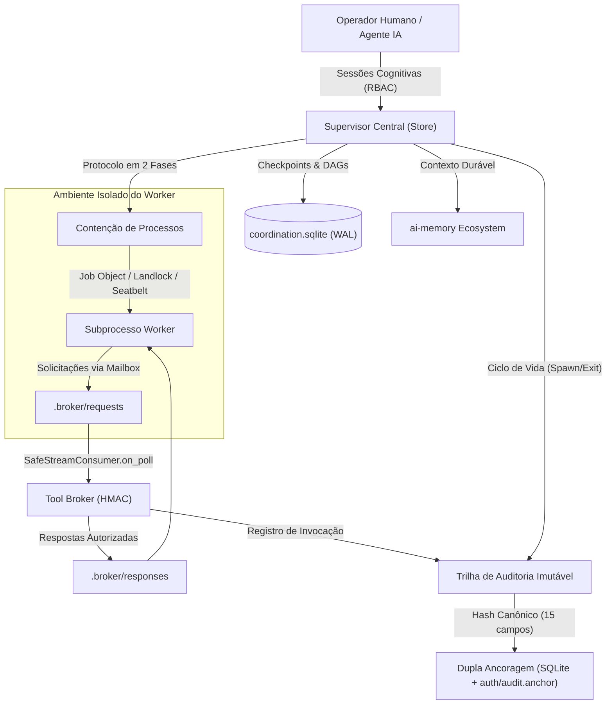

# Arquitetura do AI Coordinator (Fase 4B)

O **AI Coordinator** implementa uma infraestrutura segura e determinística para orquestração de tarefas, checkpoints cognitivos, governança de workers e execução de ferramentas entre múltiplos agentes de IA e operadores humanos.

---

## 1. Visão Geral dos Subsistemas

---

## 2. Componentes Principais

### 2.1. Store e Persistência Concorrente
- **Base de Dados SQLite**: Armazenamento transacional central (`coordination.sqlite`) em modo WAL (*Write-Ahead Logging*).
- **Concorrência Segura**: Conexões multithread configuradas com `check_same_thread=False` protegidas por `threading.RLock()` reentrante em `Store`, `ToolBroker` e `CapabilityTokenManager`.
- **Migração Transparente e Idempotente**: Aplicação retrocompatível de tabelas e triggers da Fase 4B preservando integralmente o histórico da versão v0.4.0.

### 2.2. Human-AI Cognitive Workspace
- **Atores e Sessões (`HumanPrincipal`, `HumanSession`)**:
  - Distinção clara entre operadores humanos e agentes autônomos.
  - Controle de acesso baseado em papéis (RBAC) com permissões granulares de leitura, execução de ferramentas e aprovação de mutações.
- **Checkpoints Cognitivos (`CognitiveCheckpoint`)**:
  - Armazenamento de revisões operacionais vinculadas à DAG de tarefas e a árvores de diretórios validadas por hashes SHA-256.
- **Adaptador `ai-memory` (`AIMemoryAdapter`)**:
  - Extração de memórias contextuais de longo prazo com validação de formato UUID em identificadores de workstream (`ai_memory_workstream_id`).
  - Princípio de não-confiança: memórias recuperadas são tratadas estritamente como evidências contextuais históricas, nunca como instruções autorizadas.

### 2.3. Contenção e Sandboxing de Processos
- **Protocolo de Inicialização em Duas Fases**:
  1. Criação do subprocesso bloqueado no SO (`CREATE_SUSPENDED` no Windows NT ou Trampoline seguro sincronizado via pipe no Linux/macOS).
  2. Persistência síncrona do evento `spawn` na trilha de auditoria e gravação atômica no arquivo desacoplado `auth/audit.anchor`.
  3. Liberação da execução (`proc.resume()`) estritamente após a confirmação durável da auditoria.
  4. Política *fail-closed*: se a auditoria falhar, o supervisor encerra imediatamente o processo suspenso (`safe_terminate_tree`).
- **Limites Físicos no Sistema Operacional**:
  - **Windows NT**: Win32 Job Objects com limites de memória de trabalho e encerramento automático em árvore com `JOB_OBJECT_LIMIT_KILL_ON_JOB_CLOSE`.
  - **POSIX**: Grupos de processos (`setpgid`), terminação atômica via `os.killpg` e mitigação contra reciclagem de PIDs (TOCTOU) via timestamps de criação de kernel.
  - **Trampoline POSIX Isolado**: Execução intermediária através de `sys.executable -I -S -c`, impedindo injeções de código via `PYTHONPATH` ou módulos `.pth` antes da auditoria.

### 2.4. Isolamento do Sistema de Arquivos
- **Windows AppContainer**:
  - Criação de perfis AppContainer com SID de aplicação restrito (`S-1-15-2-*`).
  - DACLs NTFS concedidas estritamente à pasta da sandbox do worker.
  - Tabela restrita de descritores herdados (`PROC_THREAD_ATTRIBUTE_HANDLE_LIST`) para isolamento de canais I/O.
- **Linux Landlock LSM**:
  - Restrição de syscalls de sistema de arquivos via ABI do kernel Landlock com `PR_SET_NO_NEW_PRIVS`.
  - Concessão de leitura/escrita delimitada à raiz da sandbox e leitura estritamente aos caminhos essenciais do sistema.
- **macOS Apple Seatbelt**:
  - Perfil SBPL operando sob `(deny default)`, importando `system.sb` para primitivas básicas do sistema.
  - Allowlist restrita concedendo leitura exclusivamente a runtimes essenciais (`/System`, `/usr`, `/Library`, `/opt`, `sys.prefix`, `sys.path`), à sandbox e às raízes de projeto declaradas (`allowed_read_roots`).
  - Bloqueio incondicional pelo kernel de arquivos confidenciais do supervisor (`auth/`, `backups/`, `checkpoints/`), banco SQLite e credenciais do usuário.

### 2.5. Tool Broker e Governança de Ferramentas
- **Negação por Padrão (Deny-by-default)**: Nenhuma ferramenta pode ser executada por um worker sem estar expressamente registrada no `ToolRegistry` e autorizada no escopo do token.
- **Capability Tokens Criptográficos (`CapabilityToken`)**:
  - Tokens assinados com HMAC-SHA256 vinculados contextualmente a `task_id`, `run_id`, `caller_pid`, `project_root` e `allowed_tools`.
  - Validação estrita de timestamp de criação de kernel (`worker_create_time_ns`) com tolerância de 2.0s contra spoofing de PID.
  - Controle de cotas atômico (`max_calls`), expiração temporal (`ttl_seconds`) e revogação durável persistida no SQLite.
- **Mailbox Assíncrona na Sandbox (`.broker`)**:
  - Troca de mensagens baseada em arquivos (`.broker/requests` e `.broker/responses`) para workers em sandbox estrita sem sockets.
  - Inspeção não-bloqueante a cada 50ms via `SafeStreamConsumer.on_poll` durante o streaming.
  - **Fail-Closed em Violações Críticas**: Distinção entre erros operacionais (respostas de erro JSON na mailbox) e violações críticas de integridade (spoofing de PID `CallerIdentityMismatchError`, token forjado `InvalidCapabilityTokenError`, mutações desautorizadas `MutationNotPermittedError`, ataques de symlink `FileSandboxSecurityError` ou falha de auditoria `ToolAuditPersistenceError`), que propagam exceção e encerram imediatamente a árvore do worker (`safe_terminate_tree`).

### 2.6. Trilha de Auditoria Criptográfica com Dupla Ancoragem
- **Tabela Append-Only (`worker_audit_log`)**:
  - Triggers SQLite `BEFORE UPDATE` e `BEFORE DELETE` abortando qualquer mutação de registros.
- **Carga de Hash Canônica**:
  - Encadeamento linear contínuo `chain_hash = SHA256(...)` cobrindo determinísticamente todos os 15 campos de cada registro de auditoria.
- **Dupla Ancoragem**:
  - Tabela interna `worker_audit_anchors` protegida por triggers SQL.
  - Arquivo externo desacoplado `auth/audit.anchor` com permissões restritas (0700/0600) e gravação atômica sincronizada com `fsync()`.
  - Verificação matemática de integridade (`verify_integrity()`) contra adulterações de dados, ordenação e truncamento de cauda (*tail truncation*).
  - Reconciliação durável pós-queda (`reconcile_anchor()`) restaurando o estado da âncora a partir do SQLite auditado.

---

## 3. Matriz de Garantias de Segurança (8 Gates de Homologação)

| Gate | Requisito Formal | Mecanismo de Imposição |
| :--- | :--- | :--- |
| **G1 — Inicialização Auditada** | Zero instruções do worker antes do commit do evento de spawn | `CREATE_SUSPENDED` (Win32) ou Trampoline unifilar `-I -S` (POSIX), gravação de auditoria durável e liberação explícita via `proc.resume()` |
| **G2 — Sandbox Efetiva** | Isolamento físico do SO impedindo acesso a arquivos do coordenador e do host | Windows AppContainer, Linux Landlock LSM e macOS Seatbelt sandbox com menor privilégio estrito |
| **G3 — Broker Integrado** | Autorização estrita de chamadas de ferramentas e mediação segura | Capability Tokens HMAC-SHA256, cotas atômicas e Mailbox `.broker` com fail-closed para violações de segurança |
| **G4 — Memória Real** | Integração resiliente e proveniência comprovada com `ai-memory` | `AIMemoryAdapter` com validação de UUID e princípio de não-confiança para dados históricos |
| **G5 — Ciclo de Vida** | Registro cronológico determinístico de todos os estados do worker | Eventos canônicos `sandbox_prepared`, `spawn`, `exit`, `timeout` e `termination` |
| **G6 — Integridade** | Detecção incondicional de adulteração ou truncamento da trilha | Hash canônico de 15 campos, encadeamento linear SHA-256 e dupla ancoragem (`auth/audit.anchor`) |
| **G7 — Compatibilidade** | Operação uniforme e consistente entre diferentes sistemas operacionais | Matriz automatizada de CI cobrindo Windows, Ubuntu Linux e macOS em Python 3.11 e 3.14 |
| **G8 — Recuperação** | Integridade e revogações sobrevivem a desligamentos e falhas de energia | Persistência SQLite de tokens revogados e reconciliação durável via `reconcile_anchor()` |