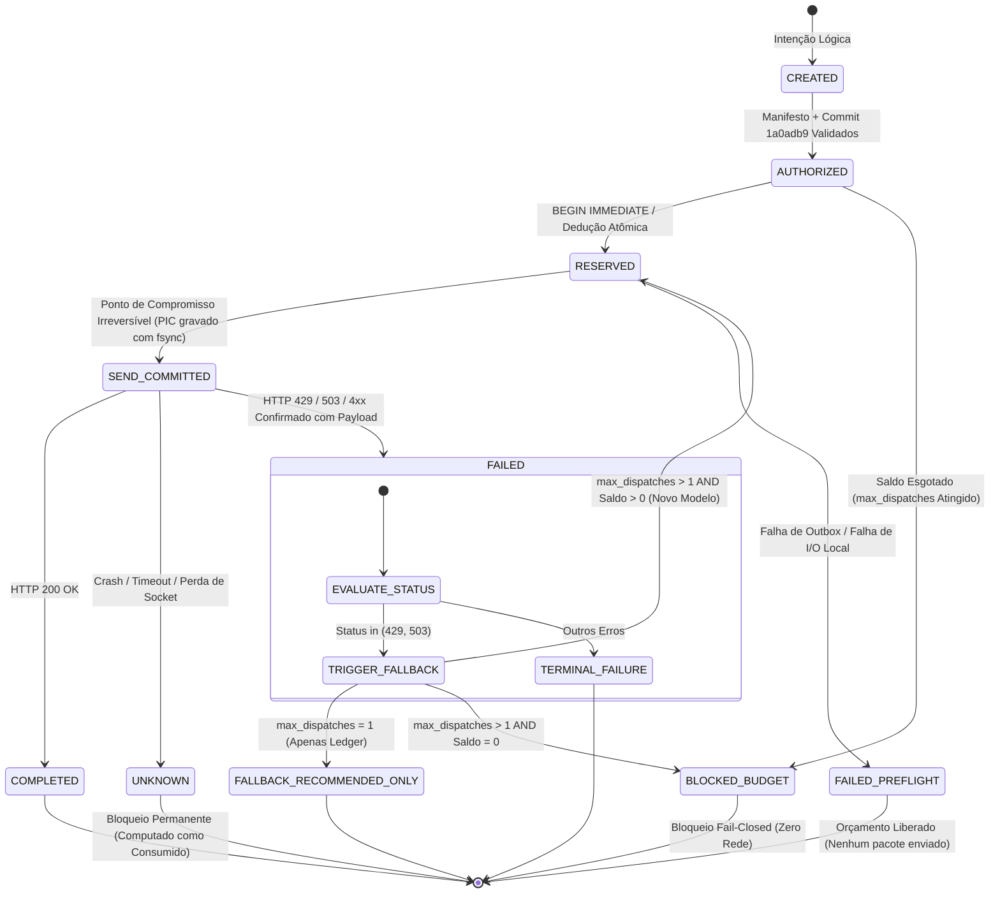

# AI Coordinator — Especificação Técnica do Fallback Multi-Modelo Governado (Fase 4C.2.1 | Revisão 4)

**Documento:** Especificação Técnica de Despacho At-Most-Once, Transactional Outbox e Fallback Multi-Modelo  
**Versão:** 1.1.0 (Revisão 4 — Resolução dos Controles P0)  
**Data:** 2026-11-09  
**Fase:** 4C.2.1  
**Tarefa ai-coordinator:** `1a52600ee41f4ccd`  
**Status:** Submetido para Revisão Independente (Estritamente Offline)  
**Repositório:** `D:\ai-coordinator`  
**Commit de Engenharia Base:** `1a0adb93ad5c4ebe755beb3d6b07dccfc43eeb92` (Preservado e Congelado)  
**Branch Estável (main):** Preservada em `a2f8f65` (`v0.5.1`)  

---

## 1. Sumário Executivo e Princípios Fundamentais

Esta revisão formaliza as três correções arquiteturais de prioridade máxima (**P0**) determinadas pela auditoria independente da Fase 4C.2.1:
1. **P0.1 — Garantia Local de At-Most-Once e Ponto de Compromisso Irreversível**: Formalização do ponto de não-retorno (`SEND_COMMITTED`) antes de qualquer emissão de pacotes TLS na rede física, eliminando a premissa irrealista de *exactly-once* distribuído e proibindo retransmissões automáticas após estados ambíguos.
2. **P0.2 — Atomicidade de Auditoria via Transactional Outbox**: Eliminação da dissociação transacional entre SQLite e JSONL. A reserva orçamentária e a intenção de auditoria são persistidas na mesma transação atômica SQLite (`pilot_quotas.db`). O ledger append-only JSONL (`pilot_audit.jsonl`) passa a ser uma **projeção persistente durável** com garantia de reconciliação e replay idempotente.
3. **P0.3 — Máquina de Estados Finita e Recuperação Conservadora de Quedas**: Introdução do estado explícito `SEND_COMMITTED` e tratamento estrito do estado `UNKNOWN` como dreno irreversível de orçamento (fail-closed), sem liberação automática sob qualquer hipótese de crash ou timeout.

---

## 2. Separação Tripartite e Garantia Local At-Most-Once (P0.1)

Em sistemas distribuídos heterogêneos onde o servidor remoto (OpenRouter) não fornece tokens de idempotência com semântica de *two-phase commit* (2PC), é matematicamente impossível um cliente garantir *exactly-once* de ponta a ponta. 

O AI Coordinator estabelece como invariante de projeto a garantia de **Entrega Estritamente At-Most-Once Local**:

$$\text{Total de Despachos Físicos Transmitidos} \le \text{max\_dispatches}$$

```
+---------------------------------------------------------------------------------------------------+
|                                  SEPARAÇÃO TRIPARTITE DE EXECUÇÃO                                 |
+---------------------------------------------------------------------------------------------------+
|                                                                                                   |
|  1. TENTATIVA LÓGICA (LogicalAttempt)                                                             |
|     - Intenção coordenada do agente/workflow para executar uma avaliação ou tarefa.              |
|     - Contém: modelo primário desejado, lista pré-autorizada de contingências e modalidade TEXT.  |
|                                                                                                   |
|                                         |                                                         |
|                                         v (Requer validação formal de manifesto e commit)         |
|                                                                                                   |
|  2. RESERVA DE ORÇAMENTO (DispatchReservation)                                                    |
|     - Alocação atômica unitária no SQLite (`global_dispatch_budgets`).                           |
|     - Operação serializada via BEGIN IMMEDIATE. Verifica se saldo restante > 0.                  |
|     - Insere registro em estado RESERVED e evento na Transactional Outbox na mesma transação.     |
|                                                                                                   |
|                                         |                                                         |
|                                         v (PONTO DE COMPROMISSO IRREVERSÍVEL - PIC)               |
|                                                                                                   |
|  3. COMPROMISSO DE ENVIO (SEND_COMMITTED)                                                         |
|     - Transição atômica em SQLite gravada em disco com fsync ANTES de abrir socket TLS.           |
|     - A partir deste microssegundo, o orçamento é consumido para sempre.                          |
|     - Se houver crash do processo, falta de luz ou SIGKILL aqui: NENHUM REENVIO É PERMITIDO.    |
|                                                                                                   |
|                                         |                                                         |
|                                         v (Apenas com SEND_COMMITTED garantido em disco)          |
|                                                                                                   |
|  4. DESPACHO FÍSICO (PhysicalDispatch)                                                            |
|     - Chamada urllib.request / TLS via socket TCP real para api/v1/chat/completions.              |
|     - Exatamente 1 emissão por reserva. Proibido reaproveitar a reserva após falha ou timeout.   |
|                                                                                                   |
+---------------------------------------------------------------------------------------------------+
```

### O Ponto de Compromisso Irreversível (Point of Irreversible Commitment - PIC)
O PIC é a linha divisória entre a governança local e a incerteza da rede:
- **Antes do PIC (`RESERVED`)**: O processo ainda não tocou a rede. Uma falha de persistência aborta a operação sem impacto externo.
- **No PIC (`SEND_COMMITTED`)**: A decisão de envio é cravada no SQLite com `PRAGMA synchronous = FULL`. O orçamento é considerado gasto.
- **Após o PIC**: Se o processo morrer antes de ler o primeiro byte de resposta, a reserva assume estado `UNKNOWN` no reinício do sistema e **permanece contabilizada como despachada**.

---

## 3. Atomicidade de Auditoria via Transactional Outbox (P0.2)

Arquivos append-only no sistema de arquivos (`pilot_audit.jsonl`) e o motor de banco de dados (`pilot_quotas.db`) não participam de um coordenador de transações distribuídas (XA/2PC). Se a reserva fosse gravada no SQLite e o processo morresse antes do `write/fsync` no JSONL, ocorreria divergência de estado (*split-brain* local).

A arquitetura resolve essa vulnerabilidade implementando o padrão **Transactional Outbox em SQLite**:

```
+---------------------------------------------------------------------------------------------------+
|                                 PADRÃO TRANSACTIONAL OUTBOX EM SQLITE                             |
+---------------------------------------------------------------------------------------------------+
|                                                                                                   |
|  TRANSAÇÃO ATÔMICA LOCAL (pilot_quotas.db - WAL FULL):                                            |
|  BEGIN IMMEDIATE;                                                                                 |
|    1. UPDATE/INSERT dispatch_reservations (reserva / transição para SEND_COMMITTED)               |
|    2. INSERT INTO outbox_events (evento de auditoria durável estruturado)                         |
|  COMMIT;  <--- GARANTIA ACID: ou ambos são persistidos, ou nenhum é gravado.                     |
|                                                                                                   |
|                                         |                                                         |
|                                         v (Projeção Assíncrona/Síncrona Garantida)                |
|                                                                                                   |
|  PROJETOR DE AUDITORIA (Ledger Projector):                                                        |
|    1. Lê eventos unprojected (WHERE projected_at_epoch IS NULL) ordenados por sequence_id         |
|    2. Escreve no arquivo docs/benchmarks/pilot_audit.jsonl                                         |
|    3. Executa os.fsync() no descritor de arquivo do JSONL                                         |
|    4. UPDATE outbox_events SET projected_at_epoch = ? WHERE event_id = ?                          |
|                                                                                                   |
|  GATE FAIL-CLOSED ANTES DA REDE:                                                                  |
|  O transporte de rede recusa o envio se a projeção durável mínima não for confirmada com fsync.   |
|                                                                                                   |
+---------------------------------------------------------------------------------------------------+
```

### Esquema Relacional Expandido (DDL SQLite)

```sql
PRAGMA journal_mode = WAL;
PRAGMA synchronous = FULL;
PRAGMA foreign_keys = ON;
PRAGMA busy_timeout = 5000;

-- 1. Orçamentos Globais
CREATE TABLE IF NOT EXISTS global_dispatch_budgets (
    budget_id TEXT PRIMARY KEY,
    manifest_id TEXT NOT NULL,
    code_commit TEXT NOT NULL,
    max_dispatches INTEGER NOT NULL CHECK (max_dispatches >= 1),
    max_budget_usd REAL NOT NULL CHECK (max_budget_usd = 0.0),
    allowed_models_json TEXT NOT NULL,
    created_at_utc TEXT NOT NULL,
    valid_until_utc TEXT NOT NULL
);

-- 2. Reservas de Despacho com Estados Irreversíveis
CREATE TABLE IF NOT EXISTS dispatch_reservations (
    reservation_id TEXT PRIMARY KEY,
    budget_id TEXT NOT NULL REFERENCES global_dispatch_budgets(budget_id),
    logical_attempt_id TEXT NOT NULL,
    sequence_index INTEGER NOT NULL CHECK (sequence_index >= 0),
    idempotency_key TEXT NOT NULL UNIQUE,
    target_model TEXT NOT NULL,
    state TEXT NOT NULL CHECK (state IN ('RESERVED', 'SEND_COMMITTED', 'COMPLETED', 'FAILED', 'UNKNOWN')),
    reserved_at_epoch REAL NOT NULL,
    send_committed_at_epoch REAL,
    dispatched_at_epoch REAL,
    completed_at_epoch REAL,
    http_status_code INTEGER,
    reconciliation_state TEXT NOT NULL DEFAULT 'NONE' CHECK (reconciliation_state IN ('NONE', 'RECONCILED_ABORTED', 'RECONCILED_TRANSMITTED'))
);

-- 3. Transactional Outbox (Fonte Única da Verdade para Auditoria)
CREATE TABLE IF NOT EXISTS outbox_events (
    event_id TEXT PRIMARY KEY,
    reservation_id TEXT NOT NULL REFERENCES dispatch_reservations(reservation_id),
    aggregate_id TEXT NOT NULL,
    event_type TEXT NOT NULL,
    payload_json TEXT NOT NULL,
    created_at_epoch REAL NOT NULL,
    projected_at_epoch REAL
);

CREATE INDEX IF NOT EXISTS idx_outbox_unprojected ON outbox_events(projected_at_epoch) WHERE projected_at_epoch IS NULL;
CREATE INDEX IF NOT EXISTS idx_res_budget_state ON dispatch_reservations(budget_id, state);
```

---

## 4. Máquina de Estados Finita e Recuperação Conservadora (P0.3)

O ciclo de vida de uma reserva é estritamente unidirecional e linear. Não existem retrocessos ou reaberturas de saldo automático.



### Matriz de Transições de Estado e Regras de Bloqueio

| Estado Origem | Estado Destino | Condição / Evento Acionador | Efeito no Saldo Global |
| :--- | :--- | :--- | :--- |
| `[*] ` | `CREATED` | Formulação da intenção lógica de execução | Nenhum (apenas memória) |
| `CREATED` | `AUTHORIZED` | Manifesto validado, orçamento US$ 0.00 confirmado | Nenhum (validação documental) |
| `AUTHORIZED` | `RESERVED` | `SELECT COUNT(...) < max_dispatches` em `BEGIN IMMEDIATE` | 1 unidade **bloqueada** |
| `RESERVED` | `SEND_COMMITTED` | Decisão de envio e outbox persistidos com fsync | 1 unidade **consumida irreversivelmente** |
| `RESERVED` | `FAILED_PREFLIGHT`| Falha ao projetar outbox ou erro de I/O em disco | 1 unidade **liberada** (comprovado zero rede) |
| `SEND_COMMITTED` | `COMPLETED` | HTTP 200 recebido do endpoint remoto | 1 unidade **consumida com sucesso** |
| `SEND_COMMITTED` | `FAILED` | Resposta de erro remoto (429/503/400) com corpo lido | 1 unidade **consumida com falha** |
| `SEND_COMMITTED` | `UNKNOWN` | Queda de processo, socket timeout, exceção não tratada | 1 unidade **consumida conservadoramente** |
| `UNKNOWN` | `*` (qualquer) | Qualquer tentativa de retransmissão automática | **TRANSICÃO ESTRITAMENTE PROIBIDA** |
| `SEND_COMMITTED` | `RESERVED` | Qualquer tentativa de reuso de reserva | **TRANSICÃO ESTRITAMENTE PROIBIDA** |

### Política de Recuperação de Estado Ambíguo (`UNKNOWN`)
1. **Reinício de Sistema**: Se o AI Coordinator for iniciado e encontrar registros em estado `SEND_COMMITTED` sem `completed_at_epoch`, um sanitizador de inicialização transita imediatamente os registros para `UNKNOWN`.
2. **Impossibilidade de Reenvio**: O estado `UNKNOWN` é um dreno definitivo de cota. O sistema presume que os bytes podem ter atingido o servidor da OpenRouter.
3. **Reconciliação Exclusivamente Manual**: A transição para `RECONCILED_ABORTED` exige manifesto específico de reconciliação assinado pelo operador humano contendo evidência criptográfica ou logs de rede comprovando que o handshake TLS não foi concluído.

---

## 5. Algoritmo de Fallback Multi-Modelo Governado

A contingência de modelos opera sob governança de dois níveis:

### Nível 1: `max_dispatches = 1` (Padrão de Segurança Estrito)
Quando o modelo primário retornar HTTP 429:
1. O evento `RATE_LIMITED_429` é gravado no Outbox e projetado no ledger.
2. O catálogo oficial autenticado é consultado via `FreeModelRegistry`.
3. Candidatos são filtrados pelos invariantes:
   - Preço zero comprovado no `FreeCostGuard` (`prompt=0.0`, `completion=0.0`).
   - Modalidade estritamente `TEXT`.
   - Presença explícita na lista `allowed_models` do manifesto.
   - Provedor alternativo preferencial (para evitar saturação no mesmo cluster upstream).
4. O coordenador emite um evento `FALLBACK_PROPOSED_BLOCKED` detalhando o modelo recomendado.
5. **A execução encerra com código 1. Zero novas conexões são abertas.**

### Nível 2: `max_dispatches > 1` (Orçamento Multi-Despacho Autorizado)
Somente se o manifesto formal do operador declarar explicitamente `max_dispatches >= 2`:
1. Após a falha HTTP 429 do modelo primário, o sistema verifica o saldo no SQLite:
   $$\text{consumed} = \text{COUNT}(\text{RESERVED, SEND\_COMMITTED, COMPLETED, FAILED, UNKNOWN})$$
2. Se $\text{consumed} < \text{max\_dispatches}$:
   - Adquire atomicamente uma nova reserva com `sequence_index = 1` e nova `idempotency_key`.
   - Transita para `SEND_COMMITTED` com fsync no banco.
   - Despacha o pacote N=1 para o modelo de contingência com `RetryPolicy(max_attempts=1)`.
3. Se $\text{consumed} \ge \text{max\_dispatches}$:
   - Bloqueio imediato por exaustão orçamentária (`BLOCKED_BUDGET`).

---

## 6. Concorrência entre Múltiplos Processos e Gestão de Locks

Para suportar múltiplos workers operando na mesma máquina:
1. **Nível de Isolamento SQLite**: Conexões utilizam `PRAGMA locking_mode = NORMAL`, `PRAGMA busy_timeout = 5000` e `PRAGMA journal_mode = WAL`.
2. **Serialização Exclusiva de Reserva**: O bloco de reserva utiliza `BEGIN IMMEDIATE`. O SQLite garante que apenas uma transação de escrita execute por vez. Outros processos aguardam até 5 segundos antes de lançar timeout de concorrência.
3. **Chave de Idempotência Determinística**:
   $$\text{idempotency\_key} = \text{SHA256}(\text{budget\_id} \parallel \text{logical\_attempt\_id} \parallel \text{sequence\_index} \parallel \text{model\_id})$$
   A unicidade impede que chamadas duplicadas criem reservas fantasmas.

---

## 7. Validação do Catálogo Autenticado e Vínculo ao Manifesto

Para impedir o uso de modelos depreciados ou desvios de rota:
1. **Validade Temporal do Catálogo**: O snapshot oficial obtido da OpenRouter (`AuthenticatedCatalogSnapshot`) tem TTL máximo de **3600 segundos (1 hora)** e integridade verificada via SHA-256. Catálogos com idade superior são rejeitados com `StaleCatalogBlockedError`.
2. **Vínculo Estrito do Manifesto**:
   - `allowed_models`: Lista exata de modelos autorizados pelo operador (ex: `["liquid/lfm-3-1.7b:free", "nvidia/nemotron-3.5-lightning:free"]`).
   - `code_commit`: Hash de 40 caracteres verificado via `git rev-parse HEAD`. Divergência de 1 caractere aborta o pré-voo em fail-closed.
   - `max_budget_usd`: Estritamente `0.0`. Qualquer float $> 0.0$ invalida o manifesto antes de qualquer leitura do banco.

---

## 8. Matriz de 12 Cenários de Testes Adversariais Offline

Esta suíte de testes cobre 100% dos caminhos críticos, executada inteiramente por mocks locais:

| ID | Cenário Adversarial | Condição Inicial | Operação Simulada | Resultado Esperado | Invariante Protegido | Classificação |
| :---: | :--- | :--- | :--- | :--- | :--- | :---: |
| **TC-01** | **Concorrência Multi-Processo** | `max_dispatches = 1`, 0 consumidos | 5 processos independentes disputam reserva via `BEGIN IMMEDIATE` | Exatamente 1 processo adquire a reserva; 4 recebem `BudgetExhaustedError` | Teto global inviolável | **PASS** |
| **TC-02** | **Crash entre Commit e Rede** | Linha gravada em `SEND_COMMITTED` | Processo sofre SIGKILL antes de instanciar o socket HTTP | No reinício, estado transita para `UNKNOWN`; computado no orçamento; zero reenvio | At-most-once / PIC | **PASS** |
| **TC-03** | **Crash antes do Ledger JSONL** | Reserva e Outbox gravados no SQLite | Processo morre antes de escrever no `pilot_audit.jsonl` | Ledger Projector detecta evento unprojected e sincroniza com fsync no reinício | Atomicidade Outbox | **PASS** |
| **TC-04** | **Timeout de Socket Físico** | Transmissão HTTP em andamento | Mock lança `urllib.error.URLError("Connection timed out")` | Reserva transita para `UNKNOWN`; saldo não é restaurado; zero retentativas | Prevenção de loop | **PASS** |
| **TC-05** | **Tentativa de Reenvio em UNKNOWN**| Reserva em estado `UNKNOWN` | Componente tenta reutilizar a reserva para nova chamada | Sistema lança `IllegalStateTransitionError`; bloqueio imediato | Integridade de estado | **PASS** |
| **TC-06** | **Colisão de Idempotência** | Reserva #1 confirmada | Tentativa de reinserir mesma `idempotency_key` | SQLite lança `sqlite3.IntegrityError`; transação é abortada | Anti-duplicação | **PASS** |
| **TC-07** | **HTTP 429 com `max_dispatches=1`** | `max_dispatches = 1`, modelo primário retorna 429 | `handle_http_429_fallback()` invocado | Retorna `RECOMMEND_ONLY`; registra proposta no Outbox; zero rede física | Tentativa única estrita | **PASS** |
| **TC-08** | **HTTP 429 com `max_dispatches=2`** | `max_dispatches = 2`, modelo primário retorna 429 | Fallback seleciona segundo modelo do manifesto | Adquire reserva #2 (`sequence_index=1`); comita `SEND_COMMITTED`; despacha modelo 2 | Fallback sob teto | **PASS** |
| **TC-09** | **Catálogo Stale (> 1h)** | Snapshot com timestamp de 3601s atrás | Validação do catálogo no `FreeModelRegistry` | Rejeição fail-closed com `StaleCatalogBlockedError` | Atualidade do catálogo | **PASS** |
| **TC-10** | **Manifesto Expirado em Fallback** | Manifesto expira entre a chamada 1 e 2 | Tentativa de fallback com `max_dispatches = 2` | Validação de expiração detecta `now > valid_until`; bloqueia despacho #2 | Janela de autorização | **PASS** |
| **TC-11** | **Tentativa de Fallback para Pago** | Catálogo contém modelo com pricing > 0 | Fallback avalia candidato com preço não-zero | `FreeCostGuard` rejeita modelo; candidato eliminado | Custo zero estrito | **PASS** |
| **TC-12** | **Falha de Disco / Read-Only** | Diretório do banco montado como read-only | Tentativa de `acquire_reservation()` | Falha de persistência aborta antes de qualquer tentativa de rede | Nenhuma rede sem auditoria| **PASS** |

---

## 9. Análise de Falhas e Viabilidade de Implementação

### 9.1 Avaliação de Viabilidade Técnica na Base Atual
A implementação desta especificação na Etapa 4C.2.2 é **100% viável** sem introduzir dependências externas (utilizando exclusivamente a biblioteca padrão Python `sqlite3`, `hashlib`, `urllib`, `dataclasses`):
- O SQLite integrado em Python suporta nativamente `PRAGMA journal_mode = WAL`, `PRAGMA synchronous = FULL` e transações `BEGIN IMMEDIATE`.
- A separação entre Transactional Outbox e Projeção JSONL elimina a dependência de chamadas atômicas do sistema de arquivos e mantém compatibilidade total com os artefatos de auditoria existentes (`pilot_audit.jsonl`).
- O isolamento da máquina de estados na classe `AtomicDispatchQuotaStore` encapsula a lógica e permite testes unitários diretos com mocks em memória (`:memory:`) e arquivos temporários.

### 9.2 Garantia de Não-Regressão
- A branch `main` (`v0.5.1`, `a2f8f65`) permanece intocada.
- O commit `1a0adb9` da Fase 4C.1 permanece congelado como base de teste e referência estável.
- Nenhum código de produção em `src/ai_coordinator` será modificado até que a especificação seja formalmente homologada pelo operador.

---

## 10. Critérios de Aceite para Conclusão da Etapa 4C.2.1

A Etapa 4C.2.1 atinge seus critérios de encerramento com a publicação desta especificação:
1. [x] **P0.1 Resolvido**: Garantia local de *at-most-once* formalizada com o Ponto de Compromisso Irreversível (`SEND_COMMITTED`).
2. [x] **P0.2 Resolvido**: Padrão Transactional Outbox detalhado com DDL completo em SQLite e projeção desacoplada para JSONL.
3. [x] **P0.3 Resolvido**: Máquina de estados explícita com tratamento fail-closed de `UNKNOWN` e proibição de retransmissões automáticas.
4. [x] **Casos de Teste Expandidos**: 12 cenários adversariais planejados cobrindo concorrência, timeouts, crashes e persistência de disco.
5. [x] **Zero Código e Zero Rede**: Nenhuma linha de código de produção alterada; nenhuma inferência live despachada.
