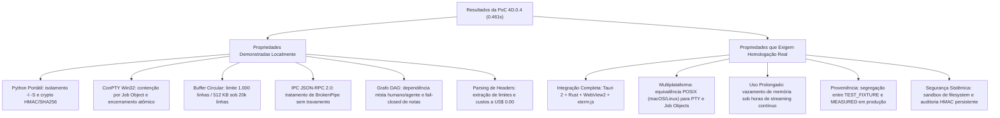
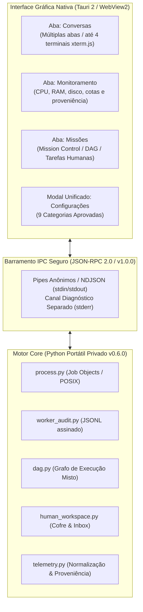
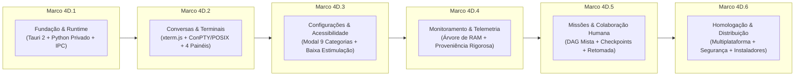
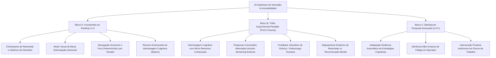

<!--
Cópia versionada, revisada e sanitizada do roadmap canônico da Fase 4D.
Origem: documento "phase4d05_definitive_roadmap.md", produzido na Fase 4D.0.5 (11/11/2026) pelo coordenador
AGY e mantido até então apenas na área de trabalho privada desse coordenador, fora do repositório.
Copiado em 13/11/2026 na branch experimental/phase4d-m3-settings (tarefa 4D.3 1210ff494600475c).
Sanitização: links para arquivos locais e caminhos de usuário foram reduzidos ao nome do recurso; o corpo técnico
não foi alterado. Correções e divergências constatadas ficam no Apêndice A; decisões aprovadas depois da
emissão do roadmap ficam nos Apêndices B e C. Em caso de conflito, prevalecem as decisões registradas.
-->

> [!NOTE]
> **Cópia versionada do roadmap canônico da Fase 4D.** Origem: `phase4d05_definitive_roadmap.md` (Fase 4D.0.5,
> 11/11/2026, coordenador AGY), copiado e sanitizado em 13/11/2026. O texto original segue sem alterações técnicas;
> as divergências constatadas no código estão no **Apêndice A** e as decisões posteriores do operador nos
> **Apêndices B e C**, que prevalecem sobre o corpo em caso de conflito.

# Roadmap Definitivo de Engenharia — AI Coordinator Desktop (Fase 4D.0.5)
## Consolidação Técnica, Matriz de Requisitos, Marcos Incrementais e Trilha de Pesquisa

> [!NOTE]
> **Status:** Roadmap Definitivo Consolidado · Fase 4D.0.5 Concluída · Pronto para Deliberação do Operador.  
> **Versão do Core de Referência:** `v0.6.0` (estável, publicada no GitHub e PyPI, branch `main` preservada no commit `1fa1236`).  
> **Branch Experimental de Testes:** `prototype/phase4d-desktop-poc` (commit `df8b67b`).  
> **Orçamento Financeiro Autorizado:** Estritamente **US$ 0,00** (zero despesas, zero inferências externas pagas).  
> **Data:** 11 de novembro de 2026.

---

### 1. Reconciliação Técnica e Análise Crítica das Evidências da PoC 4D.0.4

Antes de estabelecer os compromissos de implementação, realizamos uma revisão rigorosa dos resultados obtidos na Prova de Viabilidade (`phase4d04_poc_execution_report.md`), distinguindo com precisão o que foi provado empiricamente daquilo que permanece como hipótese a ser validada.



#### 1.1. Metodologia e Reconciliação das Medições de Memória RAM
A auditoria apontou a necessidade de registrar com precisão os valores e as respectivas janelas de medição, evitando ambiguidades entre medições locais e o ciclo de vida do processo:
* **Incremento do Buffer Circular de Terminais (Loop Q3):** Medição diferencial estrita (`ram_after - ram_before`) durante a injeção em rajada de 20.000 linhas nos 4 buffers circulares em memória. O resultado foi de **+0,992 MB**, comprovando empiricamente que a política de descarte FIFO (*First-In, First-Out*) limita a retenção de dados a 1.000 linhas / 512 KB por terminal sem vazamento.
* **Ciclo de Vida do Processo Python da Suíte (Testes 1 a 6):**
  - *Início da Bateria (RSS Inicial):* **37,65 MB** (interpretador carregado).
  - *Ponto de Estresse dos 4 Terminais (Q3):* **40,39 MB** (acréscimo operacional sob injeção massiva).
  - *Término da Suíte Completa (RSS Final):* **42,11 MB** (após carregar os módulos de teste adicionais, rotinas de inspeção do DAG, handles Win32 e chamadas de GC).
* **Esclarecimento:** O valor de 40,39 MB representou o ponto de estresse ativo durante o teste de terminais concorrentes; o valor final de 42,11 MB reflete o conjunto de trabalho (*working set*) acumulado ao final de toda a suíte de 6 cenários.
* **Diretriz para o Roadmap:** Nos marcos 4D.1 e 4D.4, a medição oficial será a **árvore completa de processos** (*Process Tree RAM*: Host Rust + WebView2/WebKit + Core Python + CLIs filhas), monitorada via `sysinfo` (Rust) e checada contra os limites de contenção do Core.

#### 1.2. Proveniência Quantitativa vs. Origem dos Dados (Compatibilidade Core v0.6.0)
* **Diagnóstico da Auditoria:** O Core v0.6.0 define estritamente em `telemetry.py` os valores: `MEASURED`, `ESTIMATED` e `UNKNOWN`. `TEST_FIXTURE` não existe e não deve ser injetado no enum para não quebrar compatibilidade de contratos.
* **Solução Arquitetural Aprovada:** Segregação ortogonal em duas camadas:
  1. **Tipo de Medição Quantitativa (`MetricProvenance` do Core v0.6.0):**
     - `MEASURED` ("measured"): valor aferido diretamente de contadores numéricos ou cabeçalhos HTTP parseados.
     - `ESTIMATED` ("estimated"): projeções e cálculos analíticos pré-chamada.
     - `UNKNOWN` ("unknown"): valores ausentes ou indeterminados.
  2. **Origem do Dado (`DataOrigin` / `source_environment` na camada Desktop/IPC):**
     - `LIVE_NETWORK`: telemetria originada de tráfego real com provedores externos via rede.
     - `TEST_FIXTURE`: dados originados de testes automatizados, fixtures sintéticas locais ou simulações.
     - `OFFLINE_CACHE`: dados restaurados de cache local sem comunicação ativa.
* **Garantia de Transparência:** No painel visual de Monitoramento (4D.4), a interface exibirá ambos os eixos (ex: *"Medição de Teste (Fixture)"* vs. *"Medição Real de Produção (Rede)"*), impedindo qualquer confusão sem violar o contrato do Core.

#### 1.3. Limitações da Bateria Rápida de 0,461 Segundo
* A duração de 461 ms atesta que os algoritmos isolados são ultrarrápidos e eficientes em memória.
* Contudo, **não substitui** testes de longa duração (*soak testing*), renderização gráfica pelo WebView2, consumo de IPC sob milhares de eventos assíncronos ou comportamento de suspensão/retomada de energia do sistema operacional.
* Essas verificações tornam-se critérios obrigatórios dos marcos **4D.2** e **4D.6**.

#### 1.4. Ausência de Homologação macOS e Linux
* A PoC rodou exclusivamente em Windows 11 utilizando ConPTY nativo e Win32 Job Objects.
* Os equivalentes POSIX (`portable-pty`, `/dev/ptmx`, `openpty`, grupos de processos e `cgroups`/`proc_info`) foram modelados arquiteturalmente, mas ainda não possuem telemetria empírica registrada neste ambiente.
* A validação em matriz cruzada multiplataforma é gate obrigatório dos marcos **4D.1** (fundação) e **4D.6** (homologação final).

---

### 2. Estrutura Geral da Aplicação e Escopo Estrito da Interface

O AI Coordinator Desktop é projetado como uma casca nativa leve, moderna e de alto desempenho construída em **Tauri 2 (Rust)** com frontend em **TypeScript / React** e terminais em **xterm.js**, consumindo diretamente os serviços do **Core Python v0.6.0** empacotado de forma privada.

> [!IMPORTANT]
> **Princípio de Reutilização Máxima do Core:**  
> O Desktop não conterá um "segundo motor" de governança. Toda a lógica de agendamento de tarefas, despacho da DAG, auditoria criptográfica, medição de custos e limites de segurança permanece sob a autoridade exclusiva do Core Python (`ai_coordinator`). A interface gráfica atua como cockpit de controle, visualização e intervenção humana.



#### 2.1. Escopo Delimitado da Interface (v1.0)
* **Aba 1 — Conversas:** Gerenciamento de abas de trabalho. Cada aba suporta até 4 terminais independentes em grade, histórico circular limitado (1.000 linhas / 512 KB), controles de interrupção imediata (*kill*) e salvamento sanitizado de sessão.
* **Aba 2 — Monitoramento:** Painel visual unificado exibindo saúde do sistema (CPU/RAM da árvore completa de processos), consumo cumulativo de tokens e custos em US$, origem e proveniência de cada métrica e alarmes de contenção.
* **Aba 3 — Missões:** Visão de controle de missão (*Mission Control*), exibindo a árvore de dependências (DAG) em tempo real, status das atividades, checkpoints salvos e caixas de diálogo para intervenção e aprovação do operador humano.
* **Modal Unificado — Configurações (9 Categorias):**
  1. *Perfil:* Identidade local, chaves públicas e preferências do operador.
  2. *Geral:* Inicialização, persistência de layout, atalhos de teclado.
  3. *Aparência:* Modos de baixa estimulação visual, redução de contraste/ruído, tipografia.
  4. *Terminal:* Configurações do `xterm.js`, cursor, fontes e buffers.
  5. *Coordinator:* Parâmetros de supervisão, timeouts, orçamentos máximos de missão.
  6. *Agentes:* Descoberta de CLIs locais (Gemini CLI, Claude Code, Agy, etc.) e MCPs.
  7. *Provedores:* Gerenciamento de credenciais seguras, limites de cotas e endpoints locais.
  8. *Segurança:* Permissões de sandbox, diretórios autorizados e políticas de acesso.
  9. *Sobre:* Versão estável (v0.6.0), licença PolyForm Noncommercial 1.0.0 e diagnóstico.
* **Exclusão Formal:** Fica terminantemente vetada a criação de uma aba "Workspace" separada na primeira versão. A colaboração humana e anotações ocorrem integradas dentro da aba **Missões** e no cofre do **Perfil**.

---

### 3. Matriz de Requisitos, Lacunas Técnicas e Componentes do Core

A matriz a seguir mapeia cada capacidade exigida, identificando o que já existe no Core v0.6.0, o esforço novo a ser construído, a dependência, os riscos e a destinação (Versão Inicial v1.0 vs. Backlog de Pesquisa).

| Requisito Operacional | Componente Existente no Core | Lacuna / Esforço Novo no Desktop | Marco | Risco | Destinação |
| :--- | :--- | :--- | :---: | :---: | :---: |
| **Python Portátil Privado** | `process.py:1614` (trampolim `-I`, `-S`) | Empacotar Python Build Standalone no build do Tauri | 4D.1 | Baixo | **v1.0** |
| **IPC Seguro e Resiliente** | `poc/desktop/ipc/protocol.py` (JSON-RPC v1.0.0) | Driver bidirecional em Rust com reconexão segura | 4D.1 | Médio | **v1.0** |
| **Isolamento de Perfis (3 Níveis)** | `human_workspace.py` (perfil e cofre) | Mapeamento no frontend e separação de credenciais | 4D.1 | Baixo | **v1.0** |
| **Terminais Múltiplos (4 Abas)** | `poc/desktop/terminal/buffer.py` | Componente React `xterm.js` integrado ao `portable-pty` | 4D.2 | Médio | **v1.0** |
| **Contenção e Kill em Árvore** | `process.py` (Job Objects e kill_tree) | Acionamento atômico via comando do Tauri no Rust | 4D.2 | Médio | **v1.0** |
| **Recuperação de Sessão** | `poc/desktop/terminal/buffer.py` (export) | Salvar e recarregar layout sanitizado via SQLite | 4D.2 | Baixo | **v1.0** |
| **Configurações (9 Categorias)** | Modelos em `ai_coordinator` | Interface modal unificada com validação de campos | 4D.3 | Baixo | **v1.0** |
| **Acessibilidade Sensorial** | Inexistente (novo) | Modos visuais de baixa estimulação, tema e fontes | 4D.3 | Baixo | **v1.0** |
| **Navegação Acessível por Teclado** | Inexistente (novo) | Atalhos completos, foco lógico e leitor de tela básico | 4D.3 | Baixo | **v1.0** |
| **Monitoramento Árvore de RAM/CPU** | `process.py` (coleta via Win32/psutil) | Coleta nativa pelo host Rust (`sysinfo`) e envio IPC | 4D.4 | Baixo | **v1.0** |
| **Proveniência de Telemetria** | `telemetry.py` (`MetricProvenance`) | Diferenciação visual entre `MEASURED` e `TEST_FIXTURE` | 4D.4 | Baixo | **v1.0** |
| **Mission Control & DAG Mista** | `dag.py` (validação e nós humanos) | Visualização interativa do grafo com nós humano/agente | 4D.5 | Médio | **v1.0** |
| **Checkpoints & Retomada Segura** | `dag.py` + `checkpoint` CLI | Interface de aprovação sem duplicação de efeitos | 4D.5 | Médio | **v1.0** |
| **Pesquisa Recorrente Supervisionada** | Estruturas de loop supervisionado do Core | Controles de orçamento, limites de iteração e parada | 4D.5 | Médio | **v1.0** |
| **Instaladores Multiplataforma** | GitHub Actions workflows existentes | Bundlers Tauri para MSI/NSIS, DMG e DEB com Python | 4D.6 | Alto | **v1.0** |
| **Aterrissagem Cognitiva & Contexto** | Inexistente (hipóteses da pesquisa) | Resumo de contexto estruturado pós-interrupção | 4D.5 | Médio | **v1.0 (Básico)** |
| **Adaptação Dinâmica de Estratégias** | Inexistente (hipótese avançada) | Modelagem adaptativa de carga cognitiva do usuário | Trilha Pesq. | Alto | **Backlog Pesquisa** |
| **Intervenção Cognitiva Autônoma** | Inexistente (hipótese avançada) | Detecção autônoma de fadiga sem inferir diagnósticos | Trilha Pesq. | Alto | **Backlog Pesquisa** |

---

### 4. Ciclo de Vida Padronizado de Subetapa (Template Obrigatório)

Para assegurar rigor científico e integridade documental, **toda e qualquer subetapa** dos marcos 4D.1 a 4D.6 seguirá obrigatoriamente a esteira de verificação com 7 critérios de aceite:

```markdown
### Subetapa 4D.X.Y — [Nome da Subetapa]
- [ ] 1. Requisito funcional e critérios de aceite formalmente definidos
- [ ] 2. Testes unitários e testes de injeção de falhas implementados e aprovados
- [ ] 3. Integração com o Core v0.6.0 e políticas de permissões/sandbox validadas
- [ ] 4. Comportamento multiplataforma verificado (Windows obrigatório; Linux/macOS conforme aplicável)
- [ ] 5. Consumo de recursos medido (RAM da árvore de processos, CPU e tempo de resposta)
- [ ] 6. Documentação técnica, logs diagnósticos e evidências arquivadas
- [ ] 7. Revisão técnica e aprovação humana registrada para integração
```

---

### 5. Detalhamento dos 6 Marcos Incrementais de Desenvolvimento (Fases 4D.1 a 4D.6)



---

#### Marco 4D.1 — Fundação, Runtime Privado, IPC e Identidade
* **Objetivo:** Estabelecer a casca nativa em Tauri 2, configurar a execução isolada do Python Standalone privado sem dependência do ambiente do sistema operacional, implementar o barramento IPC seguro e tipado com recuperação de falhas, e construir a fronteira de segurança entre perfis, cofre nativo e autoridade do Core.
* **Subetapas Aprovadas:**
  - **4D.1.1 — Estrutura e Ambiente (Host Tauri 2 & Python Privado):**
    - Criação da base Tauri 2 em branch experimental com builds reproduzíveis.
    - Preparação e fixação do runtime Python Standalone com versões e hashes criptográficos verificados.
    - Aplicação seletiva de flags: uso de `-I` (*isolated mode*) para blindar o runtime contra poluição de variáveis de ambiente do host (`PYTHONPATH`, `PYTHONHOME`) ou pacotes do usuário (`~/.local`), preservando o acesso às `site-packages` privadas empacotadas (diferenciando-o do trampolim POSIX minimalista que usa `-I -S`).
    - *Gate 4D.1.1:* Inicialização real e independente do host e do interpretador privado sem exigir Python instalado globalmente no `PATH`.
  - **4D.1.2 — IPC Seguro (Contrato Tipado, Versionado e Resiliente):**
    - Implementação do contrato JSON-RPC 2.0 (protocolo v1.0.0) com esquemas estritos de requisição, resposta e notificação.
    - Validação de mensagens, limites de payload e canal de diagnóstico desvinculado em `stderr`.
    - Tratamento determinístico de quedas abruptas, quebra de pipe (*BrokenPipe*) e reconexão segura sem duplicação de processos filhos.
    - *Gate 4D.1.2:* Comunicação bidirecional comprovada entre dois processos reais em execução, cobrindo casos de erro, desconexão forçada e payload malformado.
  - **4D.1.3 — Identidade, Autorização e Cofre Seguro de Credenciais:**
    - Definição da fronteira de segurança em 5 camadas: (1) Usuário do SO, (2) Perfil Desktop local, (3) Sessão IPC autenticada com token criptográfico efêmero, (4) Cofre nativo de credenciais (DPAPI no Windows, Keychain no macOS, Secret Service no Linux) e (5) Autoridade do Core via `HumanPrincipal` e `fs_sandbox`.
    - Garantia formal de que o mero conhecimento de um PID ou `owner_id` não confere autorização para executar tarefas privilegiadas ou acessar dados confidenciais.
    - *Gate 4D.1.3:* Identidade verificada e bateria de testes demonstrando isolamento estrito (fail-closed) entre perfis e impedindo que agentes acessem segredos do operador.
  - **4D.1.4 — Integração, Regressão, Desempenho e Homologação da Fundação:**
    - Validação do ciclo de vida completo dos processos e medição contínua de recursos (CPU, RAM da árvore completa de processos).
    - Execução de testes de regressão garantindo que os invariantes do Core v0.6.0 permaneçam 100% intactos.
    - Simulação de instalação limpa e documentação das limitações conhecidas por sistema operacional antes da abertura da interface.
    - *Gate 4D.1.4:* Evidências documentadas, suíte de testes aprovada e parecer técnico consolidado para liberação do Marco 4D.2.

---

#### Marco 4D.2 — Conversas, Terminais e Supervisão de Processos
* **Objetivo:** Implementar a aba **Conversas**, com suporte a múltiplas abas concorrentes, grade de até 4 terminais virtuais por aba via `xterm.js`, supervisão ativa de processos filhos sob Job Objects e anéis circulares de buffer.
* **Subetapas:**
  - **4D.2.1 — Componente de Grade de Terminais (`xterm.js`):** Layout responsivo suportando 1, 2, 3 ou 4 terminais por aba com redimensionamento fluido.
  - **4D.2.2 — Integração PTY Nativa (`portable-pty` + ConPTY/POSIX):** Conexão bidirecional entre o frontend e pseudoconsoles nativos, tratando eventos de teclado (`\r` no ConPTY) e streaming ANSI.
  - **4D.2.3 — Buffer Circular com Limites Estritos:** Anel circular em memória por terminal (limite de 1.000 linhas e 512 KB) com descarte FIFO garantido e rotina de sanitização de credenciais para exportação.
  - **4D.2.4 — Contenção de Processos e Cancelamento Atômico (*Kill Tree*):** Vinculação dos processos filhos a Win32 Job Objects (Windows) e grupos de processos POSIX (macOS/Linux), acionando encerramento imediato via interface.
  - **4D.2.5 — Salvamento e Recuperação de Sessões de Terminal:** Persistência do layout de abas e variáveis contextuais para reabertura rápida sem restauração de lixo transitório.
* **Portão de Aprovação (Gate 4D.2):**
  - 4 terminais em streaming pesado consomem no máximo 4 MB adicionais de RAM.
  - Encerramento forçado de tarefa (*kill*) elimina 100% dos processos filhos em < 200 ms.
  - Exportação de histórico de terminal substitui chaves (`sk-...`, tokens bearer) por marcadores `[REDACTED_CREDENTIAL]`.

---

#### Marco 4D.3 — Configurações e Acessibilidade Sensorial Básica
* **Objetivo:** Implementar o modal unificado de **Configurações** cobrindo rigorosamente as 9 categorias da especificação, incorporando preferências de baixa estimulação sensorial e usabilidade por teclado sem rotulagem ou inferência diagnóstica.
* **Subetapas:**
  - **4D.3.1 — Estrutura do Modal Unificado de Configurações:** Arquitetura visual com abas de navegação lateral para as 9 categorias aprovadas.
  - **4D.3.2 — Categorias de Conectividade e Execução (Coordinator, Agentes, Provedores):** Telas de configuração de chaves de API com armazenamento seguro no cofre do perfil, limites de cota e seleção de rotas de fallback.
  - **4D.3.3 — Categorias de Segurança e Ambiente (Segurança, Perfil, Geral, Terminal, Sobre):** Gestão de diretórios de sandbox, permissões de escrita, atalhos globais e dados da licença PolyForm Noncommercial.
  - **4D.3.4 — Modo de Baixa Estimulação Sensorial (Aparência):** Alternância para tema com paleta de contraste suave, redução de animações e transições gráficas supérfluas, e controle de densidade visual.
  - **4D.3.5 — Navegação Acessível por Teclado e Foco Lógico:** Mapeamento completo de atalhos para comutação de abas, terminais e modais, com retorno determinístico de foco pós-fechamento de diálogos.
* **Portão de Aprovação (Gate 4D.3):**
  - 100% das 9 categorias operacionais e validadas contra os esquemas do Core.
  - Credenciais de API salvas exclusivamente no cofre encriptado local (`HumanProfile`), nunca expostas em texto puro.
  - Navegação de toda a aplicação possível utilizando exclusivamente o teclado (Tab, Shift+Tab, Enter, Esc, setas).

---

#### Marco 4D.4 — Monitoramento e Telemetria com Proveniência Rigorosa
* **Objetivo:** Implementar a aba **Monitoramento**, fornecendo transparência integral sobre recursos computacionais consumidos (CPU, RAM de toda a árvore, disco) e governança financeira de tokens e custos, com separação explícita da proveniência dos dados.
* **Subetapas:**
  - **4D.4.1 — Coletor de Recursos da Árvore de Processos (Host + Core + Filhos):** Monitoramento contínuo em segundo plano via `sysinfo` no Rust e APIs do Core, agregando consumo real de RAM física (RSS) e percentual de CPU.
  - **4D.4.2 — Painel Visual de Saúde e Alarmes de Contenção:** Gráficos leves de consumo histórico com alertas visuais configuráveis caso a árvore de processos se aproxime do teto estipulado.
  - **4D.4.3 — Monitor de Cotas e Orçamento Financeiro de Provedores:** Exibição em tempo real de limites de requisições, requisições restantes, tempo de renovação e saldo em dólares/créditos.
  - **4D.4.4 — Rótulos Estritos de Proveniência (`MEASURED` vs. `TEST_FIXTURE` vs. `ESTIMATED`):** Indicadores visuais claros que informam ao operador se a métrica exibida adveio de telemetria de rede confirmada (`MEASURED`), projeção local (`ESTIMATED`) ou fixture de teste (`TEST_FIXTURE`).
* **Portão de Aprovação (Gate 4D.4):**
  - O monitor de recursos consome menos de 1% de CPU em regime de repouso (*idle*).
  - A métrica de RAM reflete a soma real da árvore de processos, sem omissão do motor WebView ou do interpretador Python.
  - Zero ocorrências de dados simulados apresentados como medições oficiais de produção.

---

#### Marco 4D.5 — Missões, Continuidade Durável e Colaboração Humano–IA
* **Objetivo:** Implementar a aba **Missões** (*Mission Control*), tornando o operador humano um participante de primeira classe no grafo de execução (DAG), com continuidade durável de tarefas, checkpoints de retomada segura e pesquisa recorrente supervisionada.
* **Subetapas:**
  - **4D.5.1 — Visualizador Interativo da DAG (Grafo de Missões):** Renderização visual de nós de tarefas, dependências e status, suportando nós com papéis de agentes (`assigned_role="worker"`) e humanos (`assigned_role="human"`).
  - **4D.5.2 — Painel de Tarefas Humanas & Caixa de Decisão (Human Workspace):** Interface clara destacando quando uma tarefa exige revisão, autorização ou decisão de arquitetura humana antes de desbloquear os agentes subsequentes.
  - **4D.5.3 — Checkpoints Duráveis e Retomada Segura:** Integração com os checkpoints do `ai-coordinator`, garantindo que interrupções e retomadas de missões recarreguem o contexto sem duplicar efeitos colaterais nem sobrescrever decisões já consolidadas.
  - **4D.5.4 — Motor de Pesquisa Recorrente Supervisionada:** Execução de tarefas iterativas com critérios formais de parada, limites máximos de iteração, controle de orçamento e deduplicação de descobertas.
  - **4D.5.5 — Resumo Estruturado de Aterrissagem Cognitiva (v1.0 Básico):** Ao reabrir o aplicativo ou retomar uma missão após interrupção, exibir um resumo sucinto em 3 tópicos: (1) Onde paramos, (2) Decisão pendente do operador e (3) Próximo passo seguro sugerido.
* **Portão de Aprovação (Gate 4D.5):**
  - O agente não consegue avançar na DAG enquanto a tarefa predecessora humana não estiver marcada como `completed`.
  - A retomada de uma missão abortada no meio preserva 100% das decisões registradas sem reexecutar tarefas atômicas concluídas.
  - Nenhuma anotação privada do cofre humano vaza para os prompts ou arquivos de trabalho dos agentes.

---

#### Marco 4D.6 — Homologação, Segurança e Distribuição Multiplataforma
* **Objetivo:** Conduzir a auditoria final de segurança, homologar o funcionamento multiplataforma nos três sistemas operacionais suportados, gerar instaladores de produção embutidos e validar o desempenho global.
* **Subetapas:**
  - **4D.6.1 — Homologação Multiplataforma (Windows 11, macOS Sequoia/Sonoma, Linux Ubuntu 24.04):** Validação dos pseudoterminais, Job Objects / grupos POSIX e caminhos de arquivo nos três alvos.
  - **4D.6.2 — Auditoria de Segurança, Permissões e Sandboxing:** Verificação de integridade contra injeção de comandos via IPC, bloqueio de escape de diretórios (`fs_sandbox.py`) e conformidade com a licença PolyForm Noncommercial 1.0.0.
  - **4D.6.3 — Geração de Instaladores Oficiais de Produção:** Criação de pacotes MSI/NSIS (Windows), DMG assinado (macOS) e pacotes DEB/AppImage (Linux) incorporando o runtime Python privado.
  - **4D.6.4 — Teste de Instalação em Máquina Limpa (*Clean-room Test*):** Instalação e execução do pacote final em máquina virtual sem desenvolvimento prévio, comprovando auto-suficiência funcional.
  - **4D.6.5 — Relatório Final de Prontidão e Consolidação:** Documentação completa da versão v1.0.0 do AI Coordinator Desktop e emissão do parecer final para lançamento.
* **Portão de Aprovação (Gate 4D.6):**
  - 100% dos testes da suíte integrados passando nos três sistemas operacionais.
  - Instalação e execução com sucesso em máquina limpa sem Python ou Node no `PATH`.
  - Zero vulnerabilidades altas ou críticas reportadas no CodeQL ou ferramentas de varredura de dependências.

---

### 6. Trilha de Pesquisa Experimental Separada (Interação & Acessibilidade Humano–IA)

Para preservar o cronograma e a robustez da versão v1.0, as **26 hipóteses** levantadas na pesquisa conceitual noturna foram categorizadas em três blocos distintos. **Nenhuma hipótese experimental bloqueia o caminho crítico do Desktop v1.0.**



#### Diretrizes da Trilha de Pesquisa:
1. **Sem Rótulos Clínicos ou Diagnósticos:** As ferramentas de acessibilidade focam puramente em preferências de interação, redução de atrito e eficiência cognitiva (ex: *"Modo de Foco"*, *"Baixo Estímulo"*, *"Resumo de Interrupção"*), sem qualquer presunção psicológica ou clínica sobre o operador.
2. **Avaliação por Evidência Empírica:** Cada hipótese do Bloco B será testada em pequenos experimentos controlados futuros, medindo o ganho real de tempo de retomada e a satisfação do usuário antes de qualquer proposta de fusão com a versão principal.
3. **Isolamento de Código:** Todo código experimental dessa trilha será mantido em pastas isoladas de laboratório (`experiments/cognitive_interaction/`), sem impactar o binário estável.

---

### 7. Governança e Transição entre Marcos

* **Execução Estritamente Sequencial:** Não será autorizada a abertura de um novo marco (ex: 4D.2) enquanto todos os critérios de aceite e portões do marco anterior (4D.1) não estiverem 100% verificados e aprovados pelo operador humano.
* **Integridade das Branches:**
  - `main`: permanece congelada e intocada até a aprovação formal de release do Marco 4D.6.
  - `prototype/phase4d-desktop-poc`: preservada como histórico da Prova de Viabilidade.
  - Novas branches de trabalho serão abertas sob a convenção `feature/phase4d-m[1-6]-[modulo]`.
* **Supervisão Contínua:** Checkpoints do `ai-coordinator` e registros de continuidade no `ai-memory` serão gravados ao término de cada subetapa.


---

## Apêndice A — Notas de revisão (13/11/2026)

Divergências entre o roadmap e o código da branch `feature/phase4d-m2-terminals` (commit `1fdc266`), constatadas no
levantamento da 4D.3. São fatos a considerar nos gates; não alteram o corpo acima.

| # | Trecho do roadmap | Situação constatada | Encaminhamento |
|---|---|---|---|
| A1 | Gate 4D.3: credenciais no cofre `HumanProfile` | `HumanProfile` não existe. O cofre implementado é o do perfil desktop (`desktop/auth/vault.py`, arquivo `vault.enc`); o Core tem `HumanPrincipal`, que é identidade e não guarda segredos | O gate refere-se ao cofre do perfil desktop |
| A2 | 4D.1.3: cofre nativo (DPAPI no Windows, Keychain no macOS, Secret Service no Linux) | Windows usa DPAPI. Fora do Windows o código usa AES-256-GCM com senha padrão derivável do nome do perfil, o que não protege o conteúdo e não atende ao desenho aprovado | Decisão D8 (Apêndice C) |
| A3 | §3: `human_workspace.py (perfil e cofre)` no Core | O cofre está na camada desktop, não no Core | Sem mudança no Core (decisão do operador) |
| A4 | Gate 4D.3: categorias "validadas contra os esquemas do Core" | O Core v0.6.0 não tem JSON Schema; há validadores pontuais (orçamentos de missão, ambiente de worker, launchers, contratos de cliente, chaves, caminhos) | Decisão D3 (Apêndice C) |
| A5 | 4D.2.5: salvar e recarregar layout sanitizado | `terminal.save_sessions` apenas exporta; não existe restauração registrada no servidor IPC | Considerar na categoria Geral sem declarar restauração inexistente |
| A6 | §7: execução estritamente sequencial | Exceção autorizada pelo operador em 12/11/2026: 4D.3 em paralelo à homologação operacional pendente da 4D.2 | Apêndice B |
| A7 | §7: branches `feature/phase4d-m[1-6]-[modulo]` | A 4D.3 usa inicialmente `experimental/phase4d-m3-settings` | Decisão D1 (Apêndice C) |

## Apêndice B — Transição 4D.2 → 4D.3 (decisão do operador, 12/11/2026)

1. Aprovada a conclusão técnica da implementação 4D.2, com CI verde no commit `1fdc266`.
2. Homologação operacional do Gate 4D.2 **pendente** até o teste manual dos terminais no Windows e a aprovação
   explícita do operador. Testes automatizados não substituem essa homologação.
3. Autorizado o início controlado da 4D.3 em branch experimental, sem merge na `main`.
4. Preservado o escopo canônico da 4D.3 (interface, configurações, acessibilidade e decisões aprovadas); sem
   Workspace; sem modificar o Core.
5. Seção de atualizações incorporada em Configurações → Sobre, preservando as exigências de segurança e
   distribuição da 4D.6.
6. Recomendações não bloqueantes da Revisão 57 mantidas com rastreabilidade (lista abaixo).
7. Nenhuma tag, release ou distribuição estável sem os gates correspondentes.

Recomendações não bloqueantes da Revisão 57 (tarefa 4D.2 `1a52600ee41f4ccd`):

| ID | Recomendação |
|---|---|
| R57-1 | Versionar `Cargo.lock` para fixar `tauri` e `tauri-plugin-updater` |
| R57-2 | Remover a permissão `updater:default` das capabilities na próxima Alpha (o frontend não usa o plugin) |
| R57-3 | Restaurar variáveis de ambiente nos testes de `test_phase4d2_desktop_alpha_integration.py` |
| R57-4 | Timeout de leitura no IPC do host (Core travado mantém o modal de atualização ocupado) |
| R57-5 | Testes da fase 4C que leem saída de subprocesso independentes de `PYTHONIOENCODING` |
| R57-6 | Testes da fase 4B sensíveis ao lançador `python.exe` de venv no Windows |
| R57-7 | Ambiente local com `mcp` 1.29.1 enquanto o `pyproject` exige `mcp>=2,<3` |

## Apêndice C — Aprovação condicionada do plano 4D.3 (decisão do operador, 13/11/2026)

Referência: checkpoint da tarefa 4D.3 (`1210ff494600475c`), revisão 3. Planejamento aprovado com alterações em D1 e
D8; implementação experimental autorizada.

| Decisão | Resolução |
|---|---|
| D1 — Branch | `experimental/phase4d-m3-settings`, derivada de `1fdc266`. Verify automático preservado; builds nativos Windows sob demanda nos checkpoints. Não publicar nem modificar canais de atualização |
| D2 — Estilo | CSS próprio com design tokens, sem Tailwind. Substituir sistematicamente as classes não implementadas e validar visualmente diálogos, cabeçalho, telas de autorização e estados de erro |
| D3 — Esquemas | Reutilizar os validadores do Core e complementar com esquemas versionados no Desktop. Validação no backend, não só no React; configurações desconhecidas, inválidas ou incompatíveis rejeitadas com erro estruturado |
| D4 — Operacionalidade | Distinguir os estados salvo, validado, aplicado e não suportado. Nada é apresentado como operacional sem integração efetiva com o Core; Coordinator, Agentes e Provedores não produzem permissões fictícias |
| D5 — Layout | Painéis redimensionáveis fora da 4D.3; comportamento atual dos terminais preservado; mudanças estruturais só com os testes e gates correspondentes |
| D6 — Temas | Nord e Dracula adiados. Prioridade: identidade visual principal, legibilidade, contraste, modo de baixa estimulação e preferência do sistema por movimento reduzido |
| D7 — Testes | Vitest e Testing Library apenas como dependências de desenvolvimento, cobrindo persistência, validação, atalhos, foco, acessibilidade, diálogos e integração com os comandos Tauri |
| D8 — Cofre | Manter DPAPI no Windows. Sem armazenamento seguro implementado, o armazenamento persistente de credenciais fica desabilitado com mensagem clara. Senha padrão derivável do perfil jamais é proteção de produção. Integração segura para Linux/macOS planejada na 4D.6 |

Requisitos adicionais: cópia revisada e sanitizada deste roadmap no repositório; regra `auth/` do `.gitignore`
corrigida sem permitir o versionamento de dados privados, credenciais ou cofres; contrato `command` entre Rust e
Python corrigido com testes de integração; as nove categorias criadas; Atualizações migradas para Configurações →
Sobre sem alterar as garantias de assinatura, autorização, congelamento e recuperação; sem aba Workspace; sem
antecipar a telemetria da 4D.4; sem modificar `src/` nem a arquitetura do Core; homologação operacional da 4D.2
mantida pendente; nenhuma tag, release ou versão estável. Execução incremental, com evidências de cada etapa antes de
ampliar o escopo.
