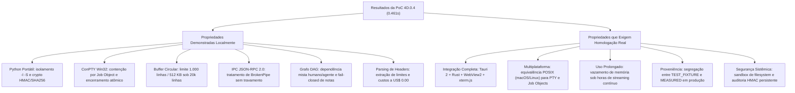
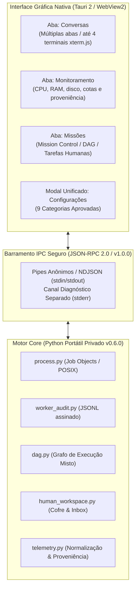
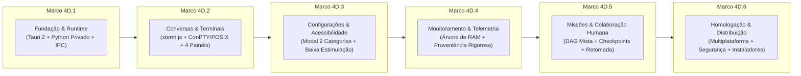
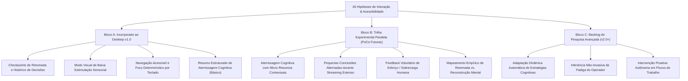

<!--
Cópia versionada, revisada e sanitizada do roadmap canônico da Fase 4D.
Origem: documento "phase4d05_definitive_roadmap.md", produzido na Fase 4D.0.5 (11/11/2026) pelo coordenador
AGY e mantido até então apenas na área de trabalho privada desse coordenador, fora do repositório.
Copiado em 13/11/2026 na branch experimental/phase4d-m3-settings (tarefa 4D.3 1210ff494600475c).
Sanitização: links para arquivos locais e caminhos de usuário foram reduzidos ao nome do recurso; o corpo técnico
não foi alterado. Correções e divergências constatadas ficam no Apêndice A; decisões aprovadas depois da
emissão do roadmap ficam nos Apêndices B e C. Em caso de conflito, prevalecem as decisões registradas.
-->

> [!NOTE]
> **Cópia versionada do roadmap canônico da Fase 4D.** Origem: `phase4d05_definitive_roadmap.md` (Fase 4D.0.5,
> 11/11/2026, coordenador AGY), copiado e sanitizado em 13/11/2026. O texto original segue sem alterações técnicas;
> as divergências constatadas no código estão no **Apêndice A** e as decisões posteriores do operador nos
> **Apêndices B e C**, que prevalecem sobre o corpo em caso de conflito.

# Roadmap Definitivo de Engenharia — AI Coordinator Desktop (Fase 4D.0.5)
## Consolidação Técnica, Matriz de Requisitos, Marcos Incrementais e Trilha de Pesquisa

> [!NOTE]
> **Status:** Roadmap Definitivo Consolidado · Fase 4D.0.5 Concluída · Pronto para Deliberação do Operador.  
> **Versão do Core de Referência:** `v0.6.0` (estável, publicada no GitHub e PyPI, branch `main` preservada no commit `1fa1236`).  
> **Branch Experimental de Testes:** `prototype/phase4d-desktop-poc` (commit `df8b67b`).  
> **Orçamento Financeiro Autorizado:** Estritamente **US$ 0,00** (zero despesas, zero inferências externas pagas).  
> **Data:** 11 de novembro de 2026.

---

### 1. Reconciliação Técnica e Análise Crítica das Evidências da PoC 4D.0.4

Antes de estabelecer os compromissos de implementação, realizamos uma revisão rigorosa dos resultados obtidos na Prova de Viabilidade (`phase4d04_poc_execution_report.md`), distinguindo com precisão o que foi provado empiricamente daquilo que permanece como hipótese a ser validada.



#### 1.1. Metodologia e Reconciliação das Medições de Memória RAM
A auditoria apontou a necessidade de registrar com precisão os valores e as respectivas janelas de medição, evitando ambiguidades entre medições locais e o ciclo de vida do processo:
* **Incremento do Buffer Circular de Terminais (Loop Q3):** Medição diferencial estrita (`ram_after - ram_before`) durante a injeção em rajada de 20.000 linhas nos 4 buffers circulares em memória. O resultado foi de **+0,992 MB**, comprovando empiricamente que a política de descarte FIFO (*First-In, First-Out*) limita a retenção de dados a 1.000 linhas / 512 KB por terminal sem vazamento.
* **Ciclo de Vida do Processo Python da Suíte (Testes 1 a 6):**
  - *Início da Bateria (RSS Inicial):* **37,65 MB** (interpretador carregado).
  - *Ponto de Estresse dos 4 Terminais (Q3):* **40,39 MB** (acréscimo operacional sob injeção massiva).
  - *Término da Suíte Completa (RSS Final):* **42,11 MB** (após carregar os módulos de teste adicionais, rotinas de inspeção do DAG, handles Win32 e chamadas de GC).
* **Esclarecimento:** O valor de 40,39 MB representou o ponto de estresse ativo durante o teste de terminais concorrentes; o valor final de 42,11 MB reflete o conjunto de trabalho (*working set*) acumulado ao final de toda a suíte de 6 cenários.
* **Diretriz para o Roadmap:** Nos marcos 4D.1 e 4D.4, a medição oficial será a **árvore completa de processos** (*Process Tree RAM*: Host Rust + WebView2/WebKit + Core Python + CLIs filhas), monitorada via `sysinfo` (Rust) e checada contra os limites de contenção do Core.

#### 1.2. Proveniência Quantitativa vs. Origem dos Dados (Compatibilidade Core v0.6.0)
* **Diagnóstico da Auditoria:** O Core v0.6.0 define estritamente em `telemetry.py` os valores: `MEASURED`, `ESTIMATED` e `UNKNOWN`. `TEST_FIXTURE` não existe e não deve ser injetado no enum para não quebrar compatibilidade de contratos.
* **Solução Arquitetural Aprovada:** Segregação ortogonal em duas camadas:
  1. **Tipo de Medição Quantitativa (`MetricProvenance` do Core v0.6.0):**
     - `MEASURED` ("measured"): valor aferido diretamente de contadores numéricos ou cabeçalhos HTTP parseados.
     - `ESTIMATED` ("estimated"): projeções e cálculos analíticos pré-chamada.
     - `UNKNOWN` ("unknown"): valores ausentes ou indeterminados.
  2. **Origem do Dado (`DataOrigin` / `source_environment` na camada Desktop/IPC):**
     - `LIVE_NETWORK`: telemetria originada de tráfego real com provedores externos via rede.
     - `TEST_FIXTURE`: dados originados de testes automatizados, fixtures sintéticas locais ou simulações.
     - `OFFLINE_CACHE`: dados restaurados de cache local sem comunicação ativa.
* **Garantia de Transparência:** No painel visual de Monitoramento (4D.4), a interface exibirá ambos os eixos (ex: *"Medição de Teste (Fixture)"* vs. *"Medição Real de Produção (Rede)"*), impedindo qualquer confusão sem violar o contrato do Core.

#### 1.3. Limitações da Bateria Rápida de 0,461 Segundo
* A duração de 461 ms atesta que os algoritmos isolados são ultrarrápidos e eficientes em memória.
* Contudo, **não substitui** testes de longa duração (*soak testing*), renderização gráfica pelo WebView2, consumo de IPC sob milhares de eventos assíncronos ou comportamento de suspensão/retomada de energia do sistema operacional.
* Essas verificações tornam-se critérios obrigatórios dos marcos **4D.2** e **4D.6**.

#### 1.4. Ausência de Homologação macOS e Linux
* A PoC rodou exclusivamente em Windows 11 utilizando ConPTY nativo e Win32 Job Objects.
* Os equivalentes POSIX (`portable-pty`, `/dev/ptmx`, `openpty`, grupos de processos e `cgroups`/`proc_info`) foram modelados arquiteturalmente, mas ainda não possuem telemetria empírica registrada neste ambiente.
* A validação em matriz cruzada multiplataforma é gate obrigatório dos marcos **4D.1** (fundação) e **4D.6** (homologação final).

---

### 2. Estrutura Geral da Aplicação e Escopo Estrito da Interface

O AI Coordinator Desktop é projetado como uma casca nativa leve, moderna e de alto desempenho construída em **Tauri 2 (Rust)** com frontend em **TypeScript / React** e terminais em **xterm.js**, consumindo diretamente os serviços do **Core Python v0.6.0** empacotado de forma privada.

> [!IMPORTANT]
> **Princípio de Reutilização Máxima do Core:**  
> O Desktop não conterá um "segundo motor" de governança. Toda a lógica de agendamento de tarefas, despacho da DAG, auditoria criptográfica, medição de custos e limites de segurança permanece sob a autoridade exclusiva do Core Python (`ai_coordinator`). A interface gráfica atua como cockpit de controle, visualização e intervenção humana.



#### 2.1. Escopo Delimitado da Interface (v1.0)
* **Aba 1 — Conversas:** Gerenciamento de abas de trabalho. Cada aba suporta até 4 terminais independentes em grade, histórico circular limitado (1.000 linhas / 512 KB), controles de interrupção imediata (*kill*) e salvamento sanitizado de sessão.
* **Aba 2 — Monitoramento:** Painel visual unificado exibindo saúde do sistema (CPU/RAM da árvore completa de processos), consumo cumulativo de tokens e custos em US$, origem e proveniência de cada métrica e alarmes de contenção.
* **Aba 3 — Missões:** Visão de controle de missão (*Mission Control*), exibindo a árvore de dependências (DAG) em tempo real, status das atividades, checkpoints salvos e caixas de diálogo para intervenção e aprovação do operador humano.
* **Modal Unificado — Configurações (9 Categorias):**
  1. *Perfil:* Identidade local, chaves públicas e preferências do operador.
  2. *Geral:* Inicialização, persistência de layout, atalhos de teclado.
  3. *Aparência:* Modos de baixa estimulação visual, redução de contraste/ruído, tipografia.
  4. *Terminal:* Configurações do `xterm.js`, cursor, fontes e buffers.
  5. *Coordinator:* Parâmetros de supervisão, timeouts, orçamentos máximos de missão.
  6. *Agentes:* Descoberta de CLIs locais (Gemini CLI, Claude Code, Agy, etc.) e MCPs.
  7. *Provedores:* Gerenciamento de credenciais seguras, limites de cotas e endpoints locais.
  8. *Segurança:* Permissões de sandbox, diretórios autorizados e políticas de acesso.
  9. *Sobre:* Versão estável (v0.6.0), licença PolyForm Noncommercial 1.0.0 e diagnóstico.
* **Exclusão Formal:** Fica terminantemente vetada a criação de uma aba "Workspace" separada na primeira versão. A colaboração humana e anotações ocorrem integradas dentro da aba **Missões** e no cofre do **Perfil**.

---

### 3. Matriz de Requisitos, Lacunas Técnicas e Componentes do Core

A matriz a seguir mapeia cada capacidade exigida, identificando o que já existe no Core v0.6.0, o esforço novo a ser construído, a dependência, os riscos e a destinação (Versão Inicial v1.0 vs. Backlog de Pesquisa).

| Requisito Operacional | Componente Existente no Core | Lacuna / Esforço Novo no Desktop | Marco | Risco | Destinação |
| :--- | :--- | :--- | :---: | :---: | :---: |
| **Python Portátil Privado** | `process.py:1614` (trampolim `-I`, `-S`) | Empacotar Python Build Standalone no build do Tauri | 4D.1 | Baixo | **v1.0** |
| **IPC Seguro e Resiliente** | `poc/desktop/ipc/protocol.py` (JSON-RPC v1.0.0) | Driver bidirecional em Rust com reconexão segura | 4D.1 | Médio | **v1.0** |
| **Isolamento de Perfis (3 Níveis)** | `human_workspace.py` (perfil e cofre) | Mapeamento no frontend e separação de credenciais | 4D.1 | Baixo | **v1.0** |
| **Terminais Múltiplos (4 Abas)** | `poc/desktop/terminal/buffer.py` | Componente React `xterm.js` integrado ao `portable-pty` | 4D.2 | Médio | **v1.0** |
| **Contenção e Kill em Árvore** | `process.py` (Job Objects e kill_tree) | Acionamento atômico via comando do Tauri no Rust | 4D.2 | Médio | **v1.0** |
| **Recuperação de Sessão** | `poc/desktop/terminal/buffer.py` (export) | Salvar e recarregar layout sanitizado via SQLite | 4D.2 | Baixo | **v1.0** |
| **Configurações (9 Categorias)** | Modelos em `ai_coordinator` | Interface modal unificada com validação de campos | 4D.3 | Baixo | **v1.0** |
| **Acessibilidade Sensorial** | Inexistente (novo) | Modos visuais de baixa estimulação, tema e fontes | 4D.3 | Baixo | **v1.0** |
| **Navegação Acessível por Teclado** | Inexistente (novo) | Atalhos completos, foco lógico e leitor de tela básico | 4D.3 | Baixo | **v1.0** |
| **Monitoramento Árvore de RAM/CPU** | `process.py` (coleta via Win32/psutil) | Coleta nativa pelo host Rust (`sysinfo`) e envio IPC | 4D.4 | Baixo | **v1.0** |
| **Proveniência de Telemetria** | `telemetry.py` (`MetricProvenance`) | Diferenciação visual entre `MEASURED` e `TEST_FIXTURE` | 4D.4 | Baixo | **v1.0** |
| **Mission Control & DAG Mista** | `dag.py` (validação e nós humanos) | Visualização interativa do grafo com nós humano/agente | 4D.5 | Médio | **v1.0** |
| **Checkpoints & Retomada Segura** | `dag.py` + `checkpoint` CLI | Interface de aprovação sem duplicação de efeitos | 4D.5 | Médio | **v1.0** |
| **Pesquisa Recorrente Supervisionada** | Estruturas de loop supervisionado do Core | Controles de orçamento, limites de iteração e parada | 4D.5 | Médio | **v1.0** |
| **Instaladores Multiplataforma** | GitHub Actions workflows existentes | Bundlers Tauri para MSI/NSIS, DMG e DEB com Python | 4D.6 | Alto | **v1.0** |
| **Aterrissagem Cognitiva & Contexto** | Inexistente (hipóteses da pesquisa) | Resumo de contexto estruturado pós-interrupção | 4D.5 | Médio | **v1.0 (Básico)** |
| **Adaptação Dinâmica de Estratégias** | Inexistente (hipótese avançada) | Modelagem adaptativa de carga cognitiva do usuário | Trilha Pesq. | Alto | **Backlog Pesquisa** |
| **Intervenção Cognitiva Autônoma** | Inexistente (hipótese avançada) | Detecção autônoma de fadiga sem inferir diagnósticos | Trilha Pesq. | Alto | **Backlog Pesquisa** |

---

### 4. Ciclo de Vida Padronizado de Subetapa (Template Obrigatório)

Para assegurar rigor científico e integridade documental, **toda e qualquer subetapa** dos marcos 4D.1 a 4D.6 seguirá obrigatoriamente a esteira de verificação com 7 critérios de aceite:

```markdown
### Subetapa 4D.X.Y — [Nome da Subetapa]
- [ ] 1. Requisito funcional e critérios de aceite formalmente definidos
- [ ] 2. Testes unitários e testes de injeção de falhas implementados e aprovados
- [ ] 3. Integração com o Core v0.6.0 e políticas de permissões/sandbox validadas
- [ ] 4. Comportamento multiplataforma verificado (Windows obrigatório; Linux/macOS conforme aplicável)
- [ ] 5. Consumo de recursos medido (RAM da árvore de processos, CPU e tempo de resposta)
- [ ] 6. Documentação técnica, logs diagnósticos e evidências arquivadas
- [ ] 7. Revisão técnica e aprovação humana registrada para integração
```

---

### 5. Detalhamento dos 6 Marcos Incrementais de Desenvolvimento (Fases 4D.1 a 4D.6)



---

#### Marco 4D.1 — Fundação, Runtime Privado, IPC e Identidade
* **Objetivo:** Estabelecer a casca nativa em Tauri 2, configurar a execução isolada do Python Standalone privado sem dependência do ambiente do sistema operacional, implementar o barramento IPC seguro e tipado com recuperação de falhas, e construir a fronteira de segurança entre perfis, cofre nativo e autoridade do Core.
* **Subetapas Aprovadas:**
  - **4D.1.1 — Estrutura e Ambiente (Host Tauri 2 & Python Privado):**
    - Criação da base Tauri 2 em branch experimental com builds reproduzíveis.
    - Preparação e fixação do runtime Python Standalone com versões e hashes criptográficos verificados.
    - Aplicação seletiva de flags: uso de `-I` (*isolated mode*) para blindar o runtime contra poluição de variáveis de ambiente do host (`PYTHONPATH`, `PYTHONHOME`) ou pacotes do usuário (`~/.local`), preservando o acesso às `site-packages` privadas empacotadas (diferenciando-o do trampolim POSIX minimalista que usa `-I -S`).
    - *Gate 4D.1.1:* Inicialização real e independente do host e do interpretador privado sem exigir Python instalado globalmente no `PATH`.
  - **4D.1.2 — IPC Seguro (Contrato Tipado, Versionado e Resiliente):**
    - Implementação do contrato JSON-RPC 2.0 (protocolo v1.0.0) com esquemas estritos de requisição, resposta e notificação.
    - Validação de mensagens, limites de payload e canal de diagnóstico desvinculado em `stderr`.
    - Tratamento determinístico de quedas abruptas, quebra de pipe (*BrokenPipe*) e reconexão segura sem duplicação de processos filhos.
    - *Gate 4D.1.2:* Comunicação bidirecional comprovada entre dois processos reais em execução, cobrindo casos de erro, desconexão forçada e payload malformado.
  - **4D.1.3 — Identidade, Autorização e Cofre Seguro de Credenciais:**
    - Definição da fronteira de segurança em 5 camadas: (1) Usuário do SO, (2) Perfil Desktop local, (3) Sessão IPC autenticada com token criptográfico efêmero, (4) Cofre nativo de credenciais (DPAPI no Windows, Keychain no macOS, Secret Service no Linux) e (5) Autoridade do Core via `HumanPrincipal` e `fs_sandbox`.
    - Garantia formal de que o mero conhecimento de um PID ou `owner_id` não confere autorização para executar tarefas privilegiadas ou acessar dados confidenciais.
    - *Gate 4D.1.3:* Identidade verificada e bateria de testes demonstrando isolamento estrito (fail-closed) entre perfis e impedindo que agentes acessem segredos do operador.
  - **4D.1.4 — Integração, Regressão, Desempenho e Homologação da Fundação:**
    - Validação do ciclo de vida completo dos processos e medição contínua de recursos (CPU, RAM da árvore completa de processos).
    - Execução de testes de regressão garantindo que os invariantes do Core v0.6.0 permaneçam 100% intactos.
    - Simulação de instalação limpa e documentação das limitações conhecidas por sistema operacional antes da abertura da interface.
    - *Gate 4D.1.4:* Evidências documentadas, suíte de testes aprovada e parecer técnico consolidado para liberação do Marco 4D.2.

---

#### Marco 4D.2 — Conversas, Terminais e Supervisão de Processos
* **Objetivo:** Implementar a aba **Conversas**, com suporte a múltiplas abas concorrentes, grade de até 4 terminais virtuais por aba via `xterm.js`, supervisão ativa de processos filhos sob Job Objects e anéis circulares de buffer.
* **Subetapas:**
  - **4D.2.1 — Componente de Grade de Terminais (`xterm.js`):** Layout responsivo suportando 1, 2, 3 ou 4 terminais por aba com redimensionamento fluido.
  - **4D.2.2 — Integração PTY Nativa (`portable-pty` + ConPTY/POSIX):** Conexão bidirecional entre o frontend e pseudoconsoles nativos, tratando eventos de teclado (`\r` no ConPTY) e streaming ANSI.
  - **4D.2.3 — Buffer Circular com Limites Estritos:** Anel circular em memória por terminal (limite de 1.000 linhas e 512 KB) com descarte FIFO garantido e rotina de sanitização de credenciais para exportação.
  - **4D.2.4 — Contenção de Processos e Cancelamento Atômico (*Kill Tree*):** Vinculação dos processos filhos a Win32 Job Objects (Windows) e grupos de processos POSIX (macOS/Linux), acionando encerramento imediato via interface.
  - **4D.2.5 — Salvamento e Recuperação de Sessões de Terminal:** Persistência do layout de abas e variáveis contextuais para reabertura rápida sem restauração de lixo transitório.
* **Portão de Aprovação (Gate 4D.2):**
  - 4 terminais em streaming pesado consomem no máximo 4 MB adicionais de RAM.
  - Encerramento forçado de tarefa (*kill*) elimina 100% dos processos filhos em < 200 ms.
  - Exportação de histórico de terminal substitui chaves (`sk-...`, tokens bearer) por marcadores `[REDACTED_CREDENTIAL]`.

---

#### Marco 4D.3 — Configurações e Acessibilidade Sensorial Básica
* **Objetivo:** Implementar o modal unificado de **Configurações** cobrindo rigorosamente as 9 categorias da especificação, incorporando preferências de baixa estimulação sensorial e usabilidade por teclado sem rotulagem ou inferência diagnóstica.
* **Subetapas:**
  - **4D.3.1 — Estrutura do Modal Unificado de Configurações:** Arquitetura visual com abas de navegação lateral para as 9 categorias aprovadas.
  - **4D.3.2 — Categorias de Conectividade e Execução (Coordinator, Agentes, Provedores):** Telas de configuração de chaves de API com armazenamento seguro no cofre do perfil, limites de cota e seleção de rotas de fallback.
  - **4D.3.3 — Categorias de Segurança e Ambiente (Segurança, Perfil, Geral, Terminal, Sobre):** Gestão de diretórios de sandbox, permissões de escrita, atalhos globais e dados da licença PolyForm Noncommercial.
  - **4D.3.4 — Modo de Baixa Estimulação Sensorial (Aparência):** Alternância para tema com paleta de contraste suave, redução de animações e transições gráficas supérfluas, e controle de densidade visual.
  - **4D.3.5 — Navegação Acessível por Teclado e Foco Lógico:** Mapeamento completo de atalhos para comutação de abas, terminais e modais, com retorno determinístico de foco pós-fechamento de diálogos.
* **Portão de Aprovação (Gate 4D.3):**
  - 100% das 9 categorias operacionais e validadas contra os esquemas do Core.
  - Credenciais de API salvas exclusivamente no cofre encriptado local (`HumanProfile`), nunca expostas em texto puro.
  - Navegação de toda a aplicação possível utilizando exclusivamente o teclado (Tab, Shift+Tab, Enter, Esc, setas).

---

#### Marco 4D.4 — Monitoramento e Telemetria com Proveniência Rigorosa
* **Objetivo:** Implementar a aba **Monitoramento**, fornecendo transparência integral sobre recursos computacionais consumidos (CPU, RAM de toda a árvore, disco) e governança financeira de tokens e custos, com separação explícita da proveniência dos dados.
* **Subetapas:**
  - **4D.4.1 — Coletor de Recursos da Árvore de Processos (Host + Core + Filhos):** Monitoramento contínuo em segundo plano via `sysinfo` no Rust e APIs do Core, agregando consumo real de RAM física (RSS) e percentual de CPU.
  - **4D.4.2 — Painel Visual de Saúde e Alarmes de Contenção:** Gráficos leves de consumo histórico com alertas visuais configuráveis caso a árvore de processos se aproxime do teto estipulado.
  - **4D.4.3 — Monitor de Cotas e Orçamento Financeiro de Provedores:** Exibição em tempo real de limites de requisições, requisições restantes, tempo de renovação e saldo em dólares/créditos.
  - **4D.4.4 — Rótulos Estritos de Proveniência (`MEASURED` vs. `TEST_FIXTURE` vs. `ESTIMATED`):** Indicadores visuais claros que informam ao operador se a métrica exibida adveio de telemetria de rede confirmada (`MEASURED`), projeção local (`ESTIMATED`) ou fixture de teste (`TEST_FIXTURE`).
* **Portão de Aprovação (Gate 4D.4):**
  - O monitor de recursos consome menos de 1% de CPU em regime de repouso (*idle*).
  - A métrica de RAM reflete a soma real da árvore de processos, sem omissão do motor WebView ou do interpretador Python.
  - Zero ocorrências de dados simulados apresentados como medições oficiais de produção.

---

#### Marco 4D.5 — Missões, Continuidade Durável e Colaboração Humano–IA
* **Objetivo:** Implementar a aba **Missões** (*Mission Control*), tornando o operador humano um participante de primeira classe no grafo de execução (DAG), com continuidade durável de tarefas, checkpoints de retomada segura e pesquisa recorrente supervisionada.
* **Subetapas:**
  - **4D.5.1 — Visualizador Interativo da DAG (Grafo de Missões):** Renderização visual de nós de tarefas, dependências e status, suportando nós com papéis de agentes (`assigned_role="worker"`) e humanos (`assigned_role="human"`).
  - **4D.5.2 — Painel de Tarefas Humanas & Caixa de Decisão (Human Workspace):** Interface clara destacando quando uma tarefa exige revisão, autorização ou decisão de arquitetura humana antes de desbloquear os agentes subsequentes.
  - **4D.5.3 — Checkpoints Duráveis e Retomada Segura:** Integração com os checkpoints do `ai-coordinator`, garantindo que interrupções e retomadas de missões recarreguem o contexto sem duplicar efeitos colaterais nem sobrescrever decisões já consolidadas.
  - **4D.5.4 — Motor de Pesquisa Recorrente Supervisionada:** Execução de tarefas iterativas com critérios formais de parada, limites máximos de iteração, controle de orçamento e deduplicação de descobertas.
  - **4D.5.5 — Resumo Estruturado de Aterrissagem Cognitiva (v1.0 Básico):** Ao reabrir o aplicativo ou retomar uma missão após interrupção, exibir um resumo sucinto em 3 tópicos: (1) Onde paramos, (2) Decisão pendente do operador e (3) Próximo passo seguro sugerido.
* **Portão de Aprovação (Gate 4D.5):**
  - O agente não consegue avançar na DAG enquanto a tarefa predecessora humana não estiver marcada como `completed`.
  - A retomada de uma missão abortada no meio preserva 100% das decisões registradas sem reexecutar tarefas atômicas concluídas.
  - Nenhuma anotação privada do cofre humano vaza para os prompts ou arquivos de trabalho dos agentes.

---

#### Marco 4D.6 — Homologação, Segurança e Distribuição Multiplataforma
* **Objetivo:** Conduzir a auditoria final de segurança, homologar o funcionamento multiplataforma nos três sistemas operacionais suportados, gerar instaladores de produção embutidos e validar o desempenho global.
* **Subetapas:**
  - **4D.6.1 — Homologação Multiplataforma (Windows 11, macOS Sequoia/Sonoma, Linux Ubuntu 24.04):** Validação dos pseudoterminais, Job Objects / grupos POSIX e caminhos de arquivo nos três alvos.
  - **4D.6.2 — Auditoria de Segurança, Permissões e Sandboxing:** Verificação de integridade contra injeção de comandos via IPC, bloqueio de escape de diretórios (`fs_sandbox.py`) e conformidade com a licença PolyForm Noncommercial 1.0.0.
  - **4D.6.3 — Geração de Instaladores Oficiais de Produção:** Criação de pacotes MSI/NSIS (Windows), DMG assinado (macOS) e pacotes DEB/AppImage (Linux) incorporando o runtime Python privado.
  - **4D.6.4 — Teste de Instalação em Máquina Limpa (*Clean-room Test*):** Instalação e execução do pacote final em máquina virtual sem desenvolvimento prévio, comprovando auto-suficiência funcional.
  - **4D.6.5 — Relatório Final de Prontidão e Consolidação:** Documentação completa da versão v1.0.0 do AI Coordinator Desktop e emissão do parecer final para lançamento.
* **Portão de Aprovação (Gate 4D.6):**
  - 100% dos testes da suíte integrados passando nos três sistemas operacionais.
  - Instalação e execução com sucesso em máquina limpa sem Python ou Node no `PATH`.
  - Zero vulnerabilidades altas ou críticas reportadas no CodeQL ou ferramentas de varredura de dependências.

---

### 6. Trilha de Pesquisa Experimental Separada (Interação & Acessibilidade Humano–IA)

Para preservar o cronograma e a robustez da versão v1.0, as **26 hipóteses** levantadas na pesquisa conceitual noturna foram categorizadas em três blocos distintos. **Nenhuma hipótese experimental bloqueia o caminho crítico do Desktop v1.0.**



#### Diretrizes da Trilha de Pesquisa:
1. **Sem Rótulos Clínicos ou Diagnósticos:** As ferramentas de acessibilidade focam puramente em preferências de interação, redução de atrito e eficiência cognitiva (ex: *"Modo de Foco"*, *"Baixo Estímulo"*, *"Resumo de Interrupção"*), sem qualquer presunção psicológica ou clínica sobre o operador.
2. **Avaliação por Evidência Empírica:** Cada hipótese do Bloco B será testada em pequenos experimentos controlados futuros, medindo o ganho real de tempo de retomada e a satisfação do usuário antes de qualquer proposta de fusão com a versão principal.
3. **Isolamento de Código:** Todo código experimental dessa trilha será mantido em pastas isoladas de laboratório (`experiments/cognitive_interaction/`), sem impactar o binário estável.

---

### 7. Governança e Transição entre Marcos

* **Execução Estritamente Sequencial:** Não será autorizada a abertura de um novo marco (ex: 4D.2) enquanto todos os critérios de aceite e portões do marco anterior (4D.1) não estiverem 100% verificados e aprovados pelo operador humano.
* **Integridade das Branches:**
  - `main`: permanece congelada e intocada até a aprovação formal de release do Marco 4D.6.
  - `prototype/phase4d-desktop-poc`: preservada como histórico da Prova de Viabilidade.
  - Novas branches de trabalho serão abertas sob a convenção `feature/phase4d-m[1-6]-[modulo]`.
* **Supervisão Contínua:** Checkpoints do `ai-coordinator` e registros de continuidade no `ai-memory` serão gravados ao término de cada subetapa.


---

## Apêndice A — Notas de revisão (13/11/2026)

Divergências entre o roadmap e o código da branch `feature/phase4d-m2-terminals` (commit `1fdc266`), constatadas no
levantamento da 4D.3. São fatos a considerar nos gates; não alteram o corpo acima.

| # | Trecho do roadmap | Situação constatada | Encaminhamento |
|---|---|---|---|
| A1 | Gate 4D.3: credenciais no cofre `HumanProfile` | `HumanProfile` não existe. O cofre implementado é o do perfil desktop (`desktop/auth/vault.py`, arquivo `vault.enc`); o Core tem `HumanPrincipal`, que é identidade e não guarda segredos | O gate refere-se ao cofre do perfil desktop |
| A2 | 4D.1.3: cofre nativo (DPAPI no Windows, Keychain no macOS, Secret Service no Linux) | Windows usa DPAPI. Fora do Windows o código usa AES-256-GCM com senha padrão derivável do nome do perfil, o que não protege o conteúdo e não atende ao desenho aprovado | Decisão D8 (Apêndice C) |
| A3 | §3: `human_workspace.py (perfil e cofre)` no Core | O cofre está na camada desktop, não no Core | Sem mudança no Core (decisão do operador) |
| A4 | Gate 4D.3: categorias "validadas contra os esquemas do Core" | O Core v0.6.0 não tem JSON Schema; há validadores pontuais (orçamentos de missão, ambiente de worker, launchers, contratos de cliente, chaves, caminhos) | Decisão D3 (Apêndice C) |
| A5 | 4D.2.5: salvar e recarregar layout sanitizado | `terminal.save_sessions` apenas exporta; não existe restauração registrada no servidor IPC | Considerar na categoria Geral sem declarar restauração inexistente |
| A6 | §7: execução estritamente sequencial | Exceção autorizada pelo operador em 12/11/2026: 4D.3 em paralelo à homologação operacional pendente da 4D.2 | Apêndice B |
| A7 | §7: branches `feature/phase4d-m[1-6]-[modulo]` | A 4D.3 usa inicialmente `experimental/phase4d-m3-settings` | Decisão D1 (Apêndice C) |

## Apêndice B — Transição 4D.2 → 4D.3 (decisão do operador, 12/11/2026)

1. Aprovada a conclusão técnica da implementação 4D.2, com CI verde no commit `1fdc266`.
2. Homologação operacional do Gate 4D.2 **pendente** até o teste manual dos terminais no Windows e a aprovação
   explícita do operador. Testes automatizados não substituem essa homologação.
3. Autorizado o início controlado da 4D.3 em branch experimental, sem merge na `main`.
4. Preservado o escopo canônico da 4D.3 (interface, configurações, acessibilidade e decisões aprovadas); sem
   Workspace; sem modificar o Core.
5. Seção de atualizações incorporada em Configurações → Sobre, preservando as exigências de segurança e
   distribuição da 4D.6.
6. Recomendações não bloqueantes da Revisão 57 mantidas com rastreabilidade (lista abaixo).
7. Nenhuma tag, release ou distribuição estável sem os gates correspondentes.

Recomendações não bloqueantes da Revisão 57 (tarefa 4D.2 `1a52600ee41f4ccd`):

| ID | Recomendação |
|---|---|
| R57-1 | Versionar `Cargo.lock` para fixar `tauri` e `tauri-plugin-updater` |
| R57-2 | Remover a permissão `updater:default` das capabilities na próxima Alpha (o frontend não usa o plugin) |
| R57-3 | Restaurar variáveis de ambiente nos testes de `test_phase4d2_desktop_alpha_integration.py` |
| R57-4 | Timeout de leitura no IPC do host (Core travado mantém o modal de atualização ocupado) |
| R57-5 | Testes da fase 4C que leem saída de subprocesso independentes de `PYTHONIOENCODING` |
| R57-6 | Testes da fase 4B sensíveis ao lançador `python.exe` de venv no Windows |
| R57-7 | Ambiente local com `mcp` 1.29.1 enquanto o `pyproject` exige `mcp>=2,<3` |

## Apêndice C — Aprovação condicionada do plano 4D.3 (decisão do operador, 13/11/2026)

Referência: checkpoint da tarefa 4D.3 (`1210ff494600475c`), revisão 3. Planejamento aprovado com alterações em D1 e
D8; implementação experimental autorizada.

| Decisão | Resolução |
|---|---|
| D1 — Branch | `experimental/phase4d-m3-settings`, derivada de `1fdc266`. Verify automático preservado; builds nativos Windows sob demanda nos checkpoints. Não publicar nem modificar canais de atualização |
| D2 — Estilo | CSS próprio com design tokens, sem Tailwind. Substituir sistematicamente as classes não implementadas e validar visualmente diálogos, cabeçalho, telas de autorização e estados de erro |
| D3 — Esquemas | Reutilizar os validadores do Core e complementar com esquemas versionados no Desktop. Validação no backend, não só no React; configurações desconhecidas, inválidas ou incompatíveis rejeitadas com erro estruturado |
| D4 — Operacionalidade | Distinguir os estados salvo, validado, aplicado e não suportado. Nada é apresentado como operacional sem integração efetiva com o Core; Coordinator, Agentes e Provedores não produzem permissões fictícias |
| D5 — Layout | Painéis redimensionáveis fora da 4D.3; comportamento atual dos terminais preservado; mudanças estruturais só com os testes e gates correspondentes |
| D6 — Temas | Nord e Dracula adiados. Prioridade: identidade visual principal, legibilidade, contraste, modo de baixa estimulação e preferência do sistema por movimento reduzido |
| D7 — Testes | Vitest e Testing Library apenas como dependências de desenvolvimento, cobrindo persistência, validação, atalhos, foco, acessibilidade, diálogos e integração com os comandos Tauri |
| D8 — Cofre | Manter DPAPI no Windows. Sem armazenamento seguro implementado, o armazenamento persistente de credenciais fica desabilitado com mensagem clara. Senha padrão derivável do perfil jamais é proteção de produção. Integração segura para Linux/macOS planejada na 4D.6 |

Requisitos adicionais: cópia revisada e sanitizada deste roadmap no repositório; regra `auth/` do `.gitignore`
corrigida sem permitir o versionamento de dados privados, credenciais ou cofres; contrato `command` entre Rust e
Python corrigido com testes de integração; as nove categorias criadas; Atualizações migradas para Configurações →
Sobre sem alterar as garantias de assinatura, autorização, congelamento e recuperação; sem aba Workspace; sem
antecipar a telemetria da 4D.4; sem modificar `src/` nem a arquitetura do Core; homologação operacional da 4D.2
mantida pendente; nenhuma tag, release ou versão estável. Execução incremental, com evidências de cada etapa antes de
ampliar o escopo.

## Apêndice D — Referências visuais aprovadas da 4D.3 (13/11/2026)

Pacote entregue pelo operador e versionado sem alterações gráficas em `docs/desktop/design-references/4d3/`
(origem: `AI-Coordinator-referencias-visuais-4D3.zip`).

| Arquivo | Papel | SHA-256 (prefixo) |
|---|---|---|
| `01-layout-principal-aprovado.png` | Referência principal: estrutura compacta, quatro terminais 2×2, barras finas, rodapés técnicos e marca em ciano com o símbolo `>_` (conceito visual aprovado) | `2DDCC4D040B0DDEC` |
| `02-indicadores-e-tooltip.png` | Referência complementar: legibilidade dos três indicadores circulares (contexto, 5 h, semanal), tooltip de contexto e estados de atividade | `2FEF176C66ECFCE8` |
| `REFERENCIAS-E-CRITERIOS.md` | Hierarquia, decisões que prevalecem sobre os mockups e critérios de comparação visual | — |

Prevalecem sobre os mockups: abas principais Conversas, Monitoramento e Missões (sem Workspace; Analytics/Cotas
dentro de Monitoramento); Configurações pela engrenagem, incluindo Sobre → Atualizações; indicadores por terminal com
proveniência real, estimada ou indisponível, sem percentuais inventados. Fidelidade visual só é declarada com captura
nativa (Tauri/WebView2) e validação humana.

## Apêndice E — Pendências registradas na Etapa 4 da 4D.3 (13/11/2026)

Registro separado, pedido pelo operador ao autorizar o commit da confirmação no cofre. Nada aqui foi implementado
nesta etapa; cada item depende de decisão e autorização próprias.

### E.1 — Substituição atômica de credenciais no backend

| Aspecto | Situação |
|---|---|
| Hoje | Configurações → Provedores confere a lista de nomes do cofre e, se o nome existe, pergunta antes de substituir. Conferir e gravar são duas chamadas: `vault.set_secret` grava sem condição, e cada operação lê, altera e regrava o `vault.enc` inteiro sem trava entre processos |
| Risco | Outro escritor entre a conferência e a gravação (outra janela do aplicativo, a versão portátil ao lado da instalada, a CLI) é sobrescrito sem pergunta, ou tem a própria gravação perdida |
| Proposta | `vault.set_secret` com modo explícito (`if_absent` ou `overwrite`); com `if_absent` e nome existente, erro estruturado com `reason: "exists"`; resposta com `replaced: true/false`; trava de arquivo entre processos em volta de ler-alterar-gravar. O painel passaria a gravar com `if_absent` e só enviaria `overwrite` depois da confirmação |
| Situação (18/11) | Implementado nas Etapas 7 e 8 da 4D.3: gravação condicional à revisão do cofre, com trava entre processos e gravação atômica (`9436e51` no cofre, `c9572d5` no IPC); remoção condicional (`11f5c7d`); a interface grava e remove com a revisão da própria leitura (`a9e2462`, `7811040`). O contrato difere da proposta acima (sem `mode`, sem `reason: "exists"` e sem `replaced`): ver Apêndice G.3. Testes em `tests/test_phase4d3_vault_atomic.py` e `tests/test_phase4d3_etapa8_ipc.py`. [conferência nativa pendente] |

### E.2 — Achados da preparação das conferências nativas, fora do escopo da Etapa 4

| ID | Achado | Severidade | Situação |
|---|---|---|---|
| E2-1 | O servidor IPC lê o stdin com a codificação padrão do Windows (cp1252), e o host Rust escreve UTF-8. Caracteres como Á, Í, aspas curvas e vários emojis derrubam o Core (terminais incluídos); outros acentos chegam trocados ao cofre e às configurações, com resposta de sucesso. Anterior à 4D.3 | Alta | Corrigido em 16/11 (autorizado pelo operador): o servidor lê e escreve os handles reais em binário, sempre em UTF-8; linha com bytes inválidos recebe erro estruturado (-32700, `reason: "invalid_utf8"`) sem derrubar o servidor e sem registrar o conteúdo; resposta termina em `\n`. O cliente de verificação (`desktop/ipc/client.py`) também passou a usar UTF-8. Teste `tests/test_phase4d3_ipc_utf8.py` (falha no código anterior, passa no novo). Valores gravados com acento trocado antes da correção não são convertidos |
| E2-2 | O build Windows não copiava `desktop/settings` para o pacote, então Perfil, Geral, Aparência, Terminal e Coordinator falhariam no aplicativo instalado (o artefato da Etapa 3, `4a8eaa4`, também não tinha a pasta) | Alta | Corrigido nesta etapa: uma linha no workflow e um teste que exige copiar todo pacote `desktop.*` importado pelo servidor |
| E2-3 | Cofre ilegível ou falha da DPAPI aparece como cofre disponível, com erro não estruturado (em inglês, sem `field`/`reason`) e sem ação de recuperação na interface | Média | Registrado em 13/11. Corrigido e testado em 17-18/11 (Etapa 7): cofre ilegível ou truncado nunca aparece como disponível ou vazio e nunca é regravado; o erro é estruturado e em português (-32004, `reason: "unreadable"`); trava ocupada por outra janela é `busy` (-32006), não ilegível, e a interface oferece "Tentar novamente" (`9436e51`, `c9572d5`, `a9e2462`). Testes de regressão no backend (falha no `e4acb71`) e na interface com a forma que o host envia (`9af3e06`). Para o cofre ilegível, a interface só orienta recuperar o acesso; não há ação de recuperação no aplicativo. [conferência nativa pendente] |
| E2-4 | Valor formado só por espaços é aceito; valores não são aparados | Baixa | Registrado em 13/11. Corrigido em `c9572d5` (Etapa 7, 17/11): valor vazio ou só com espaços é recusado (-32602, `reason: "invalid_value"`); espaços e quebras de linha em volta do valor são removidos antes de gravar. Teste em `tests/test_phase4d3_etapa7_ipc.py`. [conferência nativa pendente] |
| E2-5 | Baixa estimulação: a primeira pintura sai no modo padrão até o Core responder; falha de `settings_get` na abertura é silenciosa; a frase "Aplicado na interface" é fixa; o tema do terminal (xterm) não muda | Média | Registrado em 13/11; critério de aceite a definir com o operador. Tratado nas Etapas 5 e 7: o tema do terminal vem dos tokens, inclusive na baixa estimulação, e muda no terminal aberto sem reiniciar (`7ddbfce`); a primeira pintura usa a aparência guardada da execução anterior, e só a área dos terminais espera as preferências, por no máximo 1,5 s (os terminais em si só são criados depois da resposta do `settings_get`: P3 aberto, Apêndice G.4); falha de `settings_get` vira aviso persistente com os padrões; "Aplicado" só aparece quando é verdade; baixa estimulação e movimento reduzido também param o cursor piscante (`a9e2462`). [conferência nativa pendente] |
| E2-6 | `profile.json` corrompido impede o aplicativo de iniciar; mudança de `schema_version` descarta as configurações sem migração; sem instância única | Média | Registrado em 13/11. Corrigido e testado na Etapa 7 (`9436e51`, `9af3e06`): `profile.json` ilegível do perfil ativo vai para quarentena (`profile.json.corrupt-<data UTC>`, nunca sobrescrita) e o perfil é recriado vazio, com o mesmo nome; perfis inativos ilegíveis são ignorados; `active_profile.txt` vazio, ilegível ou apontando para perfil inexistente abre o perfil `default`. Esquema futuro ou incompatível fica somente leitura, com os padrões e sem tocar nos bytes; campos inválidos são listados e preservados até serem regravados; cópia `profile.json.pre-v1.bak` antes da primeira migração. Instância única não implementada (Apêndice G.4). [conferência nativa pendente] |
| E2-7 | O build de homologação tem a mesma versão do alpha publicado (`0.6.1-alpha.50`); a identificação é feita pelo SHA-256 do artefato | Média | Registrado em 13/11. Persiste: o build de diagnóstico da Etapa 8 (`44328616887`, commit `7811040`, 18/11) também é `0.6.1-alpha.50` (instalador `AI Coordinator Desktop_0.6.1-alpha.50_x64-setup.exe`) e é identificado pelo SHA-256 (Apêndice G.6). Mostrar o commit no Sobre e no nome do artefato (O6 da ordem de correções de 17/11) não foi feito; destino na 4D.6 (Apêndice G.4) |
| E2-8 | Sete pontos de `tests/test_phase4d2_desktop_alpha_integration.py` usam o diretório de perfis real do usuário | Média | Registrado |
| E2-9 | Fidelidade visual: acento azul (`#89b4fa`) em vez do ciano da referência 01; superfícies Catppuccin; marca `>_` dentro do aplicativo, navegação Conversas/Monitoramento/Missões e indicadores circulares ainda não existem | Alta para a homologação visual | Registrado; depende de decisão do operador sobre etapa e escopo. Ícone da janela, do executável e dos atalhos trocado em 13/11 pela logo enviada pelo operador (círculo com `>_`), com título "AI Coordinator Desktop" e barra de título escura. Em 16/11: barra de título da janela principal em `#071017` (cor da barra no print de referência do operador; Windows 11) e a logo também no instalador e no desinstalador. Plano das Etapas 5 e 6 (fidelidade visual) entregue ao operador em 16/11 para aprovação, fora do repositório |
| E2-10 | Com `-I`, o stderr do servidor IPC continua na codificação local; linhas de diagnóstico com acento chegam ao host como UTF-8 inválido e são descartadas pela leitura do stderr | Baixa | Registrado em 16/11 (revisão da correção do E2-1) |
| E2-11 | Duas linhas ainda derrubam o servidor IPC (e o Core e os terminais junto): JSON muito aninhado dentro de 1 MB (`RecursionError`) e `method` que não é texto (`TypeError`). O host não envia nenhuma das duas | Média | Registrado em 16/11 (revisão da correção do E2-1). Severidade elevada para Alta pelo operador em 16/11. Vetor novo, reproduzido em 17/11 com o Python 3.11.9 empacotado: inteiro com mais de 4.300 dígitos em `params` ou no `id` (`ValueError`), com uma linha de 5 KB. Corrigido e testado em 17/11 (`e0f18fa`): profundidade até 64, inteiros até 128 dígitos, só números finitos (NaN e Infinity recusados), `method` só texto não vazio, `params` só objeto, quadro acima de 1 MB descartado até a quebra de linha; proteção geral (-32603 sem o conteúdo da linha) e resposta estruturada para linha vazia, só espaços, BOM e lotes (`c9572d5`); prova da proteção geral (`9af3e06`). Teste `tests/test_phase4d3_ipc_hardening.py`; sondas com o Python 3.11.9 empacotado em 18/11: 8/8 e 5/5, servidor vivo e ping respondido. Não testável pela interface (o host não envia essas linhas) |
| E2-12 | Um surrogate isolado escrito como escape JSON (`\ud800`) é aceito e gravado; a leitura seguinte devolve um valor que o host rejeita. O host não consegue enviar esse escape | Baixa | Registrado em 16/11 (revisão da correção do E2-1). Corrigido em `c9572d5` (Etapa 7, 17/11): texto com surrogate isolado vindo de escape JSON, em chave ou valor, é recusado antes de qualquer gravação (-32600, `reason: "lone_surrogate"`), sem ecoar o conteúdo. Teste em `tests/test_phase4d3_etapa7_ipc.py`. Não testável pela interface (o host não envia esse escape) |

### E.3 — Limites aceitos no painel de credenciais

- Uma gravação já enviada ao cofre conclui mesmo que Configurações seja fechada; o resultado não é exibido depois.
- "Cancelar" mantém nome e valor digitados, para corrigir o nome sem redigitar a credencial; ambos são descartados
  ao sair do painel, ao fechar Configurações e depois de uma gravação bem-sucedida.
- O clique de ponteiro no botão destrutivo só responde depois de 600 ms (indicado visualmente); teclado sem atraso.

## Apêndice F — Proposta visual para depois da homologação: sinapses interativas (16/11/2026)

Registro autorizado pelo operador em 16/11/2026. É só uma proposta: não faz parte da 4D.3, nada foi implementado e a
avaliação acontece depois da homologação nativa. Origem: ideia do operador (13/11) inspirada na interatividade do site
pitaIA, aproveitando a linguagem visual e o comportamento, sem copiar a tecnologia. A animação do site não foi
inspecionada, então não se sabe se ele usa WebGL, Three.js ou shaders.

| Aspecto | Proposta |
|---|---|
| Resposta ao cursor | Pontos luminosos atraídos ou deslocados suavemente pelo mouse; conexões mudam de curvatura e pequenos pulsos atravessam a rede; movimento lento, com inércia, para não parecer animação repetitiva |
| Profundidade | Parte das sinapses em primeiro plano e parte desfocada ao fundo (paralaxe discreta). Ciano para conexões estabelecidas, dourado para conexões novas, violeta durante reorganizações |
| Estado real | Animações só para eventos verificados: pulso entre o Coordinator e o agente ao iniciar uma missão; mudança de estado da conexão ao concluir uma delegação. Nunca simular decisões ou aprendizados inexistentes |
| Tecnologia | CSS e SVG para ícones, transições e brilhos; Canvas 2D para as sinapses e a interação com o cursor; WebGL/Three.js só se um protótipo mostrar ganho visual claro, pelo custo de memória e GPU no WebView2 |
| Onde aplicar | Abertura: a rede em tela cheia, recuando para o fundo da interface. Conversas: animação mínima, para não atrapalhar a leitura dos terminais. Missões: uso funcional, mostrando relações e comunicações reais entre Coordinators, agentes e tarefas |
| Salvaguardas | Pausar com a janela oculta; respeitar a preferência do sistema por movimento reduzido e o modo de baixa estimulação; opção para desligar os efeitos |

Dependências e limites:

- O uso em Missões depende da 4D.5, e os eventos reais dependem da telemetria da 4D.4.
- A avaliação pode usar uma gravação curta da interação no site, se o operador enviar.
- A implementação exige decisão própria do operador (etapa, escopo e critério de aceite), como qualquer item deste
  roadmap.

## Apêndice G — Etapas 5 a 8 da 4D.3 e transição para a 4D.4 (17-18/11/2026)

Registro do fechamento funcional da 4D.3 na branch `experimental/phase4d-m3-settings`, de `7ddbfce` a `7811040`
(15 commits, nenhuma mudança em `src/`). Fontes: os próprios commits; o plano de continuidade 4D.3 → 4D.6 e a ordem
única de correções, ambos de 17/11 e fora do repositório; as revisões independentes das Etapas 7 e 8; a avaliação do
operador ao aprovar a Etapa 8 (18/11); a CI e o build listados em G.6.

Termos usados:

- corrigido e testado: coberto por testes automáticos e por revisão, fora do aplicativo instalado;
- conferido no app nativo: visto no aplicativo Windows (Tauri e WebView2). A conferência nativa da Etapa 8 foi
  interrompida em 18/11 sem resultado; onde ela falta está escrito [conferência nativa pendente].

### G.1 — Situação dos defeitos e entregas das Etapas 5 a 8

| Etapa | Commits | Conteúdo | Verificação |
|---|---|---|---|
| 5. Identidade e casca global (17/11) | `7ddbfce`, `8ea5963`, `3ffd57b`, `deafb5f` | Paleta da referência 01 e baixa estimulação por tokens; cabeçalho, navegação Conversas/Monitoramento/Missões e barra de status; F6/Shift+F6 entre regiões | Revisão independente em `deafb5f` |
| 6. Painel do terminal (17/11) | `5bb562c`, `85a7ad5`, `e4acb71` | Identidade estável dos terminais (F10), estado real do painel, indicadores sem valores inventados | CI 44173217909, 9/9 |
| 7. Categorias funcionais e teclado (17-18/11) | `e0f18fa`, `9436e51`, `c9572d5`, `a9e2462`, `9af3e06` | E2-11, E2-6, E.1, E2-3; métodos só leitura de Segurança, Agentes e Provedores; preferências aplicadas; atalhos globais | Revisão independente: 38 achados; 17 verificados por um segundo revisor (14 confirmados e corrigidos em `9af3e06`, 3 refutados); 21 P3 registrados. CI 44240056908, 9/9 |
| 8. Fechamento funcional (18/11) | `11f5c7d`, `0790bfa`, `7811040` | Autorização ampla com confirmação, remoção condicional de credencial, chamadas ao Core fora da thread principal com prazo (R57-4), E/S de terminal ordenada | Revisão antes do build: achados P2 corrigidos antes do commit, P3 registrados (G.4). CI 44328607811 e 44328617103; build 44328616887 |

Defeitos do ciclo, R57-4 e itens opcionais O1 a O4 da ordem de correções de 17/11:

| Item | Severidade ou classe | Corrigido e testado | App nativo |
|---|---|---|---|
| F7 teclado preso no terminal | Bloqueante (operador, 16/11) | Etapa 5: F6/Shift+F6 saem do terminal e percorrem as regiões, sem parada de Tab vazia no painel, tecla de saída no nome acessível e na barra de status (`3ffd57b`); regiões da autorização e da inicialização (`deafb5f`); atalhos globais da 4D.3.5 (`a9e2462`). Vitest com 1 a 4 painéis; Tab, Esc, Shift+Tab e Ctrl+C conferidos byte a byte até `terminal_write` | [conferência nativa pendente] |
| F10 identidade dos terminais | Alta (operador, 16/11) | Etapa 6: identidade pelo `session_id`, menor posição livre, fechar remove só a sessão daquele id (`5bb562c`); nomes que não se repetem na aba, estado real e foco (`85a7ad5`); fechamento que falha, ou que o host não confirma, mantém o painel (`85a7ad5`, `e4acb71`). 200 sequências aleatórias com cinco invariantes e ConPTY com `cmd.exe` reais no Windows; o teste novo falha em 90 de 205 casos no código anterior | [conferência nativa pendente] |
| F11 CPU enganosa | Média (operador, 16/11) | Parcial: a barra de status mostra sempre "CPU: indisponível" e nenhum componente lê o percentual (`8ea5963`). O host ainda calcula e envia `cpu_usage_percent` (critério 2 do C4 não atendido); a medição real fica para a 4D.4.1 | [conferência nativa pendente] |
| E2-11 linha malformada derruba o IPC | Alta (operador, 16/11) | `e0f18fa`, `c9572d5`, `9af3e06`, com o vetor novo de 17/11 (Apêndice E.2) | Não testável pela interface |
| R57-4 leitura do IPC sem prazo | P1, antes da 4D.4.1 (plano de 17/11) | `0790bfa`: threads leitora e escritora; prazo contado desde o pedido da vez (30 s; 120 s para criar aba, criar sessão e restaurar sessões); -32007 `timeout` ou `disconnected`; resposta atrasada descartada pelo id; pedido acima de 1 MiB recusado no host. Testes estáticos em Python; o módulo `ipc_transport_tests` (8 testes) compila com `cargo check --tests`, mas não roda na CI; o transporte foi exercitado numa crate de rascunho contra um Core falso e contra o `server.py` real | [conferência nativa pendente] |
| Terminal humano com teto de 256 MB (achado do operador no build 44328616887, 18/11) | P1 (bloqueia o uso principal do terminal; existente desde a 4D.2.1, `6e8c297`, também no alpha.50 instalado) | `68d63c8`: cada terminal rodava num Job Object com limite de 256 MB para a árvore inteira; Claude Code ("MemoryExhaustion", "Segmentation fault at address 0xBBADBEEF" com "Commit: 0.26 GB") e OpenCode ("memory allocation … failed", "Standalone server exited before reporting readiness") morriam ao iniciar, Codex e AGY cabiam. O terminal humano passa a rodar sem teto de memória, ainda no próprio Job Object e encerrado ao fechar; o agente governado mantém os 256 MB. Testes no Windows: 384 MB no terminal humano (falha no código anterior) e `MemoryError` no agente governado | Confirmado fora da janela (ConPTY real, código Python empacotado com `68d63c8`, perfil isolado): Claude Code e OpenCode interativos vivos após 15 s no terminal humano; os dois caem no agente governado. Na interface: [conferência nativa pendente] |
| O1 token padrão `default-dev-token` | Baixa | `e0f18fa`: sem token o servidor IPC não inicia (sai com código 2). Teste em `tests/test_phase4d3_ipc_hardening.py` | [conferência nativa pendente] |
| O2 comparação do token | Baixa | `e0f18fa`: `secrets.compare_digest`; método e token nunca vão para o diagnóstico | Sem efeito visível |
| O3 (E2-10) stderr em UTF-8 | Baixa | Não feito (G.4) | — |
| O4 (E2-12) surrogate isolado | Baixa | `c9572d5` (Apêndice E.2) | Não testável pela interface |

Entregas das Etapas 7 e 8 por categoria de Configurações:

| Categoria | Etapa 7 | Etapa 8 | App nativo |
|---|---|---|---|
| Perfil | Nome do perfil no cabeçalho (`a9e2462`); perfil ilegível em quarentena e recriado; seleção inválida abre o `default` (`9436e51`, `9af3e06`) | Erros estruturados de `profile_get_active` mostrados como texto (`0790bfa`, `7811040`) | [conferência nativa pendente] |
| Geral | Abrir o último projeto (vale na próxima inicialização) e lista dos projetos autorizados para abrir com um clique; mapa de atalhos globais (`a9e2462`); sem "Salvar sessões" (`9af3e06`) | — | [conferência nativa pendente] |
| Aparência | Densidade aplicada; cursor sem piscar na baixa estimulação e com movimento reduzido; primeira pintura com a aparência guardada (`a9e2462`) | — | [conferência nativa pendente] |
| Terminal | Fonte, cursor e histórico aplicados ao terminal aberto, sem recriar sessões (`a9e2462`) | — | [conferência nativa pendente] |
| Coordinator | Sem mudança de função: salvo e validado, não aplicado (o Desktop não executa missões); com configurações de outra versão, mostra os padrões (`9af3e06`) | — | [conferência nativa pendente] |
| Agentes | Inventário só leitura (`discovery.agents` em `c9572d5`, painel em `a9e2462`): CLIs conhecidas pelo Core e presença do lançador, nomes de servidores MCP; nunca abre uma CLI nem devolve valores, argumentos, URLs ou tokens; Gemini CLI "não suportado" | — | [conferência nativa pendente] |
| Provedores | Rotas de fallback só leitura (`providers.routes` em `c9572d5`, `9af3e06`); cotas indisponíveis até a 4D.4.3; cofre com gravação condicional e trava entre processos (E.1, E2-3, E2-4) | Remoção condicionada à revisão da lista (`11f5c7d`, `7811040`) | [conferência nativa pendente] |
| Segurança | Política em vigor só leitura e revogação de diretórios com confirmação, recusada com terminal ativo nesta janela (`c9572d5`, `a9e2462`); textos corrigidos sobre o ambiente dos agentes e o alcance da revogação (`9af3e06`) | Diretório amplo só com confirmação explícita; selo "Acesso amplo" (`11f5c7d`, `7811040`) | [conferência nativa pendente] |
| Sobre | — | Chamadas do atualizador e medição da árvore de processos fora da thread principal (`0790bfa`) | [conferência nativa pendente] |
| Fora das categorias (Conversas e IPC) | E2-11 (`e0f18fa`, `c9572d5`) | R57-4 (`0790bfa`); uma leitura de saída por vez; escrita e redimensionamento um por vez em cada sessão (`7811040`) | E2-11 não testável pela interface; o resto: [conferência nativa pendente] |

### G.2 — Mudanças de comportamento para validação do operador

Nenhuma destas mudanças foi vista no app nativo: [conferência nativa pendente].

| Mudança | Como fica | Commit |
|---|---|---|
| Sem o botão "Salvar sessões" | O botão sai da faixa da aba. Ele dizia "arquivados", mas o resultado do host era descartado: nada era exportado. Geral diz que exportar o histórico e restaurar sessões ainda não são suportados | `9af3e06` |
| Ctrl+Shift+2 reservado | Ctrl+Shift+1 a 4 levam ao cabeçalho do painel 1 a 4. O `^@` (NUL) que o xterm enviava com Ctrl+Shift+2 não chega mais ao shell, também no teclado ABNT2; consequência da D12 | `a9e2462` |
| Prazo do IPC | Cada chamada ao Core tem 30 s; criar aba, criar sessão e restaurar sessões têm 120 s. A espera na fila conta: algo digitado atrás de uma chamada longa pode falhar com o aviso "Erro de escrita no terminal: …" em vez de esperar, e o que foi digitado depois é descartado ("O que foi digitado depois disso não foi enviado."). Mensagens: "O Core não respondeu em N s. A operação pode ter sido concluída: confira antes de repetir." e "O Core encerrou a comunicação. Reinicie o aplicativo." | `0790bfa`, `7811040` |
| Autorização ampla com confirmação | Raiz de disco ou volume, raiz de compartilhamento UNC, `/`, a pasta pessoal e qualquer pasta que a contenha pedem confirmação ("Autorizar {caminho} com acesso amplo?", Cancelar com o foco, Esc cancela, clique só depois de 600 ms). Incluir a pasta que contém a pessoal (ex.: `C:\Users`) é mais restrito que o pedido. Entradas amplas já gravadas continuam e ganham o selo "Acesso amplo" em Segurança | `11f5c7d`, `7811040` |
| Revogação limpa o último projeto | Revogar um diretório também esquece o último projeto quando ele é esse diretório ou está dentro dele; a abertura automática deixa de reabri-lo | `9436e51` |
| Perfil ilegível em quarentena | O `profile.json` ilegível do perfil ativo é copiado para `profile.json.corrupt-<data UTC>` e o perfil é recriado vazio, com o mesmo nome: sem projetos autorizados e sem configurações. A recuperação é informada uma vez, num aviso que fica na tela durante a sessão. Seleção de perfil inválida abre o `default` | `9436e51`, `9af3e06` |
| Configurações de outra versão | Esquema futuro ou incompatível fica somente leitura; a interface usa e mostra os padrões desta versão e não grava por cima ("Esta versão usa os próprios padrões e não grava sobre elas.") | `9436e51`, `9af3e06` |
| Leitura da saída pausa 5 s após timeout | Depois de um timeout, a leitura da saída dos terminais pausa 5 s para as ações do operador passarem. Com o Core encerrado, para de vez com o aviso "Os terminais pararam de atualizar: …" | `7811040` |
| Core encerrado na inicialização | "Tentar novamente" não aparece, porque a mensagem manda reiniciar o aplicativo; no timeout o botão continua | `7811040` |
| Timeout ao autorizar | "A autorização do projeto não foi confirmada: …" e a lista de projetos é relida; se o Core autorizou mesmo assim, o projeto aparece para abrir | `7811040` |
| Terminal humano sem teto de memória | O terminal humano deixa de ter o limite de 256 MB por árvore de processos (ele já roda com as permissões do operador, sem isolamento); continua contido no próprio Job Object e é encerrado ao fechar. O agente governado mantém os 256 MB | `68d63c8` |

### G.3 — Contrato do E.1: proposta × implementado

O texto do E.1 fica como registro da proposta de 13/11. O contrato em vigor é o da coluna "Implementado".

| Aspecto | Proposta do E.1 (13/11) | Implementado (`9436e51`, `c9572d5`, `11f5c7d`) |
|---|---|---|
| Como pedir a substituição | Parâmetro `mode`: `if_absent` ou `overwrite` | Sem `mode`. `vault.set_secret` sem `expected_revision` só cria; com a revisão lida, substitui só se o cofre ainda for aquela revisão e o nome existir |
| Revisão | Não prevista | `vault.list_keys` devolve `{keys, revision}`; a revisão é o SHA-256 do `vault.enc` cifrado (64 caracteres hexadecimais) ou `absent` sem arquivo |
| Nome já existe, sem confirmação | Erro com `reason: "exists"` | -32005 com `reason: "conflict"` ("Já existe uma credencial com este nome. Recarregue e confirme a substituição.") |
| Cofre mudou desde a leitura | Não previsto | -32005 com `reason: "conflict"`; nada é gravado |
| Resposta de sucesso | `replaced: true/false` | `{stored: true, key}`, sem `replaced` |
| Trava | Trava de arquivo entre processos em volta de ler-alterar-gravar | Trava entre processos (`vault.enc.lock`, espera de até 10 s), arquivo temporário, fsync e `os.replace`; no Windows, novas tentativas curtas em violação de compartilhamento (cerca de 0,5 s). Trava ocupada: -32006 `busy`, nada alterado |
| Cofre ilegível | Não previsto | Nunca tratado como vazio nem regravado: -32004 `unreadable` (E2-3) |
| Remoção | Fora da proposta | `vault.delete_secret` aceita `expected_revision`: revisão diferente dá -32005 `conflict` e nada é removido; revisão inválida dá -32602 `invalid_value`; sem revisão, remove como antes (`11f5c7d`) |
| Interface | Gravar com `if_absent` e enviar `overwrite` só depois da confirmação | Grava sem revisão quando o nome é novo; para substituir, pergunta e envia a revisão da leitura que mostrou o nome; conflito relê a lista na hora (`a9e2462`). A remoção leva a revisão da lista em que Remover foi clicado e, sem revisão conhecida, nada é removido (`7811040`) |

### G.4 — Registro de riscos remanescentes

Classes pelo critério do operador de 17/11: P0 corrigir já; P1 antes da fase que bloqueia; P2 acumular para a 4D.6;
P3 revisão final. A classe vem da fonte indicada; "(proposta)" marca a classe que nenhuma fonte deu, a aprovar pelo
operador.

| Risco | Situação em 18/11 | Classe | Destino |
|---|---|---|---|
| Revogação entre janelas e ausência de instância única | Revogar confere só os terminais da própria janela: um terminal aberto em outra janela continua no diretório revogado; terminais novos são barrados em todas as janelas (teste em `9af3e06`), e `security.status` diz isso. Sem instância única (E2-6), cada execução abre outra janela com o seu Core; preferências gravadas numa janela podem ser sobrescritas por outra (mecanismo anterior à Etapa 7: a revisão confirmou que ele existe e por isso não o contou como achado da etapa). Avaliação nativa com duas janelas: [conferência nativa pendente] | Operador, 18/11: P1 de segurança, a confirmar nos cenários de revogação. Revisão da Etapa 7: P2 na lente de segurança, P3 no segundo revisor. Sem rebaixar até a avaliação | Avaliar os cenários de revogação antes de fixar a classe (operador, 18/11); correção estrutural (instância única, E2-6) sem etapa definida |
| Prazo do IPC (R57-4) | Mitigado em `0790bfa` (G.1). Resta: um erro interno inesperado do Core, ainda na validação, volta com id nulo; o host descarta a linha e a chamada espera o prazo inteiro (30 s, ou 120 s nos métodos de terminal) antes de dizer que o Core não respondeu. Uma chamada que estoura o prazo ainda pode ser concluída no Core (a mensagem avisa). [conferência nativa pendente] | P3 (proposta) | Revisão final |
| Comandos fora da thread principal | Resolvido em `0790bfa`: todo comando que chama o Core e a medição da árvore de processos rodam no pool de bloqueio. Resta o `bridge.shutdown()` da atualização num worker assíncrono (até cerca de 500 ms). [conferência nativa pendente] | P3 (revisão antes do build da Etapa 8) | Revisão final |
| Raiz do disco autorizada | Tratado com confirmação explícita em `11f5c7d` e `7811040` (G.2); a pasta recusada nunca é gravada. Entradas amplas já gravadas continuam valendo, listadas em `broad_projects`. Para a pasta que contém a pessoal, os textos da interface podem ficar imprecisos (revisão antes do build). [conferência nativa pendente] | P3 (plano de 17/11) | Revisão final |
| Remoção de credencial | Condicional desde `11f5c7d` e `7811040`. Sem revisão, o servidor ainda remove sem condição (compatibilidade); a interface sempre envia a revisão. A revisão `absent` (cofre ainda inexistente) seria recusada numa remoção; a interface não chega a esse caso. [conferência nativa pendente] | P3 (revisão da Etapa 7) | Revisão final |
| Ordem de invokes do mesmo tick | Mitigado em `7811040`: uma escrita e um redimensionamento em andamento por sessão, e o que é digitado no meio vai junto logo depois. Escrita e redimensionamento seguem filas separadas, então a ordem entre os dois, disparados juntos, não é garantida (leitura do código). [conferência nativa pendente] | P3 (revisão antes do build da Etapa 8) | Revisão final |
| Criação de aba que estoura o prazo | `terminal_create_tab` que passa de 120 s e termina depois deixa a aba impossível de criar ("Terminal operation failed") | P3 (revisão antes do build da Etapa 8) | Revisão final |
| Mocks divergentes | Mocks e fixtures da interface divergem do host real em códigos, `reason`, formas e textos. Parte corrigida: E2-3 com a forma real (`9af3e06`); fixtures da conferência visual com as regras novas (`7811040`) | P3 (revisões das Etapas 7 e 8) | Revisão final |
| R57-1 `Cargo.lock` não versionado | O `cargo check` local resolveu `tauri` 2.12.7, e o executável do build 44328616887 traz a mesma versão (caminhos `tauri-2.12.7` no binário); sem o arquivo, cada build resolve de novo | P2 (plano de 17/11) | 4D.6 (4D.6.3) |
| E2-7 versão igual ao alpha | Persiste no build 44328616887 (`0.6.1-alpha.50`); O6 não feito | P2 (plano de 17/11) | 4D.6 |
| E2-10 stderr | Diagnóstico do servidor IPC continua na codificação local; O3 não feito | P2 (plano de 17/11) | 4D.6 |
| F11, parte do host | O host ainda calcula e envia `cpu_usage_percent`; a interface não usa | P2, absorvido (plano de 17/11) | 4D.4.1 |
| E2-8, R57-2, R57-3, R57-5, R57-6, R57-7 | Sem mudança nas Etapas 5 a 8 (`updater:default` continua nas capabilities) | P2 (plano de 17/11) | 4D.6 |
| Core-1 | Autorização humana fraca no Core (sondas P1 a P3 do 2º agente); DAG sem escalonador que respeite nós humanos | P1 da 4D.5 (plano de 17/11) | Antes da 4D.5; alterações do motor decididas e autorizadas à parte (operador, 17/11) |
| Core-2 | Failover `running -> starting` no mesmo `run` | P1 da 4D.5 (plano de 17/11) | No registro até a 1.0.0 (operador, 17/11) |
| Core-3 | AppContainer do worker sem rede (D4) | P1 da 4D.5, se houver despacho (plano de 17/11) | No registro até a 1.0.0 (operador, 17/11) |
| Teto de 256 MB do agente governado | Mantido de propósito em `68d63c8`. Com ele, Claude Code e OpenCode caem ao iniciar como agente governado (confirmado fora da janela em 18/11, G.6): não podem ser workers governados do Desktop enquanto o teto for fixo. Não remover indiscriminadamente (operador, 18/11): limites configuráveis por agente e pelos recursos disponíveis, preservando a supervisão de processos, o isolamento e o Resource Ledger | Dependência da 4D.5 (operador, 18/11) | 4D.5, antes de qualquer despacho de CLI como worker |
| Build final reproduzível | O build de diagnóstico 44328616887 é do `7811040` e não contém `68d63c8`; as verificações posteriores usaram a cópia portátil com 3 arquivos Python trocados (`desktop/terminal/manager.py`, `session.py`, `pty_backend.py`, hashes em `app-e8-terminal-arquivos-trocados.txt` na pasta de evidências). A entrega definitiva precisa de um build reproduzível a partir de um commit que inclua `68d63c8`, com versão própria (E2-7) e, de preferência, `Cargo.lock` versionado (R57-1) | Pendência de fechamento (operador, 18/11) | Build seguinte autorizado pelo operador; obrigatório antes da homologação da 4D.6 |
| Core-4 | Corrida do `icacls` e 293 ACEs órfãs, `emit` com acento, `security.md` acima do uso real, teste que consulta o ai-memory real, teste instável da 4C.2.4 | P2 (plano de 17/11) | 4D.6; ACLs órfãs no registro até a 1.0.0, remoção só com autorização do operador |
| Outros P3 das revisões | Seguem abertos, entre outros: gravar um subcampo do orçamento de missão devolve ao padrão os outros já salvos; revogar uma subpasta sob pasta-pai autorizada responde `revoked: true` com o acesso mantido pela pasta-pai; Ctrl+Shift+2 (G.2); na abertura, os terminais só são criados depois da resposta do `settings_get` (até o prazo de 30 s do IPC), apesar do prazo de 1,5 s das preferências; "O Core não está em execução" volta sem `data.reason`, e a abertura oferece um "Tentar novamente" que não ajuda | P3 (revisões das Etapas 7 e 8) | Revisão final |
| Defeito que só aparece no app instalado | Conferência nativa da Etapa 8 interrompida; Conferências 1 a 4 adiadas. O primeiro uso do app pelo operador já revelou um (teto de 256 MB no terminal humano, G.1, corrigido em `68d63c8`) | Risco do plano de 17/11, sem classe | Decisão do operador (G.5, item 5) |
| Perfil real usado pelo build de diagnóstico | Aberto pelo Explorer (sem o ambiente isolado dos testes), o portátil usa o perfil real `~\.ai-coordinator`. Em 18/11 às 12:28 isso gravou `last_project` e regravou `D:\ai-coordinator` em `profile.json`, sem quarentena nem cópia `pre-v1` e sem credenciais no cofre. O alpha.50 instalado continua lendo o perfil (o `from_dict` dele ignora campos desconhecidos); se ele gravar, `last_project` some, sem outro efeito. As duas versões não devem ficar abertas ao mesmo tempo (o alpha.50 não tem a trava entre janelas). Os testes automatizados usam sempre perfil isolado | P3 (registro) | Até a 4D.6, quando a versão nova for instalada |
| Pedido de melhoria do operador (18/11): escolha do shell | O selo `cmd.exe` do cabeçalho do terminal vira uma lista (`cmd.exe`, Windows PowerShell e, se instalado, PowerShell 7); trocar num terminal aberto reinicia aquele terminal depois de confirmação (o programa em execução é encerrado); shell padrão em Configurações → Terminal. Motivo: lançadores do operador são funções do PowerShell, que o `cmd.exe` não reconhece | Melhoria, sem classe de defeito | Depois do fechamento da 4D.3 (pedido do operador) |

**Nenhum P0 conhecido em 18/11.** O plano de 17/11 não tinha P0 ativo, e as revisões independentes da Etapa 7
(38 achados) e da Etapa 8 antes do build (achados P2 e P3) não classificaram nenhum achado como P0. Isso vale para o
que foi testado fora do app nativo: [conferência nativa pendente]. Em 18/11 o operador disse que não confirmaria
definitivamente os riscos restantes como não críticos antes de verificar os cenários de revogação de permissões; essa
verificação ainda não foi feita.

### G.5 — Proposta de exceção de governança para abrir a 4D.4

Status: **proposta, pendente de aprovação do operador.** Exceção ao §7 nos mesmos termos do Apêndice B:

1. A 4D.4 abre com a 4D.3 funcionalmente fechada: Etapas 5 a 8 commitadas até `68d63c8`, CI verde e um build de
   diagnóstico (`44328616887`), conforme G.6.
2. A homologação nativa completa da 4D.3 (Conferências 1 a 4 e todos os pontos com [conferência nativa pendente]
   neste apêndice) e a homologação multiplataforma ficam para a 4D.6 (4D.6.1 e 4D.6.5).
3. O Gate 4D.2 continua **não** declarado aprovado: a homologação operacional dos terminais no Windows segue
   pendente (Apêndice B, item 2).
4. O Gate 4D.3 também não é declarado aprovado: os três itens têm implementação no código e testes automáticos, sem
   conferência nativa (tabela abaixo).
5. A conferência curta no app, prevista para a Etapa 8, foi interrompida em 18/11 (só rodou o harness, G.6). Em 18/11
   o operador decidiu que ela vem antes do pedido de abertura da 4D.4, com autorização própria, só no ambiente de
   diagnóstico isolado: Claude e OpenCode na interface, teclado, configurações, permissões e cofre, integridade dos
   arquivos protegidos depois dos testes, matriz do gate e necessidade de build final reproduzível. A 4D.4 não abre
   automaticamente: depende do pedido formal e da aprovação do operador.
6. Continuam valendo: branch experimental, sem merge na `main`; nenhuma tag, release, distribuição ou mudança no canal
   de atualização; Core sem alteração (Core-1 a Core-4 com decisão própria); P1 corrigidos antes da fase que bloqueiam,
   P2 acumulados para a 4D.6, P3 na revisão final.
7. Origem: decisão 1 do plano de continuidade de 17/11, que recomenda a exceção nos termos do Apêndice B; o operador
   condicionou a exceção ao fim da Etapa 8 (17/11).

| Item do Gate 4D.3 | Código e testes (até `7811040`) | App nativo |
|---|---|---|
| 1. 9 categorias operacionais e validadas | As 9 mostram o estado verdadeiro (salvo, validado, aplicado, não suportado), com validação no backend (D3); Coordinator salvo e validado, não aplicado, porque o Desktop não executa missões | [conferência nativa pendente] |
| 2. Credenciais só no cofre | DPAPI no Windows, gravação e remoção condicionais (G.3); sem cofre seguro, nada é gravado (D8) | [conferência nativa pendente] |
| 3. Navegação só por teclado | F6/Shift+F6, atalhos globais e devolução de foco (Etapas 5 e 7), cobertos por Vitest | [conferência nativa pendente] |

### G.6 — Evidências

| Evidência | Identificação | Resultado |
|---|---|---|
| CI Verify | 44173217909 (Etapa 6) | 9/9 verde |
| CI Verify | 44226255023 (`a9e2462`) | Falhou só no job da interface, no Linux (3 testes de revogação): o foco era movido num `requestAnimationFrame`, ficava um quadro no `<body>` e o Esc não chegava a Configurações. Corrigido em `9af3e06` com teste que falha no código anterior |
| CI Verify | 44240056908 (`9af3e06`) | 9/9 verde |
| CI Verify | 44328607811 (`7811040`, experimental) | Verde |
| CI Verify | 44328617103 (`7811040`, branch temporária `feature/phase4d-m3-etapa8-diagnostico`) | Verde |
| Build Desktop Alpha (Windows) | 44328616887 (`7811040`) | Sucesso na primeira tentativa; código Python empacotado idêntico ao do `7811040`. SHA-256 abaixo |
| Testes locais, Etapa 7 | `9af3e06` | pytest das fases 4D 536/536; Vitest 361/361; `tsc` sem erros; sondas do E2-11 com o Python 3.11.9 empacotado sem queda |
| Testes locais, Etapa 8 | `7811040` | pytest das fases 4D.1 a 4D.3 594/594 (23 arquivos); Vitest 403/403 (18 arquivos); `tsc` sem erros; `vite build` ok; `cargo check` limpo, só os 3 avisos anteriores (rustc 1.100.0, tauri 2.12.7, Rust isolado, fora da instalação do sistema); sondas do E2-11 com o Python 3.11.9 empacotado: `sonda_ipc.py` 8/8 e `sonda_e2_11.py` 5/5 |
| Conferência nativa da Etapa 8 | Portátil do build 44328616887, perfil isolado | Interrompida em 18/11, por volta das 11h20; só rodou o harness do primeiro bloco (aberturas do app com captura da tela). Não é conferência: [conferência nativa pendente] |
| CI Verify | 44346842439 (`68d63c8`) | 7 jobs verdes, inclusive os dois do Windows com os testes novos de memória; o job macOS do Python 3.11 foi cancelado porque o GitHub não alocou máquina ("The job was not acquired by Runner of type hosted even after multiple attempts") e o de artefatos foi pulado. Na reexecução dos jobs não concluídos: 9/9 verde |
| Terminal com Claude Code e OpenCode (fora da janela) | `cli-no-terminal-68d63c8.json` | ConPTY real com o Python e o código empacotados (`68d63c8` aplicado), perfil isolado, ferramentas interativas por 15 s: terminal humano vivo nos dois casos; agente governado (256 MB) cai nos dois |
| Pasta de evidências (fora do repositório) | `D:\ai-memory\auditoria\2026-11-18-4d3-etapa8` | `artefato-44328616887.sha256` (hashes do artefato); `instalacao-producao-antes.sha256` e `perfil-real-antes.sha256` (linha de base da instalação de produção e do perfil real, gravada antes da conferência); `n1-s0-harness` (capturas, textos e logs do harness) |
| Revisões (fora do repositório) | Relatórios de trabalho de 17-18/11 | Revisão independente da Etapa 7 (38 achados) e relatórios da Etapa 8 antes do build (implementação, duas revisões, correções e bateria final) |

SHA-256 do artefato do build 44328616887:

- `ai-coordinator-desktop.exe`: `a5984ca46e730cf5150ca8a0d3cb4f34908d86343977e92f9f573afc43c152fb`
- `ai-coordinator-desktop-alpha-portable.zip`: `559d50c162cd328b613f6c9eac568a52937b35e37f615da69a14f040b443db04`
- `AI Coordinator Desktop_0.6.1-alpha.50_x64-setup.exe` (não executado):
  `2ca454ab061949f19cb90f53fcaf63a7c700207d7789829b0e41eb5e8a401543`

---

## Apêndice H — Requisito futuro para o backlog do Mission Control (Fase 4D.5): Human-in-the-Loop assíncrono por tarefa (24/11/2026)

Status: **backlog futuro (não implementado na Fase 4D.4)**. Avaliação técnica prevista exclusivamente quando iniciarmos a **Fase 4D.5 — Mission Control**, reaproveitando os mecanismos existentes do Core (`dag.py`, checkpoints duráveis, invariantes e controle de recursos / *Resource Ledger*) e dependendo de decisão e aprovação próprias antes de qualquer alteração no Core.

### Capacidades previstas para avaliação na Fase 4D.5

1. **Solicitação de intervenção humana:** permitir que uma tarefa ou nó do fluxo solicite formalmente uma ação ou decisão do operador humano sem derrubar a missão.
2. **Suspensão seletiva do agente ou tarefa dependente:** suspender apenas a tarefa que aguarda o operador e as tarefas que dependem diretamente dela no grafo.
3. **Continuidade das tarefas independentes:** manter os demais agentes e ramificações independentes da DAG em execução normal.
4. **Checkpoint persistente:** gravar estado durável da tarefa suspensa e do contexto necessário antes de aguardar o operador.
5. **Notificação ao operador:** sinalizar de forma clara no Desktop/Mission Control qual tarefa aguarda intervenção e o motivo objetivo da parada.
6. **Retomada mediante confirmação explícita e revalidação dos invariantes:** somente retomar a tarefa após confirmação explícita do operador e nova verificação dos invariantes aplicáveis.
7. **Preservação do histórico e prevenção de operações duplicadas:** manter trilha íntegra do histórico de execução e impedir reexecução duplicada de etapas ou efeitos já concluídos.
8. **Possibilidade de cancelamento seguro:** permitir abortar a espera/tarefa de forma limpa e determinística, preservando a consistência da missão.

---

## Apêndice I — Lições operacionais (24–25/11/2026), dependências da Fase 4D.5 / 4D.6 e pré-fechamento da Fase 4D.4

Registro de governança e backlog técnico decorrente da execução completa da **Fase 4D.4 — Segunda rodada (`5c94318`)**, antes da autorização de atualização para `0.6.1-alpha.52`.

### I.1 — Backlog técnico para o Marco 4D.5 (Mission Control)

1. **Handoff preventivo por cota entre agentes/modelos heterogêneos:** validar transferência limpa antes de 90% de uso da janela de 5 h sem perda de requisitos nem retrabalho de código.
2. **Recuperação após desligamento inesperado (`power loss`) e integridade atômica em disco:** desligamento abrupto em 24/11 deixou arquivo de leitura local preenchido com bytes nulos (`leitura-claude-max.json`, `2.662` bytes zero) e temporário truncado (`0` bytes no `hook-spool`). Leitores do Coordinator devem tratar arquivos zerados/truncados isoladamente por perfil (já verificado em `provider_adapters.py`), e escritores gerenciados no Mission Control devem usar gravação temporária + `fsync` + troca atômica.
3. **Resiliência ante indisponibilidade ou atraso do `ai-memory`:** em reinicializações após falha no Windows, o servidor local `ai-memory` demorou ~24 min (`19m27s` antes do primeiro log + `5m20s` até abrir a porta). A integração no Core/Mission Control deve operar com *timeouts* curtos, degradação controlada e checkpoints autossuficientes no Coordinator, de modo que indisponibilidade do `ai-memory` nunca bloqueie a retomada mínima de uma tarefa.
4. **Identidade explícita de sessão, projeto, tarefa, agente e perfil:** nunca depender apenas do diretório inicial (`cwd`) do terminal para escopo. Propagar explicitamente `(session_id, project, task_id, agent, launcher_profile)` no despacho e vincular decisões automáticas de cota na 4D.5 diretamente ao perfil correspondente em `ProviderTelemetryItem.accounts` (`profile == target_launcher_profile`), jamais a `windows` agregadas ou ao nome do perfil de autorização do Desktop (`Default Profile`).
5. **Regras de confiabilidade para seleção automática de provedores na 4D.5:** dados com `stale=True` (`> 15 min`), `provenance != "measured"` (`estimated` / `unknown`), janelas renovadas (`used_percent=None`) ou histórico de execução anterior em `coordination.sqlite` (`route_health` expirado / `runs`) jamais podem ser interpretados como disponibilidade atual garantida. Manter busca remota do OpenRouter desativada por padrão (*opt-in* explícito).
6. **Preservação integral de instruções críticas e invariantes nos checkpoints:** checkpoints e handoffs devem carregar integralmente invariantes, critérios de aceite, pendências numeradas e achados de revisão (evitando perdas como a observada no Bloco 4 entre checkpoints anteriores).

### I.2 — Dependência explícita do Marco 4D.6 (Distribuição Multiplataforma)

- **Compilação e verificação nativa Rust/Tauri em Linux e macOS:** incluir obrigatoriamente na 4D.6 a compilação nativa dos binários Rust/Tauri para Linux (Ubuntu) e macOS, englobando o **Apontamento 1 (P3)** da revisão da 4D.4 r2 (`cargo check` em ambiente Ubuntu e `cargo test --locked` em `desktop/src-tauri` no fluxo de CI), além da verificação em janela real no app instalado.

### I.3 — Pendências manuais nativas para fechamento da Fase 4D.4 antes da `0.6.1-alpha.52`

Uso exclusivo pelo atalho isolado **`AI Coordinator (validacao 4D.4 r2, perfil isolado)`** (`D:\ai-coordinator-diag\app-4d4-r2`, commit `5c94318`, versão `0.6.1-alpha.50.diag.4`):

1. Menu de contexto da aba com clique direito e `Shift+F10` em diretórios autorizados.
2. Digitar texto no terminal, alternar entre abas e confirmar preservação do conteúdo na tela/buffer.
3. Executar agente de IA autorizado ao vivo dentro do terminal e confirmar sua identificação na aba **Monitoramento** (no benchmark automatizado em instância única, `agent_spawned_in_pty=False`, mantendo este item dependente de verificação manual ao vivo).


---

## Apêndice J — Fechamento funcional da 4D.4 e decisões para 4D.5, 4E e 4F

Este registro consolida o checkpoint 115 e o aceite posterior do operador. O Apêndice I preserva o roteiro original. Os resultados abaixo atualizam a situação do item I.3. A atualização controlada da `0.6.1-alpha.52` foi autorizada sob condição de aprovação dos gates técnicos. A evidência do instalador e dos testes pós-instalação será registrada na tarefa `1210ff494600475c`.

### J.1 — Evidência do checkpoint 115

O executável `0.6.1-alpha.50.diag.4` do commit `5c94318` foi conferido contra o manifesto do artefato. O ensaio usou Core `v0.6.0`, ConPTY, perfil sintético e dois diretórios autorizados de teste. O harness enviou cliques e teclas diretamente ao WebView2 por CDP restrito ao loopback, em um desktop Windows separado. O atalho oficial passou na verificação preliminar. A entrega de cliques e teclas pelo Windows via atalho ficou sem ensaio.

| Verificação | Resultado observado | Evidência registrada no checkpoint 115 |
| --- | --- | --- |
| Menu de contexto | Clique direito e `Shift+F10` abriram o menu das abas. `Esc` o fechou nas duas tentativas. | `CDP-03-menu-clique-direito.png`, `CDP-04-menu-shift-f10.png`, `menu.json` |
| Continuidade do terminal | A saída `R2_PTY_76294` e o PID `12184` permaneceram após alternar entre Monitoramento e Conversas. A abertura de outro projeto preservou a saída do primeiro terminal e o segundo manteve o próprio marcador. | `terminal-telas.json`, `terminal-projetos.json`, `CDP-09-terminais-projetos.png` |
| Identificação de agente | O Monitoramento exibiu `OpenCode`, `opencode.exe` e PID `21276`, filho do PowerShell `12184` no PTY. O processo abriu um listener local. O ensaio verificou a identificação do processo, sem inferência. | `agente.json`, `CDP-11-linha-opencode.png` |

Os três resultados funcionais foram aprovados pelo operador. A árvore de teste foi encerrada com zero processos restantes. As capturas e os registros ficam no diretório de conferência referenciado pelo checkpoint 115, no relatório `resultado-4d4-r2.md`.

O ensaio de entrada nativa do Windows é complementar após a instalação, quando houver sessão disponível. O benchmark anterior de Monitoramento continua representando um terminal aberto e será complementado se houver medição isolada com inferência ativa. O Apontamento 1 (P3) de Linux e macOS permanece na 4D.6 conforme I.2. A origem de `CreateProcessAsUserW failed: 5` continua em aberto. A correção de identidade do launcher do checkpoint 114 segue em laboratório, com integração sujeita a revisão patch explícita do Core, validação isolada e manifesto do artefato que a incluir.

### J.2 — Execução paralela e adaptativa

- O Coordinator manteve a tarefa, os checkpoints e os critérios de aceite. O harness Codex iniciou `native_review` em modo somente leitura para revisar critérios e opções enquanto o agente principal verificava o artefato e a disponibilidade do desktop. O harness selecionou o desktop separado e executou o ensaio.
- Abertura do perfil, autorização dos diretórios, alternância de vistas, entrada no PTY, verificação do PID e encerramento foram sequenciais porque compartilharam a mesma janela ou dependeram do estado anterior. As asserções de menu, buffer, PID, descendência e listener foram determinísticas.
- A rodada teve **14 min 11 s**, conforme o registro encaminhado pelo operador. O desktop compartilhado ocupado motivou a troca do método de entrada e limitou a cobertura. O aceite funcional e a autorização condicional da atualização foram decisões humanas. O ensaio funcional ficou sem benchmark concorrente e sem coleta comparativa de consumo, cotas, tempo ou retrabalho. O consumo e o ganho de paralelismo desta rodada não foram quantificados.
- O caso passa a orientar avaliação futura de recursos exclusivos, prontidão de tarefas, retomada após bloqueios e qualidade de evidência. Uma avaliação do escalonador deve registrar intervalo e consumo por tarefa, espera por recurso, troca de método, intervenções humanas e retrabalho. Comparações de ganho exigem uma referência sequencial equivalente.

### J.3 — Contratos e componentes confirmados no Core

| Capacidade atual | Reaproveitamento e lacuna para a fase futura |
| --- | --- |
| O MCP opcional `ai-coordinator-mcp` oferece bootstrap de projeto, tarefas, checkpoints, resolução de rotas e delegação de workers pela fachada `Coordinator`, também acessível pelo CLI. [MCP](../../src/ai_coordinator/mcp_server.py) · [API](../../src/ai_coordinator/api.py) · [CLI](../../src/ai_coordinator/cli.py) | Inventariar ferramentas existentes, definir seu escopo e adaptar os contratos ao Gateway. A exposição programática precisa de identidade vinculada a perfil, projeto e missão, além de autorização e auditoria por operação. |
| O Tool Broker já possui registro de ferramentas, políticas de permissão e aprovação, tokens de capacidade vinculados à tarefa e ao worker, expiração, revogação, limites e auditoria. [Tool Broker](../../src/ai_coordinator/tool_broker.py) | Reusar as políticas e avaliar como a identidade de um cliente local ingressa no contrato. Os tokens atuais do broker têm vínculo com o processo supervisionado. O Gateway precisa definir o vínculo dos clientes com as operações de Desktop e de missão. |
| O IPC JSON-RPC do Desktop coordena operações internas do host, Core e terminais. O CLI já reserva e supervisiona workers por rota. [IPC](../../desktop/ipc/protocol.py) · [Servidor IPC](../../desktop/ipc/server.py) · [CLI](../../src/ai_coordinator/cli.py) | Definir operações públicas de consulta e solicitação sobre contratos do Core. Terminais e mutações sensíveis passam por autorização explícita, limites e auditoria. A janela segue independente do serviço de coordenação autorizado. |
| `MissionControl`, DAG, reconstrução de trajetória, Invariant Oracle e Resource Ledger já cobrem planejamento, dependências, revisões, evidência e controle de efeitos. [Missão](../../src/ai_coordinator/mission.py) · [DAG](../../src/ai_coordinator/dag.py) · [Reconstrução](../../src/ai_coordinator/reconstruction.py) · [Oracle](../../src/ai_coordinator/invariants.py) · [Ledger](../../src/ai_coordinator/resource_ledger.py) | Conectar prontidão, reservas, decisões de despacho e consolidação sob limites comuns. Projetar concorrência entre ramos independentes com exclusão de recursos em conflito e idempotência após reenvio. |
| Checkpoints revisionados, Human Workspace e modelos de dependências humanas já fornecem base para continuidade durável. [Persistência](../../src/ai_coordinator/storage.py) · [Human Workspace](../../src/ai_coordinator/human_workspace.py) · [DAG](../../src/ai_coordinator/dag.py) | Integrar handoff, memória autorizada e intervenção seletiva à missão. As tarefas independentes continuam enquanto o ramo dependente aguarda decisão autorizada. |
| Insight Engine, Experience Store e telemetria de trajetória oferecem insumos para aprendizado supervisionado. [Insight Engine](../../src/ai_coordinator/insights.py) · [Experiências](../../src/ai_coordinator/experience.py) · [Trajetória](../../src/ai_coordinator/trajectory.py) | Evoluir o mecanismo existente para avaliação de estratégias e políticas com evidências, supervisão, teste e reversão na 4E. |

### J.4 — Visão aprovada para as fases futuras

Os princípios permanentes são **processo, qualidade e melhoria contínua**. Os cinco pilares de inspiração são **processadores, cérebro, aviação, fábrica e indústria, e gestão da qualidade**. As decisões abaixo complementam as subetapas e os gates já numerados no corpo deste roadmap.

**4D.5 — Mission Control**

- Planejar processamento heterogêneo com unidades lógicas `P-Core`, `E-Core`, `D-Core`, `S-Core`, `H-Core` e `V-Core`. Vincular as funções e capacidades de cada unidade a critérios de qualidade, custo, cota, latência e evidência na fase de desenho. A unidade pode ser um algoritmo determinístico, agente, pessoa ou verificador, conforme a operação.
- Definir o pipeline de entrada, análise de dependências, despacho, execução, verificação e consolidação. Permitir paralelismo e conclusão fora da ordem apresentada quando a DAG e os recursos permitirem. Reavaliar dinamicamente a alocação conforme bloqueios, disponibilidade, custo e progresso, com reserva de recursos e revisão dos resultados.
- Definir a coerência de contexto entre tarefas e a hierarquia lógica `L0`–`L4`. Especificar, por nível, escopo, autoridade, retenção, recuperação, promoção e invalidação. Incluir armazenamento local, isolamento por identidade e compartilhamento seletivo autorizado. Preservar handoff e checkpoints autossuficientes para recuperação com degradação controlada durante a indisponibilidade do AI Memory.
- Planejar o **AI Coordinator Gateway** independente da interface gráfica, com **MCP Server local** para solicitações de agentes e **MCP Client** para ferramentas e serviços autorizados. Prever consulta inicial de estado, recursos, tarefas e capacidades, seguida por solicitações de despacho, resultados, handoff e intervenção humana. A interface programática usa os mesmos contratos do Core para execução e persistência.
- Aplicar segurança e autorização desde a primeira operação exposta. Confinar a superfície ao uso local nesta fase, autenticar o acesso e vincular credenciais individuais a identidade, perfil, projeto, missão e prazo. Definir limites de chamadas, concorrência, delegação, recursos e orçamento, revogação, prevenção de duplicação e auditoria. Operações sensíveis passam por aprovação humana e verificação de invariantes. Execução arbitrária de comandos fica desabilitada por padrão.
- A conferência 4D.4 do checkpoint 115 é um caso para avaliar planejamento de dependências e exclusividade de recursos. A instrumentação precisa indicar quando o trabalho foi planejado pelo Coordinator, executado pelo harness ou decidido pelo operador.

**4E — Meta-Coordinator e Insight Engine**

- Evoluir o Insight Engine existente com aprendizado experiencial, seleção adaptativa de estratégias, metacognição operacional e reconhecimento das próprias capacidades, limitações e incertezas.
- Organizar experimentação e melhoria contínua supervisionadas com critérios verificáveis, comparação de resultados, trilha de evidências e decisões humanas. Versionar políticas, testar mudanças e permitir sua reversão. Manter a execução sujeita aos limites e invariantes da missão.

**4F — Ecossistema e conectividade**

- Planejar APIs, SDKs e integrações externas sobre os contratos já validados no Core e no Gateway. Avaliar acesso remoto seguro e opcional e processamento distribuído quando tecnicamente justificado.
- Preservar o uso inteiramente local como opção independente, inclusive com modelos locais. Acesso remoto permanece desabilitado nesta etapa.

Este registro é documental. A 4D.5 e o Meta-Coordinator aguardam sua fase de implementação. A frente do AI Memory continua independente na tarefa `52e09fb9b0f24a91`, checkpoint 8. O fechamento da 4D.4 preserva o escopo da frente SSW.

### J.5 — Encerramento da 4D.4 e instalação local

Em 25/11/2026, a **0.6.1-alpha.52** foi instalada localmente após aprovação dos gates. O build do commit 1b5d681 e os workflows 45693420438 e 45693420453 passaram. Foram confirmados a assinatura Minisign do NSIS com a chave fixada, o SHA-256 informado pelo CI, a versão PE e a integridade de 4.359 arquivos portáteis. O executável instalado foi conferido com a marca NSIS documentada do Tauri. O backup da alpha.51 e dos dados do usuário foi validado por SHA-256 e preservado com o instalador de recuperação assinado.

O teste do executável instalado confirmou Core conectado, terminal em projeto já autorizado, saída preservada na troca de vistas, provedores locais no Monitoramento e encerramento sem processos órfãos. O ensaio usou uma cópia do perfil em desktop Windows separado. A entrada nativa pelo Windows no desktop compartilhado continua como verificação complementar. A homologação funcional, a instalação local e o smoke encerram a entrega 4D.4 no Windows. O caso completo e as evidências estão na tarefa 1210ff494600475c, checkpoint 117, relatório resultado-alpha52.md.

A revisão de identidade do launcher segue separada como futura revisão patch do Core. As fases posteriores permanecem planejadas, com uso local e Gateway sujeito aos gates do Apêndice J. O Core v0.6.0, o runtime central, o AI Memory e a frente SSW permaneceram fora da atualização.

---

## Apêndice K — Consolidação da `main`, Pre-Release `0.6.1-alpha.52` e Especificação do Instalador Unificado na `4D.6` (25/11/2026)

### K.1 — Consolidação na `main` e estratégia de versionamento independente

1. **Referência consolidada na `main`:** a consolidação das entregas homologadas das fases `4D.1` a `4D.4` e do Apêndice J (`4d81c3c`) sobre a `main` (`1fa1236`) preserva integralmente o código funcional compilado e validado no candidato `1b5d681` (`0.6.1-alpha.52`), sem alterar `src/ai_coordinator/`, `pyproject.toml` (`0.6.0`), `plugins/` ou `skills/`.
2. **Versionamento independente entre Desktop e Core:**
   - **Core (`v0.6.0`):** permanece preservado como release estável no GitHub e no PyPI.
   - **Desktop (`0.6.1-alpha.52`):** publicado exclusivamente como GitHub Pre-Release Alpha (`prerelease: true`, tag `v0.6.1-alpha.52`), sem promoção automática para canais estáveis.
   - **Isolamento de workflows:** `.github/workflows/release.yml` passou a ignorar tags `*-alpha*`, `*-beta*` e `desktop-*` e a bloquear publicação automática no PyPI e no GitHub Packages para pré-lançamentos.
   - **Canal de auto-atualização:** `desktop/updates/alpha.json` na `main` foi atualizado para `0.6.1-alpha.52`. O binário compilado em `1b5d681` mantém `updater.endpoints` apontando para o canal histórico `feature/phase4d-m2-terminals/desktop/updates/alpha.json`; no próximo ciclo de build do Desktop (`4D.5` / `4D.6`), migrar `updater.endpoints` para canais dedicados na `main` (`alpha.json` / `stable.json`).
3. **Avaliação separada das próximas versões do Core (sem implementação nesta entrega):**
   - **`v0.6.1` (candidata a patch do Core):** avaliação separada da correção de identidade física de diretório do launcher Windows (`lab/launcher-identity-checkpoint113`, commit `7fae072`), sujeita a validação isolada em venv e registro nos manifestos do runtime central e do Desktop antes de qualquer promoção.
   - **`v0.7.0` (candidata à evolução funcional da `4D.5`):** avaliação condicionada à análise arquitetural e de compatibilidade do Mission Control e do Gateway MCP local.
   - **Itens preservados fora da consolidação:** `feature/phase4d-m3-alpha51-candidate` (`d29c483`), `prototype/phase4d-desktop-poc` (`df8b67b`), `lab/launcher-identity-checkpoint113` (`7fae072`), frente experimental do `ai-memory` e frente SSW.

### K.2 — Proposta arquitetural para o Marco 4D.6 (`4D.6.3` / `4D.6.4`): Instalador Unificado, Modular e Gerenciador de Componentes

Para reduzir o atrito de adoção por novos usuários (especialmente usuários que já possuem Claude Code, Codex, Antigravity ou OpenCode instalados), o planejamento do Marco **4D.6** incorpora os seguintes requisitos para o instalador oficial e gerenciamento modular pós-instalação:

1. **Instalação completa por um único download:** um ponto de entrada único (`AI Coordinator Setup`) oferecendo a modalidade **Completa (recomendada)** com Desktop, Core, CLI, servidor MCP e integrações compatíveis.
2. **Modalidade somente Desktop:** instalação isolada da interface gráfica com runtime Python privado embarcado.
3. **Modalidade somente CLI/Core (+ MCP):** instalação enxuta para uso em terminal e servidores MCP sem interface gráfica.
4. **Modalidade personalizada:** seleção granular por componente (Desktop, Core/CLI, MCP, Agent Skill e conectores individuais de agentes).
5. **Detecção automática somente leitura:** inspeção não destrutiva das ferramentas e agentes já presentes no sistema (Claude Code, Codex, Antigravity/AGY, OpenCode, Git, Python), sem modificar arquivos durante a detecção.
6. **Resolução determinística de dependências:** verificação de pré-requisitos por componente, usando runtime embarcado quando necessário e evitando conflitos com ambientes Python/Node existentes do usuário.
7. **Configuração estritamente autorizada (*opt-in*):** ativação de MCP, plugins e skills somente após consentimento explícito por item na revisão do instalador, com backup prévio das configurações alteradas; proibição de instalar provedores externos ou habilitar integrações silenciosamente.
8. **Distribuição online e opção offline completa:** instalador online enxuto que baixa os módulos selecionados sob demanda e pacote completo offline contendo os componentes locais redistribuíveis já verificados.
9. **Gerenciador modular de componentes no Desktop:** painel em **Configurações** para visualizar versões instaladas, adicionar, atualizar ou remover módulos (Desktop, Core, MCP, plugins, skills e componentes opcionais) após a instalação inicial.
10. **Atualizações independentes e controle de compatibilidade:** matriz de versões compatíveis entre Desktop, Core e conectores, permitindo atualizar um módulo sem obrigar reinstalação integral.
11. **Verificação criptográfica obrigatória dos pacotes:** conferência de `SHA-256` e assinatura Ed25519/Minisign em todos os artefatos baixados ou embutidos (somada à avaliação de assinatura nativa de sistema operacional, como Authenticode no Windows e notarização no macOS).
12. **Recuperação após falhas (*rollback*):** instalação transacional em estágios, preservando o estado anterior e restaurando automaticamente caso qualquer etapa de instalação ou atualização falhe.
13. **Desinstalação seletiva preservando dados do usuário:** remoção de binários por componente sem apagar perfis, projetos autorizados, cofre de credenciais, banco `coordination.sqlite` ou checkpoints do usuário.
14. **Conformidade estrita de licenças:** auditoria e empacotamento obrigatório de licenças e avisos (`PolyForm-Noncommercial-1.0.0`, `LICENSE`, `NOTICE`, Python Build Standalone e dependências de terceiros). Componentes opcionais externos (como `ai-memory`) só podem ser oferecidos no instalador após homologação própria e verificação de compatibilidade de licença.

### K.3 — Aprendizados operacionais de supervisão, cotas e concorrência para o backlog da Fase 4D.5 (26/11/2026)

Registro de requisitos operacionais observados durante a consolidação pré-4D.5 (sem implementação nesta entrega):

1. **Detecção de processos estagnados:** identificar processos/tarefas vivos no sistema operacional sem avanço observável de saída, estado ou *heartbeat*.
2. **Diferenciação semântica de estados de execução:** distinguir no Monitoramento e no escalonador entre *execução produtiva*, *espera legítima* (rede/CI externo), *espera bloqueada por entrada interativa* (ex.: prompt de credencial em `stdin`) e *ociosidade*.
3. **Timeouts e modo não interativo obrigatório:** impor *timeouts* explícitos e variáveis não interativas (`GIT_TERMINAL_PROMPT=0`, `GCM_INTERACTIVE=never`, `stdin` fechado) em comandos automatizados.
4. **Supervisão de subagentes e liberação adaptativa de recursos ociosos:** rastrear o ciclo de vida de subagentes e *workers* e encerrar imediatamente instâncias ociosas ao término de sua subtarefa.
5. **Supervisão de baixo custo durante delegações prolongadas:** utilizar notificações reativas de conclusão em vez de consultas repetitivas de status que consumam cota do coordenador.
6. **Previsão de consumo de cotas até a conclusão:** estimar se a janela restante (5 h e semanal) comporta toda a etapa antes de despachar, acionando *handoff* preventivo antes da interrupção em meio à execução.
7. **Investigação estruturada de testes intermitentes e corrida pré-`pin` no Tool Broker:** distinguir instabilidade de sincronização do teste de regressão real. Registrar para futura revisão do Core (`v0.6.1+` / `4D.6`) o alinhamento de `test_14_mailbox_concurrent_directory_swap_race` (que inicia a *thread* atacante antes de `_PinnedDirectory.pin()`, podendo acionar rejeição *fail-closed* em `ntpath.realpath` / `validate_contained_path` antes da fixação do *handle* Win32, sem qualquer escrita fora da *sandbox*) e a avaliação de fixação do *handle* antes da resolução canônica do caminho final.
