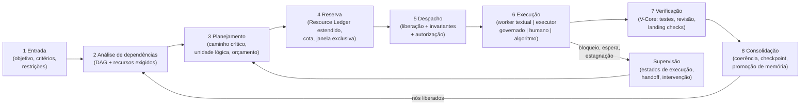
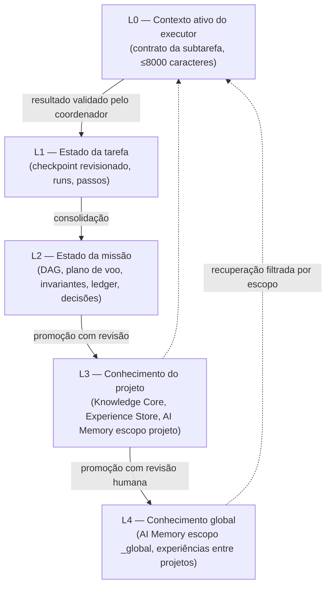
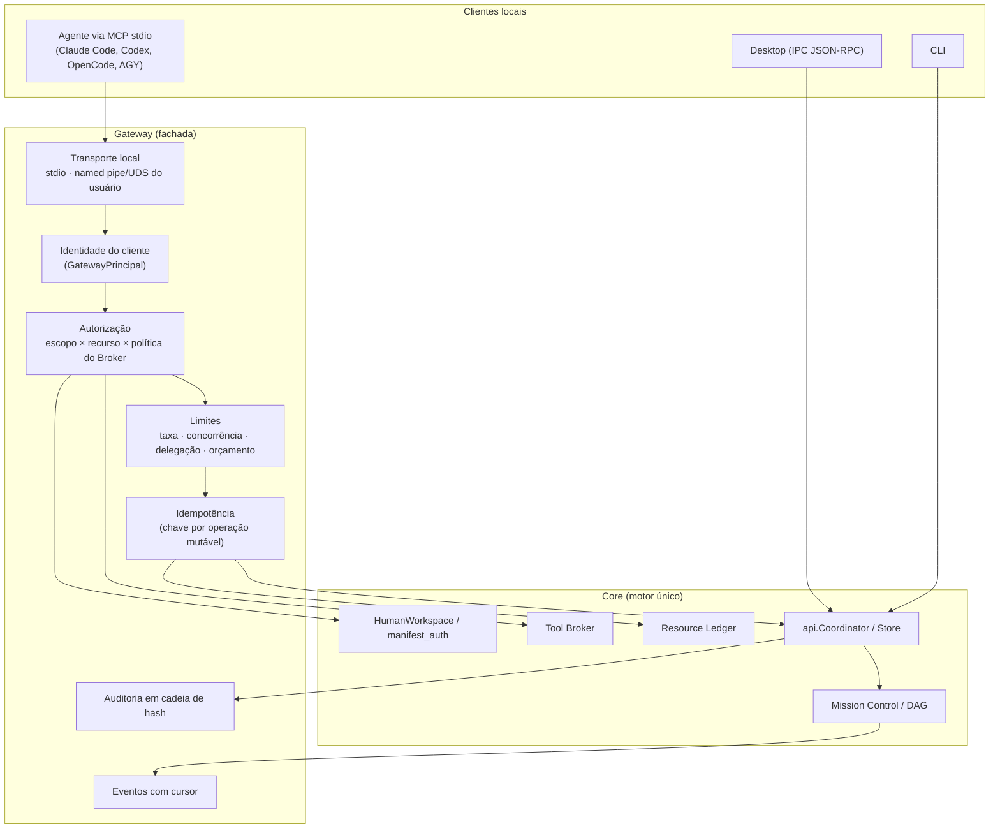
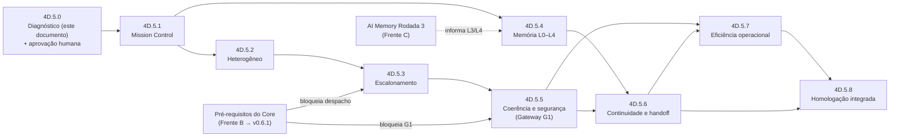

# Fase 4D.5.0: diagnóstico arquitetural e plano integrado da 4D.5

> [!NOTE]
> **Status:** diagnóstico e planejamento. Este documento não implementa nada. O que está descrito como "proposta" ou "a construir" ainda não existe no código.
> **Referência:** `main` em `87509121170f548be58f20f90abd3397b9f94ed5`, Core `v0.6.0`, Desktop `0.6.1-alpha.52` (Pre-Release), Verify da `main` 9/9 (run `45834905135`).
> **Tarefa:** `8c6c0932d1b2431a` (Frente A, missão `4494783d8b3248ce`) e consolidação `65da6d872ca442aa` (Frente D).
> **Data:** 26/11/2026.
> **Normas complementares:** a progressão incremental governada (6 estágios / 5 níveis) e as políticas normativas impeditivas (`B3-03`, `B3-04`, `B3-08`, fencing monotônico, reconciliação pós-spawn, idempotência e recuperação após crash) estão detalhadas em [`phase4d5-0-impeditive-policies.md`](phase4d5-0-impeditive-policies.md). O estudo de caso da missão anterior está em [`phase4d5-0-case-study-tri-front-4494783d8b3248ce.md`](../reports/phase4d5-0-case-study-tri-front-4494783d8b3248ce.md).
> **Prevalência:** em caso de conflito com o corpo do roadmap (`phase4d-roadmap.md`, seção 5), prevalecem os Apêndices H a K e as decisões do operador. A reconciliação está na seção 5.1.

## 0. Escopo, método e convenções

O diagnóstico partiu do código da `main` e não da documentação histórica. Cada afirmação cita `arquivo:linha` do worktree em `8750912`. Os testes citados rodam no workflow `Verify` (`.github/workflows/ci.yml`), que tem 9 jobs: Python 3.11 e 3.14 em Ubuntu, macOS e Windows (6 jobs), mais `desktop-frontend`, `opencode-package` e `release-candidate-artifacts`. O CI não executa `cargo test` do host Tauri (Apêndice I.2).

Classificação usada na matriz A.1:

| Sigla | Significado | Evidência exigida |
|---|---|---|
| **IH** | Implementada e homologada | Código e testes no Verify 9/9, com fechamento de fase registrado em relatório ou checkpoint. Também homologação nativa, quando a fase exigir. |
| **IP** | Implementada parcialmente | Parte do contrato existe, mas faltam partes necessárias ou elas não estão ligadas ao fluxo real. |
| **INH** | Implementada, mas não homologada | Código e testes existem, mas falta a validação exigida pela própria fase (operação real, plataforma nativa ou testes dedicados). |
| **NE** | Necessita evolução | Adequada ao escopo original e insuficiente para a 4D.5. Pode acompanhar IH. |
| **IN** | Inexistente | Nenhum código correspondente. |

"Homologado" não significa "pronto para a 4D.5". A coluna "Para a 4D.5" registra a distância até o que esta fase exige.

---

## 1. A.1: auditoria das capacidades existentes

### 1.1 Matriz de cobertura

| # | Componente | O que existe (código) | Testes que sustentam | Classe | Para a 4D.5 |
|---|---|---|---|---|---|
| 1 | **Coordinator** (Store, tarefas, checkpoints, reservas, rotas) | `Store.new` em `storage.py:1140`, checkpoint com revisão otimista em `storage.py:1194` (recusa revisão desatualizada) e reserva com limite de chamadas em `storage.py:1226`. Execução de workers em `cli.py:161`; plano de rota em `runtime.py:281`; fachada `Coordinator` em `api.py:14`. | `test_core.py` (16), `test_storage_atomicity_and_reconciliation.py` (11), `test_phase4c_stress_and_concurrency.py` (13). Verify 9/9. Uso operacional diário (checkpoints 1 a 121 da tarefa `1210ff494600475c`). | **IH** | **NE.** Os workers são estritamente textuais: entrada de até 8000 caracteres, saída de até 1600 (`routes.example.json` → `limits`) e nenhum acesso a arquivos. Não há executor que altere arquivos sob governança, nem entidade de missão acima das tarefas. Esta missão precisou de uma tarefa-pai manual (`4494783d8b3248ce`) para guardar o grafo. |
| 2 | **Mission Control** (plano de voo, liberação, passos, pouso) | `FlightPlan` em `mission.py:120` e `check_clearance` em `mission.py:262`, que bloqueia por silêncio de rádio, orçamento e desvio. Também `record_step` (`mission.py:303`), `verify_landing` (`mission.py:480`) e a ligação ao checkpoint `complete` em `storage.py:1208`. | `test_mission_control.py` (10), `test_mission_e2e_integration.py` (3). | **IP** | A liberação só é checada na reserva de run (`storage.py:1234`): não há despacho que a consulte. Nas tarefas operacionais o plano de voo é opcional e, na prática, vazio (`flight_plan: null` nas tarefas desta missão). No Desktop, "Missões" é só uma vista planejada (`desktop/src/components/shell/MainNav.tsx:15`, `planned: true`). |
| 3 | **DAG e dependências** | Nós, arestas e revisões em `dag.py:53`, `:103` e `:137`. Validação com detecção de ciclo em `dag.py:313`; conjunto pronto em `get_ready_nodes`, `dag.py:404`. Revisões e propostas de trajetória com fencing de worker ativo em `storage.py:1644`, `:1850` e `:2024`; estado por nó em `storage.py:2223`. | `test_dag_versioning.py` (13), `test_phase3e_integrated_stress_and_fencing.py` (15). | **IH** (modelo) | **NE.** `get_ready_nodes` só é exportado (`storage.py:50`, `__init__.py:96`): nenhum código o consome para despachar. Faltam estimativa de duração e custo por nó, caminho crítico, recursos exigidos por nó e ligação nó↔tarefa/run. |
| 4 | **Trajectory Predictor** | `TrajectoryPredictor` em `trajectory.py:250`, com projeção de orçamento (`:382`), predição (`:520`), deduplicação de alertas (`:177`) e registro (`storage.py:2318`). CLI `trajectory-predict`. | `test_trajectory_predictor.py` (11). | **IH** (offline) | **NE.** As predições não realimentam o escalonamento. A acurácia nunca foi medida em missões reais e as cotas reais (aviso-cota) não entram como insumo. |
| 5 | **Invariant Oracle** | `InvariantOracle` em `invariants.py:218`, com avaliação (`:273`), avaliação por revisão (`:491`), verificadores confiáveis e tokens de evidência (`:73`). Usado pelo Knowledge Core (`knowledge.py:485`). | `test_invariants_and_resource_ledger.py` (14). | **IH** | **NE.** Os invariantes de missão (autoridade humana, exclusividade de recurso, escopo) não são avaliados automaticamente antes de despachar ou consolidar. |
| 6 | **Resource Ledger** | Intenção e confirmação com idempotência em `resource_ledger.py:220` e `:333`. Também reconciliação (`:377`) e compensação (`:450`, `:491`). | `test_invariants_and_resource_ledger.py` (14). | **IH** | **NE.** Modela efeitos colaterais (arquivos, recursos externos), não recursos de execução: janelas exclusivas de disco e CPU, cotas, slots de agente. Esta missão improvisou um lock de arquivo (`missao-tri-frente/heavy_lock.py`) justamente por essa lacuna. |
| 7 | **Tool Broker** | Tokens de capacidade vinculados a tarefa e worker em `tool_broker.py:307`, com emissão, revogação e verificação (`:354`, `:424`, `:439`). Também registro e políticas (`:597`), `execute` com aprovação (`:847`), aprovação por chave de supervisor (`:1091`), mailbox com diretório fixado por handle (`:1103`, `_PinnedDirectory` em `:52`) e consulta de auditoria (`:1467`). | `test_phase4b_tool_broker.py` (12), `test_v051_security_hardening.py` (15), `test_phase4b_adversarial_suite.py`, suíte de validação de handles no candidato `v0.6.1` (9 testes). | **IH** (`v0.6.0` com endurecimento pendente no Windows; tratado em lab `v0.6.1`) | **NE.** O token do broker se vincula ao PID do worker supervisionado (`cli.py:318`): não há identidade de cliente local para o Gateway. **Item `B3-01`:** endurecimento preventivo de contenção e validação de handles no Windows (`B3-01`, patch `v0.6.1`, sob divulgação coordenada). Corrigido localmente em `lab/core-v0.6.1-candidate` (`pytest` completo 1275/4/0), aguardando homologação e publicação do patch `v0.6.1`. |
| 8 | **Experience Store** | `ExperienceStore` em `experience.py:187`, com registro (`:193`), busca (`:283`) e resumo de lições (`:394`). Normaliza o projeto para consultas entre projetos (`:20`). CLI `experience`. | `test_phase3d_adaptive_reconstruction_and_insights.py` (24). | **IH** | **NE.** O registro é manual (CLI ou API): execuções, despachos e handoffs não geram experiência automaticamente. Falta um esquema para as evidências da 4E (seção 4). |
| 9 | **Insight Engine** | `InsightEngine` em `insights.py:185`, com níveis de autonomia `manual`, `contextual` e `proactive` (`insights.py:64`), incubadora (`:263`), exploração e conexão (`:447`, `:557`) e promoção a proposta de trajetória (`:733`). | `test_phase3d_adaptive_reconstruction_and_insights.py` (24). | **IH** | Base para a 4E. Na 4D.5, só como **consumidor de evidências**, com `proactive` desabilitado. |
| 10 | **Supervisão de processos** | Job Objects e encerramento por handle em `process.py:324` e `:475`, grupos e pidfd POSIX em `process.py:596`, `safe_terminate_tree` em `process.py:1052`, `SupervisedProcess` em `process.py:1161`. Máquina de estados dos runs em `storage.py:214`, com reconciliação dono/processo/heartbeat (`storage.py:1441`), cancelamento (`:1374`) e recuperação (`:1571`). Timeout por chamada limitado a 600 s (`cli.py:340`). | `test_process_lifecycle.py` (7), `test_phase4b_process_sandbox.py` (7), `test_phase4d2_governed_pty.py`. Homologação nativa Windows na 4D.2. | **IH** | **NE.** O heartbeat só é gravado no spawn e no fim (`cli.py:293`, `:357`), não durante a execução. O estado `NEEDS_INPUT` existe (`storage.py:223`), mas nenhum código o produz. Não há detecção de estagnação por progresso, nem distinção entre espera legítima, espera por entrada e ociosidade (Apêndice K.3). |
| 11 | **Fallback multimodelo** | O fallback sequencial entre candidatos da rota (`cli.py:182`) é guiado por saúde e cooldown compartilhados (`availability.py:189`, `:474`) e registra cada tentativa. O fallback governado OpenRouter, com cota atômica, contingência e autorização humana, fica em `openrouter/atomic_quota.py` (1630 linhas). | `test_phase4c2_atomic_quota_fallback.py` (12), `test_phase4c2_transport_governance.py` (18), `test_phase4c24_adversarial_recovery.py` (18), `test_v061_failover_transitions.py` (7 no lab `47c9122`). | **IP**, com **defeito confirmado (D1)** na `v0.6.0` (corrigido em lab `47c9122`) | **D1:** na `v0.6.0`, o fallback de rota **aborta** quando o primeiro candidato falha depois do spawn (timeout, erro de cota ou saída vazia). A tentativa seguinte chama `transition_run(..., STARTING)` (`cli.py:204`) com o run ainda em `running`, e `RUNNING → STARTING` não é uma transição permitida (`storage.py:266`). O resultado é um `ValueError` e o run fica `interrupted` sem tentar o segundo candidato (reproduzido no run `0ff7516833314f96`; os 14 runs com fallback concluídos no `coordination.sqlite` são anteriores à `v0.6.0`). **Correção candidata validada em laboratório (`47c9122`):** `Store.begin_worker_attempt` rearma `RUNNING → STARTING` apenas com `pid` e `process_create_time` nulos, validado em 7/7 testes com subprocessos reais sem mock de `_run_worker`; pendente de publicação na `v0.6.1` (runtime central `v0.6.0` permanece sem patch até autorização). O fallback governado OpenRouter está `READY_OFFLINE`, com `OPERATIONAL_VALIDATION_PENDING` (`docs/reports/phase4c26_final_readiness_report.md:10`), e **não está ligado** ao `run_worker`: nenhum `import` de `openrouter` em `cli.py` ou `runtime.py`. |
| 12 | **CLI, IPC, MCP e integrações** | CLI com 30 subcomandos (`cli.py`). O MCP opcional tem 8 ferramentas (`mcp_server.py:11`: bootstrap, listar, criar, retomar, checkpoint, rotas, plano e delegação). O IPC JSON-RPC do Desktop tem 30 métodos registrados (`desktop/ipc/server.py:388-417`), autenticados por token de sessão (`server.py:340`, `:372`), nenhum de missão ou tarefa. Há plugins Claude Code e OpenCode (`plugins/`). | CLI: `test_core.py`, `test_mission_control.py`. IPC: `test_phase4d1_ipc.py` (7), `test_phase4d3_*_ipc*.py`. **MCP: nenhum teste dedicado** (só `test_core.py:225` exercita a fachada `Coordinator`). | CLI e IPC: **IH**. MCP: **INH** | **NE para o Gateway.** O MCP herda a confiança do usuário do SO, sem identidade de cliente, escopo, limite ou auditoria por operação. `delegate_to_worker` consome cota sem orçamento próprio. Não há descoberta de capacidades nem eventos. |
| 13 | **Autorização humana** | Tokens de sessão humana em `human_workspace.py:279` e verificação de principal em `:295`. Aprovações operacionais HMAC com proteção contra replay em `manifest_auth.py:321` e `:449`. Aprovação de ferramenta por chave de supervisor em `tool_broker.py:1091`, override administrativo em `storage.py:412`, autorização de diretórios no Desktop (`desktop/auth/authorizer.py`). | `test_phase4b_human_workspace.py` (48), `test_phase4c2_ed25519_truststore.py` (28), `test_phase4d1_auth.py` (13). | **IH** | **NE.** Não há fila de intervenção por nó de DAG nem suspensão seletiva do ramo dependente (Apêndice H). As aprovações não se vinculam a nós `assigned_role="human"`. |
| 14 | **Sandbox** | `validate_contained_path` em `fs_sandbox.py:196`. AppContainer em `fs_sandbox.py:243`, com zero capabilities (`:326`), Landlock em `:397`, Seatbelt `deny default` em `:562` e orquestração em `ExecutionSandbox` (`:733`). Fica habilitado por padrão (`security.enforce_filesystem_sandbox`, padrão `true`, `cli.py:224`) e é fail-closed no `run_worker` (`cli.py:265`). | `test_phase4b_filesystem_sandbox.py` (10), `test_phase4b_multiplatform_regression.py` (Seatbelt roda em macOS no CI; `docs/test_matrix_and_skips.md:28-30`), `test_security_hardening_h1_h7.py` (9). | **IH** (`v0.6.0` com pendências para 4D.5) | **NE.** Verificação experimental da Frente B: na AppContainer sem capabilities (`CapabilityCount=0`), `curl` interno retornou `HTTP_000` vs `200` externo (`B3-03`); não há taxa de CPU, afinidade, prioridade nem I/O por worker no Job Object (`B3-08`); `WindowsAppContainerController.setup` concede `icacls` `(OI)(CI)RX` recursivo por tentativa com SID novo (~2 min com Python global e ACEs acumuladas, `B3-09`); e `enforce_filesystem_sandbox=false` falha fechado no spawn Windows por ausência de perfil AppContainer (`B3-10`). O endurecimento preventivo `B3-01` está tratado no candidato `v0.6.1` (linha 7). |
| 15 | **AI Memory (integração)** | `AIMemoryAdapter` em `ai_memory_adapter.py:68`, com verificação de autenticação e escopo, timeouts de 3 a 5 s (`:122`, `:238`, `:292`) e `fetch_context` (`:342`). É usado só em `resume_human_project`, com fallback offline (`human_workspace.py:1105`, `:1116`). A tarefa guarda `ai_memory_workstream_id` (`storage.py`). | `test_phase4b_ai_memory_integration.py` (21). | **IP** | Os handoffs reais são feitos pelos harnesses (skills `ai-memory-handoff`), fora do Core, sem vínculo verificável tarefa↔handoff. O serviço continua na `v2.5.2` em produção, e a Rodada 3 de laboratório está na Frente C (tarefa `52e09fb9b0f24a91`). |
| 16 | **Desktop** | Host Tauri (`desktop/src-tauri/src/main.rs`, 3287 linhas), IPC, terminais ConPTY, configurações com cofre, Monitoramento com proveniência e agentes detectados. Vistas em `desktop/src/App.tsx:188`. | Vitest 490/490, `test_phase4d1..4d4_*`. Homologação nativa Windows nos checkpoints 115 e 117; Pre-Release alpha.52 com 5/5 artefatos verificados (checkpoint 121). | **IH** (Windows) | Linux e macOS nativos: **INH** (4D.6). A vista **Missões** não existe (**IN**): é só um placeholder planejado. Não há métodos IPC para missões, DAG ou intervenção. |

**Componentes auxiliares relevantes para a 4D.5:**

- `UnifiedKnowledgeCore` (`knowledge.py:134`) e `KnowledgeLearning` (`knowledge_learning.py:36`) são IH (`test_phase4a_*`, 37 testes). São a base natural do nível L3 (seção 2.6).
- A telemetria cognitiva (`telemetry.py:347`, `:626`, `:899`; `storage.py:2869`) é IH (`test_phase4c_telemetry.py`, 15). Ela já separa a proveniência em `measured`, `estimated` e `unknown` (`telemetry.py:31`).
- A auditoria de workers com cadeia de hash (`worker_audit.py:136`, `:482`) é IH (`test_phase4b_worker_audit.py`, 10) e pode ser reaproveitada pela auditoria do Gateway.

### 1.2 Achados transversais

1. **O Core tem os modelos, mas não o ciclo de controle.** DAG, conjunto pronto, liberação, oráculo, ledger e predição existem e estão testados, mas nenhum laço *ler o estado → escolher o próximo nó → reservar recursos → despachar → verificar → consolidar* os conecta. A 4D.5 deve construir esse laço sobre os componentes existentes, não substituí-los.
2. **Execução versus proposta.** Os workers do Core só devolvem texto. Toda execução com arquivos desta e das missões anteriores foi feita pelo harness (Claude Code, Codex, AGY). O plano trata o "executor com arquivos sob governança" como capacidade nova e sujeita a pré-requisitos de segurança, nunca como extensão silenciosa do worker textual.
3. **Estado compartilhado entre versões.** O runtime central `v0.6.0` e todos os clientes usam o mesmo `D:\ai-memory\coordinator\coordination.sqlite`. Qualquer Core `v0.7.0` de laboratório que aplique migração de esquema nesse arquivo afetaria os quatro clientes. Desenvolvimento e testes da 4D.5 precisam de um `--root` separado, e as migrações precisam ser compatíveis com leitores `v0.6.0` ou ter um gate de promoção explícito.
4. **Sinais de vida pobres.** O heartbeat é gravado no spawn e no fim, e o timeout é por chamada (até 600 s). Isso basta para workers textuais curtos, mas não distingue os estados que o Apêndice K.3 exige. Por isso, a detecção de estagnação depende de telemetria nova de progresso, não só de mudar limiares.
5. **Recursos de execução fora do modelo.** Cotas (aviso-cota), janelas exclusivas de disco e CPU e slots de agente ficam fora do Resource Ledger e do DAG. Nesta própria missão, a arbitragem foi manual: `heavy_lock.py` mais as regras de `MISSAO.md`.
6. **A superfície programática não tem identidade de cliente.** CLI e MCP confiam no usuário do SO, e o Tool Broker vincula tokens ao PID supervisionado. O Gateway precisa de uma identidade nova (cliente, perfil, projeto, missão, prazo) sem criar um segundo modelo de autorização.
7. **A garantia de fallback por cota não vale na `v0.6.0` (D1).** O protocolo operacional (`COORDINATOR.md`, "Fallbacks atravessam clientes/provedores para sobreviver a cota esgotada") depende do fallback pós-spawn, que hoje aborta (linha 11). É a primeira evidência concreta para o item B.3 "identidade e transições das execuções durante failover", candidato natural ao patch `v0.6.1`. O defeito foi descoberto ao usar o próprio Coordinator nesta missão. É o tipo de evidência operacional que a seção 4 pretende sistematizar.

---

## 2. A.2: arquitetura de processamento inteligente

### 2.1 Princípios e invariantes da arquitetura

| ID | Invariante | Origem | Onde é verificado hoje / a verificar |
|---|---|---|---|
| I1 | Autoridade humana: nenhuma operação sensível sem aprovação explícita, e resultado de worker é proposta. | J.4, COORDINATOR.md | `tool_broker.py:847`, `manifest_auth.py:449`. A verificar: nós humanos do DAG. |
| I2 | Motor único: toda governança fica no Core; Desktop, CLI, MCP e Gateway são fachadas. | Roadmap §2 | Revisão de arquitetura e testes de contrato. |
| I3 | Local-first, sem acesso remoto nesta fase. | J.4, 4F | Gateway só via stdio, named pipe ou UDS do usuário. |
| I4 | Fail-closed em sandbox, auditoria e broker. | 4B | `cli.py:265`, `:309`, `:330`. |
| I5 | Checkpoints revisionados: nenhuma sessão sobrescreve outra. | Core | `storage.py:1206`. |
| I6 | Identidade explícita de sessão, projeto, tarefa, agente e perfil, nunca inferida do `cwd`. | I.1.4 | A construir (Gateway, despacho). |
| I7 | Proveniência honesta: `stale`, `estimated` e `unknown` nunca valem como disponibilidade atual. | I.1.5 | `telemetry.py:31`. A estender a cotas e recursos. |
| I8 | Sem efeitos duplicados: reenvio e retomada são idempotentes. | Gate 4D.5 | `resource_ledger.py:39`, `:220`. |
| I9 | AI Memory indisponível nunca bloqueia a retomada mínima. | I.1.3 | `human_workspace.py:1116`. A estender ao handoff. |
| I10 | Segredos nunca em prompts, checkpoints, memória ou eventos. | Core | `telemetry.py:63`, `resource_ledger.py:90`. |
| I11 | Nenhuma interface contorna as permissões do Core. | Instrução 4D.5 | Testes adversariais do Gateway. |
| I12 | Na 4D.5, aprendizado não altera política automaticamente. | J.4, 4E | `InsightEngine` sem `proactive`. |

### 2.2 Pipeline de processamento

A analogia com o processador orienta o desenho e não impõe uma implementação. Os estágios a seguir são estados lógicos de um nó de missão, executados pelo **mesmo Core**:



| Estágio | Componente existente reaproveitado | Lacuna a construir |
|---|---|---|
| 1 Entrada | `FlightPlan` (`mission.py:120`), `PlanNode.entry_criteria` e `exit_criteria` (`dag.py:58`) | Entidade de missão que agrupe tarefas e um plano por missão. |
| 2 Dependências | `validate_dag` (`dag.py:313`), `get_ready_nodes` (`dag.py:404`) | Recursos exigidos por nó (`metadata.resources`), arestas `informs` (não bloqueantes) distintas de `depends_on`. |
| 3 Planejamento | `route_plan` (`runtime.py:281`), `TrajectoryPredictor.project_budget` (`trajectory.py:382`) | Caminho crítico com durações estimadas e seleção de unidade lógica (seção 2.3). |
| 4 Reserva | `Store.reserve` (`storage.py:1226`), `ResourceLedger.record_intent` (`resource_ledger.py:220`) | Recursos de execução: slots, janelas exclusivas, cotas com proveniência. |
| 5 Despacho | `check_clearance` (`mission.py:262`), `InvariantOracle.evaluate` (`invariants.py:273`), `ToolBroker.execute` (`tool_broker.py:847`) | Laço de despacho com idempotência por `(mission, node, attempt)`. |
| 6 Execução | `run_worker` (`cli.py:161`), `SupervisedProcess` (`process.py:1161`), `ExecutionSandbox` (`fs_sandbox.py:733`), HumanWorkspace | Executor governado com arquivos (pós-pré-requisitos) e telemetria de progresso. |
| 7 Verificação | `verify_landing` (`mission.py:480`), oráculo, verificadores confiáveis (`invariants.py:260`) | Verificação independente como nó do DAG (V-Core). |
| 8 Consolidação | `checkpoint` (`storage.py:1194`), `update_node_status` (`storage.py:2223`), Knowledge Core | Detecção de conflito entre ramos e promoção L1→L3 com revisão. |

**Paralelismo e execução fora de ordem:** todo nó do conjunto pronto cujos recursos exclusivos estejam livres é elegível, independentemente da ordem de apresentação. A conclusão fora de ordem é aceita porque a consolidação (estágio 8) só libera dependentes de nós concluídos e verificados. O **pipeline** sobrepõe o estágio 7 de um nó ao estágio 6 de outro quando não há dependência nem recurso exclusivo em comum. Exemplo nesta missão: a redação da Frente A corre em paralelo com as repetições de corrida da Frente B.

**Escalonamento dinâmico:** o Planejamento é reavaliado em quatro eventos: bloqueio, mudança de disponibilidade (cota ou recurso), divergência de progresso (`TrajectoryPredictor`) e conclusão. Mudanças no grafo seguem o fluxo de proposta e aprovação já existente (`propose_trajectory`, `storage.py:1850`; `activate_trajectory_proposal`, `:2024`, com fencing de worker ativo). O escalonador não reescreve o DAG por conta própria.

### 2.3 Unidades lógicas de processamento

São **classes de capacidade** atribuídas a nós, não processos nem serviços novos. Uma mesma pessoa, modelo ou algoritmo pode servir a mais de uma classe em nós diferentes.

| Unidade | Papel | Executores típicos | Critério dominante | Exemplo nesta missão |
|---|---|---|---|---|
| **P-Core** (desempenho) | Raciocínio complexo, nós do caminho crítico | Modelos de alta capacidade (rota `analysis` / `expert`) | Qualidade e evidência | Arquitetura A.2/A.3 |
| **E-Core** (eficiência) | Triagem, extração, resumo e rascunho | Rotas `triage`, `extract` e `summarize` (Flash, OpenRouter `:free`) | Custo e cota | Resumo de logs de benchmark |
| **D-Core** (determinístico) | Operações sem LLM | Testes, `git`, hashing, `validate_dag`, oráculo, scripts | Exatidão e reprodutibilidade | Contagem de testes e SHA-256 |
| **S-Core** (supervisão e segurança) | Aplicar política: sandbox, broker, auditoria, liberação, estados de execução | `fs_sandbox`, `tool_broker`, `mission`, `worker_audit` | Fail-closed | `heavy_lock.py` e liberação |
| **H-Core** (humano) | Decisão, aprovação e homologação nativa | Operador via HumanWorkspace e Desktop | Autoridade | Aprovação das 3 frentes |
| **V-Core** (verificação) | Conferência independente de resultados | Revisor de outro modelo, suíte de testes, landing checks | Independência em relação ao autor | Revisão `run --category analysis` desta frente |

Cada unidade terá um descritor de capacidade a construir na 4D.5.2. O descritor estende `routes.json` e `Health` sem substituí-los:

```text
UnitDescriptor {
  unit_class: P|E|D|S|H|V
  executor_kind: algorithm | textual_worker | governed_executor | human | verifier
  capabilities: [categoria, linguagem, ferramenta]
  cost_model: {unit, value, provenance}
  quota_source: {provider, profile, window, used_pct, reset, provenance, observed_at}
  latency_estimate: {p50, p95, provenance}
  evidence_quality: measured | estimated | unknown
  trust: {can_write_files: bool, sandbox_required: bool, max_delegation_depth: int}
  concurrency_limit: int
}
```

A seleção por nó aplica, nesta ordem, as restrições rígidas (I1 a I12, unidade exigida, recursos) e depois a pontuação: qualidade exigida, custo, cota disponível *medida e não vencida*, latência e qualidade de evidência. Cota `stale` ou `estimated` nunca conta como disponível (I7). A decisão e as alternativas descartadas são gravadas (seção 4).

### 2.4 Escalonador, caminho crítico e arbitragem de recursos

- **Caminho crítico:** cada nó recebe uma duração estimada (`metadata.estimate`), com proveniência (`estimated` até haver histórico, `measured` depois, via Experience Store). O caminho crítico é o caminho mais longo do DAG ponderado e é recalculado a cada evento de replanejamento. Nós críticos têm prioridade na reserva de P-Core e de recursos exclusivos.
- **Arbitragem:** o Resource Ledger ganha **recursos de execução** (`ResourceType` novo, `resource_ledger.py:65`):
  - `exclusive_window` (disco, CPU, porta);
  - `agent_slot` (por cliente e perfil);
  - `quota_budget` (por janela de cota).

  A reserva é atômica na mesma transação SQLite do `reserve` (`storage.py:1226`), tem prazo (lease) vinculado a `holder_pid + process_create_time_ns`, emite `fencing_token` monotônico verificado até o efeito colateral e nunca autoriza *stale takeover* por relógio se o detentor real estiver vivo. Isso generaliza o `heavy_lock.py` (e o modelo `heavy_lock_v2.py`) com posse atômica, fila FIFO priorizada com folga garantida para SO/usuário e *backpressure* por pressão de host, conforme especificado na Política `B3-08` e na seção 6 de [`phase4d5-0-impeditive-policies.md`](phase4d5-0-impeditive-policies.md).
- **Fora de ordem com segurança:** um nó só é despachado se (a) todas as arestas `depends_on` estão `completed` e verificadas, (b) seus recursos exclusivos foram reservados, (c) `check_clearance` passa e (d) os invariantes do nó estão verdes. Arestas `informs` não bloqueiam e só anexam contexto quando disponível.
- **Pipeline com preempção mínima:** a 4D.5 não interrompe execução em andamento para reatribuir. Só reordena a fila de elegíveis. A preempção fica para avaliação na 4E.

### 2.5 Coerência e consolidação de resultados

1. **Escopo de escrita por nó:** cada nó declara `allowed_paths` (mecanismo existente em `mission.py:64`). Dois nós com escopos de escrita sobrepostos não podem rodar em paralelo. A regra vira uma restrição de recurso exclusivo derivada automaticamente.
2. **Isolamento físico:** ramos paralelos que alteram o mesmo repositório usam worktree e branch próprios, como nesta missão. A consolidação é um nó explícito, com merge e testes (D-Core) e revisão (V-Core).
3. **Conflito semântico:** se dois ramos produzem conclusões contraditórias sobre o mesmo fato, a consolidação não escolhe sozinha. Ela abre um item no HumanWorkspace (H-Core) com as duas evidências. Exemplo real: a conclusão "sem escrita fora da sandbox" do K.3.7 contra a correção técnica posterior sobre as 5 falhas do `test_14`.
4. **Checkpoint como ponto de consolidação:** só o resultado consolidado e verificado vai para o checkpoint da missão. As saídas de workers ficam em `tasks/ID/runs/` como evidência bruta.

### 2.6 Hierarquia lógica de memória L0–L4



| Nível | Escopo | Autoridade de escrita | Retenção | Recuperação | Promoção | Invalidação | Armazenamento |
|---|---|---|---|---|---|---|---|
| L0 | Uma execução | Nenhuma (efêmero) | Fim da execução | Montado pelo coordenador | Para L1 só após revisão | Descartado | Prompt e arquivo de entrada do run |
| L1 | Uma tarefa | Coordenador da tarefa (revisão otimista) | Vida da tarefa | `resume` | Para L2 na consolidação | Nova revisão | `coordination.sqlite` (tarefas, runs) |
| L2 | Uma missão | Coordenador da missão; nós humanos para decisões | Vida da missão mais o arquivo | `dag-revision --show` e flight plan | Para L3 com revisão (V-Core ou humana) | Revisão de DAG ou proposta aprovada | `coordination.sqlite` (revisões, ledger, invariantes) |
| L3 | Um projeto | Knowledge Core com estados e evidência | Até ser substituído | `find`, `memory_query` com escopo exato | Para L4 só com revisão humana | `supersede` e revisões de página | Knowledge Core e AI Memory (projeto) |
| L4 | Todos os projetos | Operador | Longa | `memory_query global=true` | — | Revisão humana | AI Memory `_global` |

Regras de coerência: escrita sempre para cima e só por promoção revisada; leitura para baixo filtrada por escopo (I6); toda recuperação de L3/L4 é tratada como **dado não confiável**, como já exige o contrato do ai-memory. L1 e L2 são autossuficientes. Se o AI Memory não responder em 3 a 5 s (`ai_memory_adapter.py:292`), a retomada segue só com L1 e L2 (I9).

### 2.7 Estados de execução e detecção de estagnação

A proposta estende a máquina existente (`storage.py:214`) com **subestados de observação** para runs `running`. Os subestados não substituem os estados de ciclo de vida e são produzidos pela supervisão a partir de sinais medidos:

| Subestado | Definição | Sinais (medidos) | Ação padrão |
|---|---|---|---|
| `productive` | Há progresso dentro da janela | Bytes novos de stdout/stderr, mtime no sandbox, heartbeat com contador de progresso, CPU crescente com saída | Nenhuma |
| `waiting_declared` | Espera legítima com motivo e prazo | O executor declarou `wait(reason, deadline)`, por exemplo CI externo | Nenhuma até o prazo, depois `stalled` |
| `waiting_input` | Bloqueado por entrada interativa | Padrões de prompt na saída (`Username for`, `Password:`, `[y/N]`), processo auxiliar de credencial (GCM) filho, stdin aberto num comando declarado não interativo | Transição para o `NEEDS_INPUT` existente e pedido de intervenção (H-Core). Nunca responder automaticamente. |
| `idle` | Vivo, sem CPU, I/O nem espera declarada | CPU e I/O sem variação acima do limiar | Notificar. Liberar o slot se a política da tarefa permitir. |
| `stalled` | Sem progresso além do limiar, com ou sem CPU | Nenhum sinal de progresso além do limiar, ou espera declarada vencida | Notificar e propor cancelamento. Cancelar automaticamente só se o comando foi declarado não interativo e passou do timeout. |

Cada classificação registra o sinal e a proveniência. "Inferido por padrão de texto" é `estimated`, nunca `measured`. O caso real da tarefa presa de 18:07:44 (`git credential fill` aguardando o GCM, Apêndice K.3) seria classificado como `waiting_input` pela combinação "comando não interativo + GCM filho + nenhuma saída".

**Prevenção antes da detecção:** comandos automatizados recebem `GIT_TERMINAL_PROMPT=0`, `GCM_INTERACTIVE=never`, stdin fechado e timeout explícito. Hoje o Core aplica só parte disso aos workers textuais: ambiente por allowlist (`runtime.py:33`), stdin em `DEVNULL` quando não há entrada (`cli.py:271`) e timeout por chamada (`cli.py:340`). As variáveis de Git e GCM **não** são definidas pelo Core. Esse conjunto completo precisa virar contrato do executor governado e do harness.

### 2.8 Supervisão de agentes, cotas, handoff e notificações

- **Registro de agentes e subagentes:** cada agente despachado (worker textual, executor governado ou harness externo) recebe a identidade `(mission, task, node, agent, profile, parent_agent)`, um prazo e um orçamento. Ao fim da subtarefa, o slot é liberado e o agente encerrado (K.3.4). Agentes sem nó ativo são `idle` e entram na política de liberação.
- **Previsão de consumo de cota:** a predição de consumo até a conclusão combina a duração e os tokens estimados dos nós restantes do caminho crítico (Experience Store) com a leitura atual de cota do perfil (`state/cota/leitura-*.json`, com idade da leitura). Se a janela restante não comporta o trabalho com margem, o escalonador prefere outro perfil ou cliente, ou agenda o **handoff preventivo** antes do nó.
- **Handoff preventivo:** passa a ser um nó do DAG. Ele grava o checkpoint completo, com invariantes, critérios e pendências numeradas (I.1.6), abre o handoff no AI Memory (opcional, I9) e entrega o comando de retomada. A eficiência do handoff (tempo até retomar, perda de contexto, retrabalho) é medida (seção 4).
- **Notificações reativas de baixo custo:** uma tabela de eventos append-only com cursor substitui as consultas repetidas. O consumidor bloqueia num `wait(cursor, timeout)` em vez de fazer polling com LLM. O caso real que isso evita: o coordenador AGY consumiu de 90% a 97,2% da cota semanal consultando status durante uma delegação (registrado no relato do operador).

### 2.9 Recuperação de falhas e intervenção humana seletiva

- **Recuperação:** a retomada de missão reconstrói o conjunto pronto a partir de L2 e reconcilia os runs ativos (`storage.py:1441`) validando `(PID, create_time_ns)`, revogando tokens e reconciliando intenções antes de qualquer retry pós-spawn (`phase4d5-0-impeditive-policies.md` §6). Nós `completed` e verificados nunca são reexecutados (`I8`). Efeitos parciais são reconciliados pelo Resource Ledger (`resource_ledger.py:377`, compensação em `:450`) sob idempotência estrita. Arquivos zerados ou truncados (Apêndice I.1.2) são tratados por escrita temporária mais `fsync` mais troca atômica nos escritores novos.
- **Intervenção seletiva (Apêndice H):** um nó que solicita decisão humana suspende só a si mesmo e seus dependentes transitivos. O restante do conjunto pronto continua. A retomada exige confirmação explícita, revalidação dos invariantes do nó e aprovação vinculada ao nó, reaproveitando `HumanOperationalApproval` (`manifest_auth.py:246`) e o inbox do HumanWorkspace (`human_workspace.py:444`). O cancelamento seguro marca o ramo como `skipped` com justificativa, sem apagar o histórico.

---

## 3. A.3: AI Coordinator Gateway

### 3.1 Princípio

O Gateway é **mais uma fachada** sobre `api.Coordinator` e `Store`, como o CLI, o MCP e o IPC do Desktop (I2, I11). Ele não tem regras próprias de autorização: reaproveita o Tool Broker (políticas, aprovação, limites), o HumanWorkspace e o manifest_auth (autoridade humana), o Resource Ledger (idempotência) e a auditoria em cadeia de hash do `worker_audit`. É local-first: stdio (MCP atual) e, opcionalmente, named pipe ou UDS restritos ao usuário. **Sem TCP remoto** nesta fase.



### 3.2 Identidade, credenciais e revogação

- `GatewayPrincipal = {client_id, agent, launcher_profile, session_id, project, mission_id?, scopes[], expires_at, issued_by}`. Diferente do token do broker, ele **não** se vincula a PID: o cliente é um agente interativo que não é filho supervisionado do Core. Por isso, a revogação e o prazo curto substituem o vínculo de processo.
- A credencial é emitida pelo operador (Desktop ou CLI com sessão humana, `human_workspace.py:279`), é individual por cliente e perfil, vinculada a projeto e, opcionalmente, missão, e tem prazo. É um token assinado por HMAC, no mesmo formato dos tokens de capacidade do broker (`tool_broker.py:354-422`: o banco guarda só metadados, nonce, `max_calls` e revogação, nunca o token). Entra no ambiente do agente lançado pelo launcher (`Start-AI.ps1`), nunca num arquivo do projeto.
- A revogação é imediata (lista consultada a cada operação, como `CapabilityTokenManager.revoke_token`, `tool_broker.py:424`), e a expiração é curta por padrão.
- A identidade é declarada e verificada: `project` deve coincidir com o marcador `.ai-memory.toml` e a identidade física do diretório (correção do launcher da Frente B, `7fae072`). Projeto inferido do `cwd` é recusado (I6).

### 3.3 Escopos e operações

| Grupo | Operações (propostas) | Escopo mínimo | Política padrão |
|---|---|---|---|
| Descoberta | `capabilities`, `version`, `contracts` | — | allow |
| Consulta | `missions.list/get`, `tasks.get`, `dag.get`, `dag.ready`, `resources.status`, `quota.status` (com proveniência e idade) | `read:project` | allow |
| Continuidade | `checkpoint.save` (revisão otimista), `handoff.prepare` | `write:task` | allow, restrito à própria tarefa |
| Subtarefas | `subtask.create`, `subtask.status` | `request:subtask` | allow dentro do orçamento e da profundidade de delegação |
| Agentes | `agent.request` (unidade lógica e requisitos) | `request:agent` | approval quando consome cota de outro perfil |
| Execução | `dispatch.request` (nó pronto → run governado) | `request:dispatch` | approval para executor com arquivos; worker textual dentro do orçamento |
| Humano | `human.request_intervention`, `human.status` | `request:human` | allow (cria item no inbox) |
| Eventos | `events.wait(cursor, timeout)` | `read:project` | allow |
| Controle | `subtask.cancel`, `credential.revoke` (só humano) | `admin` humano | approval |

As 8 ferramentas MCP existentes viram operações dos grupos Consulta, Continuidade e Subtarefas. `delegate_to_worker` passa a exigir `request:subtask` e a debitar o orçamento da tarefa (`worker_calls_per_task`). **Execução arbitrária de comandos não existe no Gateway** (J.4): `dispatch.request` só aceita nós de DAG existentes e executores registrados.

### 3.4 Limites, idempotência e auditoria

- **Limites:**
  - taxa por principal, reaproveitando `BrokerRateLimitExceededError` (`tool_broker.py:209`);
  - concorrência por principal e por missão;
  - **profundidade de delegação** padrão 1 (um agente lançado pelo Gateway não lança outro sem aprovação);
  - orçamento de missão (`FlightBudget`, `mission.py:89`).
- **Idempotência:** toda operação que altera estado exige `idempotency_key`. Repetir com a mesma chave devolve o resultado original. Repetir com a mesma chave e conteúdo diferente gera `IdempotencyError` (`resource_ledger.py:39`).
- **Auditoria:** registro canônico com hash encadeado por operação (principal, operação, escopo, decisão, resultado e latência), reaproveitando `compute_canonical_record_hash` (`worker_audit.py:79`) e a sanitização (`worker_audit.py:118`). Nenhum segredo entra no registro.

### 3.5 Progressão incremental (6 estágios / 5 níveis) e fases do Gateway dentro da 4D.5

A entrega da `4D.5` segue a **progressão incremental governada em 6 estágios / 5 níveis** definida normativamente em [`phase4d5-0-impeditive-policies.md`](phase4d5-0-impeditive-policies.md) (§2): (1) Mission Control + DAG consultivo (`4D.5.1`) → (2) Gateway local somente leitura `G0` (`4D.5.1`) → (3) Workers textuais governados (`4D.5.2`) → (4) Execução com arquivos após fechamento integral dos pré-requisitos (`G1`/`G2`/`G3`) → (5) Escalonamento adaptativo e paralelismo governado (`4D.5.3`, `4D.5.5`–`4D.5.7`) → (6) Evidências para o Meta-Coordinator `4E` (`4D.5.8`).

| Fase | Conteúdo | Subetapa | Pré-requisito |
|---|---|---|---|
| G0 | Consulta e descoberta somente leitura sobre o MCP atual, mais suíte dedicada do MCP cobrindo as 8 ferramentas (contratos, leitura, erro e recusa de escrita fora de escopo) | 4D.5.1 | Estágio 1 (DAG consultivo) |
| G1 | `GatewayPrincipal`, escopos, limites, idempotência, ACL/autenticação de par no pipe/UDS e auditoria; subtarefas e checkpoint | 4D.5.5 | `B3-01`, `B3-02`, `B3-15`, `B3-04` (aprovação humana autenticada e vinculada a hash na camada `Store`) e `P9` (suíte G0 aprovada) |
| G2 | Eventos com cursor, `human.request_intervention`, `handoff.prepare` | 4D.5.6 | G1 |
| G3 | `dispatch.request` para executor governado com arquivos | 4D.5.8 *(ou posterior)* | G2, `B3-03` (deny-by-default + proxy loopback autenticado), `B3-04`, `B3-08` (arbitragem CPU/RAM/I/O), `B3-09`, fencing monotônico até o efeito colateral e aprovação explícita do operador |

> [!NOTE]
> **Simplificação registrada após revisão independente (`ae9ec9679ffa49cd`):** caso algum impeditivo de `B3-03`, `B3-04`, `B3-08` ou `B3-09` permaneça aberto na decisão do operador, a `4D.5` pode ser entregue em escopo reduzido seguro (Estágios 1–3: DAG consultivo + Gateway `G0` somente leitura + workers textuais governados), adiando `G1`–`G3` e a execução governada com arquivos sem comprometer aprovação, fencing ou isolamento.

O acesso remoto, inclusive em loopback TCP, fica para a 4F.

---

## 4. A.4: evidências para o Meta-Coordinator (4E)

A 4D.5 **registra**, e a 4E **aprende**. Nenhum dado desta seção altera política na 4D.5 (I12).

### 4.1 Registro de decisão de execução

O registro é gravado como `CognitiveTelemetryRecord` (`telemetry.py:347`) mais `ExperienceRecord` (`experience.py:90`), ligados a `trajectory_events` (`storage.py:2291`). Esquema proposto:

```text
ExecutionDecisionRecord {
  ids: {mission, task, node, run?, decision_id}
  decided_by: coordinator | harness | human          # separa as três origens
  decision_type: route_select | schedule | parallelize | defer | reserve |
                 handoff | retry | escalate | cancel | consolidate
  inputs: {ready_set, critical_path, quota_snapshot[{profile, used_pct, age_s, provenance}],
           resource_state, predicted_duration{value, provenance}}
  alternatives: [{option, score, rejected_reason}]
  chosen: option
  outcome: {
    wall_time_s, cpu_s, ram_peak_mb, disk_io_mb,              # medidos
    tokens_in, tokens_out, cost_usd, quota_delta_pct,          # com proveniência
    failures, retries, rework_minutes, human_interventions{count, minutes},
    quality{tests_passed, review_findings, acceptance_met},
    handoff{time_to_resume_s, context_loss_items, repeated_steps}
  }
  observations: {unit_class, executor, capability_limits_observed[]}
}
```

### 4.2 O que coletar, de onde e como

| Evidência | Fonte | Proveniência | Reuso |
|---|---|---|---|
| Estratégia de execução | Revisões de DAG e decisões | measured | `storage.py:1644` |
| Decisões de escalonamento | `ExecutionDecisionRecord` | measured | Nova tabela ou telemetria |
| Qualidade dos resultados | Testes, landing checks, achados de revisão | measured | `mission.py:417` |
| Tempo | Início e fim por nó e run | measured | `runs`, `trajectory_events` |
| Tokens e custo | `runtime.usage` (`runtime.py:147`) e cabeçalhos | measured/estimated/unknown | `telemetry.py:192` |
| Cotas | Leituras do aviso-cota com idade | measured, com `age_s` | Fonte externa ao Core |
| Hardware | `sysinfo` do Desktop e árvore de processos | measured | 4D.4 (`desktop/ipc/collector.py`) |
| Falhas e retrabalho | Estados de run, tentativas e reaberturas | measured | `storage.py:1308` |
| Intervenções humanas | HumanWorkspace | measured | `human_workspace.py:707` |
| Eficiência de handoff | Nó de handoff mais retomada | measured | Novo |
| Capacidades e limitações | Observações por unidade e modelo | estimated (julgamento) | `ExperienceCategory` |

A coleta é obrigatória nos nós despachados pelo Mission Control e opcional, via `experience` na CLI, no trabalho do harness. Para ganho de paralelismo, a comparação só vale contra uma **referência sequencial equivalente** (J.2). Esta missão já registra as métricas por frente em `missao-tri-frente/metrics-*.json`, como primeiro conjunto manual.

---

## 5. A.5: plano de implementação da 4D.5

### 5.1 Reconciliação com o corpo do roadmap

O corpo do roadmap (seção 5, Marco 4D.5) definiu cinco subetapas. A numeração aprovada pelo operador em 26/11/2026 tem oito. O mapeamento preserva todo o conteúdo original:

| Subetapa original | Destino na numeração aprovada |
|---|---|
| 4D.5.1 Visualizador interativo da DAG | 4D.5.1 Mission Control (vista Missões) |
| 4D.5.2 Painel de tarefas humanas | 4D.5.1 (leitura) e 4D.5.6 (intervenção seletiva, Apêndice H) |
| 4D.5.3 Checkpoints duráveis e retomada segura | 4D.5.6 Continuidade e handoff |
| 4D.5.4 Pesquisa recorrente supervisionada | 4D.5.3 (nó iterativo com critério de parada e orçamento) |
| 4D.5.5 Resumo de aterrissagem cognitiva | 4D.5.6 |
| Gate 4D.5 original (3 critérios) | Incorporado ao 4D.5.8 |

### 5.2 Subetapas

Cada subetapa segue o template obrigatório de 7 critérios da seção 4 do roadmap. Os critérios objetivos estão na tabela 5.6.

| Subetapa | Conteúdo | Componentes reaproveitados | Novo |
|---|---|---|---|
| **4D.5.1 Mission Control** | Entidade de missão (missão → tarefas → nós), DAG por missão, conjunto pronto em **modo consultivo** (o Coordinator propõe e o harness ou humano executa), vista **Missões** somente leitura no Desktop, IPC de leitura, Gateway G0 e testes dedicados do MCP | `dag.py`, `mission.py`, `storage.py`, `mcp_server.py`, IPC | Tabela de missão, métodos IPC `mission.*` de leitura, vista React |
| **4D.5.2 Processamento heterogêneo** | `UnitDescriptor`, classes P/E/D/S/H/V, seleção por restrições e pontuação, cota com proveniência e idade | `routes.json`, `Health`, `route_plan` | Descritor, registro de decisões |
| **4D.5.3 Escalonamento adaptativo** | Caminho crítico, recursos de execução no Ledger (lease), despacho fora de ordem, pipeline, replanejamento por evento, previsão de cota, nó iterativo supervisionado | `ResourceLedger`, `check_clearance`, `InvariantOracle`, `TrajectoryPredictor`, propostas de DAG | Laço de despacho, recursos de execução |
| **4D.5.4 Memória hierárquica** | Contratos L0–L4, promoção e invalidação, recuperação filtrada por escopo, degradação sem AI Memory | Knowledge Core, `AIMemoryAdapter`, checkpoints | Política de promoção e testes de degradação |
| **4D.5.5 Coerência e segurança** | Escopos de escrita por nó, conflito entre ramos, consolidação como nó, Gateway G1 (identidade, escopo, limites, idempotência, auditoria), invariantes avaliados no despacho | `allowed_paths`, Tool Broker, `worker_audit`, manifest_auth | `GatewayPrincipal`, auditoria do Gateway |
| **4D.5.6 Continuidade e handoff** | Handoff preventivo como nó, checkpoint completo (I.1.6), intervenção humana seletiva (Apêndice H), retomada sem reexecução, aterrissagem cognitiva, Gateway G2 | HumanWorkspace, `focus` checkpoints, Ledger | Nó de handoff e eventos com cursor |
| **4D.5.7 Eficiência operacional** | Subestados de execução, detecção de estagnação e de espera por entrada, timeouts e modo não interativo como contrato, supervisão e liberação de agentes ociosos, notificações reativas | `storage.py:214`, `reconcile`, `process.py`, `streaming.py` | Telemetria de progresso, produtor de `NEEDS_INPUT` |
| **4D.5.8 Homologação integrada** | Missões ponta a ponta, CI 9/9 mais `cargo test`, homologação nativa Windows, benchmark contra referência sequencial, revisão de segurança do Gateway, critérios do Gate 4D.5 original | Verify, `synthetic_benchmark.py`, `benchmark` | Missões de referência |

### 5.3 Grafo de dependências e caminho crítico



**Caminho crítico:** aprovação de 4D.5.0 → 4D.5.1 → 4D.5.2 → 4D.5.3 (que espera os pré-requisitos do Core) → 4D.5.5 → 4D.5.7 → 4D.5.8. A 4D.5.4 e a 4D.5.6 podem correr em paralelo ao trecho 4D.5.2 a 4D.5.5, desde que tenham worktree próprio. A Rodada 3 do AI Memory informa a 4D.5.4, mas não a bloqueia: L3 e L4 podem ser desenhados sobre o contrato da `v2.5.2`, com degradação. A 4D.5.1 **não depende** da Frente B, porque é somente leitura e consultiva.

### 5.4 Riscos

| ID | Risco | Probabilidade/impacto | Mitigação |
|---|---|---|---|
| R1 | Core de desenvolvimento migrar o `coordination.sqlite` compartilhado e quebrar os 4 clientes `v0.6.0` | Média/alto | `--root` separado em todo o desenvolvimento, migrações compatíveis com leitores `v0.6.0`, gate de promoção com backup. |
| R2 | Automação contornar a autoridade humana | Baixa/crítico | I1 e I11 verificados por testes adversariais; despacho com arquivos só após P5 e aprovação. |
| R3 | Previsão de cota errar e interromper no meio | Alta/médio | Leituras com idade, margem conservadora, handoff preventivo como nó. |
| R4 | Falso positivo de estagnação cancelar trabalho útil | Média/médio | Cancelamento automático só para comandos não interativos acima do timeout; nos demais casos, notificação e pedido humano. |
| R5 | O Gateway virar superfície de ataque local (processo do mesmo usuário) | Média/alto | Credencial individual, escopo, prazo, revogação, profundidade de delegação, auditoria, testes adversariais. |
| R6 | Escopo da 4E vazar para a 4D.5 | Média/médio | I12 e `proactive` desabilitado; registro sem ação. |
| R7 | Contratos Desktop/Core divergirem | Média/médio | O IPC só chama `api`/`Store`; há testes de contrato. |
| R8 | Lacunas Linux/macOS | Alta/médio | O Verify cobre o Core; o Desktop nativo fica para a 4D.6. |
| R9 | Latência ou indisponibilidade do AI Memory | Alta/baixo | I9, timeouts curtos, L1/L2 autossuficientes. |
| R10 | Evidência estimada apresentada como medida | Média/alto | Proveniência obrigatória em todo registro (I7). |
| R11 | Endurecimento preventivo de contenção e validação de handles no Windows (`B3-01`, patch `v0.6.1`, sob divulgação coordenada) | Alta/crítico | `B3-01` (tratado em lab `v0.6.1`) bloqueia G1 e despacho (4D.5.3, 4D.5.5); priorizar homologação do patch `v0.6.1` sob divulgação coordenada antes de abrir funcionalidades novas. |
| R12 | Escalonador apoiado em fallback que aborta (D1) e caminhos de falha sem teste real | Alta/alto | `B3-02` (`47c9122` em lab). Exigir, em toda subetapa, testes de integração com subprocessos reais nos caminhos de falha, além dos mocks. |

### 5.5 Pré-requisitos do Core (classificação integrada da Frente B, `b3-classificacao.json`)

> [!NOTE]
> Classificação definitiva de **16 itens** pela Frente B (`e5dd9201b45341aa`, `b3-classificacao.json`), integrada aos pré-requisitos arquiteturais `P8`–`P10` da Frente A. Onde um item possui dupla classificação, ambas estão explícitas.

#### Classe 1 — `patch_v0.6.1` (prioridade imediata; sem migração de esquema)

| ID | Área | Achado e evidência | Estado no candidato `lab/core-v0.6.1-candidate` | Impacto na 4D.5 |
|---|---|---|---|---|
| **B3-01** *(ex-P1)* | Sandbox / mailbox | Endurecimento preventivo de contenção e validação de handles no Windows (`B3-01`, patch `v0.6.1`, sob divulgação coordenada). | **Corrigido em lab** (candidato `v0.6.1`, suíte de contenção e `pytest` 1275/4/0); aguarda publicação. | Também **`impeditivo_4D.5_governada`**: bloqueia G1 e despacho (`4D.5.3`, `4D.5.5`). |
| **B3-02** *(ex-P6 / D1)* | Failover | `RUNNING → STARTING` inválido após falha pós-spawn aborta fallback entre candidatos (`cli.py:204`, `storage.py:266`, `pytest-failover-*`). | **Corrigido em lab** (`47c9122`: `Store.begin_worker_attempt` com `pid`/`process_create_time` nulos; 7/7 reais); aguarda publicação. | Também **`impeditivo_4D.5_governada`**: bloqueia fallback por cota e escalonador (`4D.5.3`). |
| **B3-15** *(ex-P2)* | Identidade do launcher | `7fae072` valida pertencimento por volume + file id (`samefile`). Ressalva: `st_ino == 0` em shares de rede iguala diretórios; substituição de diretório registrado pós-registro exige escrita no pai. | **Correção principal em lab** (`fa51228`, 5/5 testes); ressalva `st_ino == 0` recomendada, não implementada. | Base para identidade de projeto no despacho e no Gateway. |
| **B3-07** | Roteamento | `routes.json` lista `agy` (1º candidato de `code`), mas o contrato recusa `agy` como `worker_headless` e a tentativa consome `attempts_per_run`. | **Não implementado**; correção pequena (marcar como `skipped` antes de contar tentativa ou ajustar `routes.json`). | Reduz profundidade efetiva do fallback enquanto não corrigido. |

#### Classe 2 — `impeditivo_4D.5_governada` (bloqueia 4D.5.3, paralelismo e Gateway G1–G3; não bloqueia 4D.5.1 consultiva; normas em [`phase4d5-0-impeditive-policies.md`](phase4d5-0-impeditive-policies.md))

| ID | Área | Achado / Pré-requisito | Estado e encaminhamento | Bloqueia |
|---|---|---|---|---|
| **B3-03** *(ex-P4)* | Rede / sandbox | AppContainer criada com `CapabilityCount=0` (`curl` interno `HTTP_000` vs externo `200`; run `0ff7516833314f96` falhou com timeout de refresh de modelos no `codex`, embora haja runs `codex` concluídos até 13:31Z de 26/11 sem causa isolada). | **Política normativa definida (`phase4d5-0-impeditive-policies.md` §3); não implementado.** `deny-by-default`, autorização explícita por cliente/missão e proxy loopback autenticado por run; proibida rede irrestrita como atalho. | Executor governado com arquivos (`G3`), `4D.5.3`. |
| **B3-04** *(ex-P5)* | Autorização humana | `dag-proposal --resolve approved` não autentica o principal: qualquer chamador com CLI aprova a própria proposta; `activate_trajectory_proposal` só checa status `approved`. | **Política normativa definida (`phase4d5-0-impeditive-policies.md` §4); não implementado (`v0.7.0`).** Identidade verificável vinculada a operação, missão, projeto, finalidade e hash do conteúdo, com expiração, revogação, anti-replay e aplicação obrigatória na camada `Store`. | Despacho de operações sensíveis, `G1`/`G3`, `4D.5.5`. |
| **B3-08** *(ex-P3)* | Limites de recursos | Job Object limita memória, processos e tempo de CPU (`ResourceLimits` sem padrão em `routes.example.json`), mas não controla taxa de CPU, afinidade, prioridade nem I/O por worker (restrição `0xC`/`BelowNormal` foi manual). | **Política normativa definida (`phase4d5-0-impeditive-policies.md` §5); não implementado.** Folga garantida para SO/usuário, limites configuráveis, prioridade com precedência de segurança, concorrência, *backpressure*, fila FIFO priorizada e janelas exclusivas. | Despacho paralelo autônomo (`4D.5.3`). |
| **B3-09** | Sandbox / desempenho | `WindowsAppContainerController.setup` concede `icacls (OI)(CI)RX` recursivo ao Python e pais de argumentos com SID novo por run e sem remoção (~2 min/tentativa com Python global e ACEs acumuladas). | **Não corrigido.** Reutilizar perfil/SID AppContainer por cliente e conceder uma vez. *(Também `estabilizacao_nao_impeditiva`.)* | Escala e paralelismo (`4D.5.3`). |
| **P8** | Esquema compartilhado | Runtime central `v0.6.0` e clientes compartilham `coordination.sqlite` (`storage.py:609`, `:935`). | **Arquitetural (Frente A).** Desenvolvimento em `--root` separado e migrações compatíveis com leitores `v0.6.0` (R1). | Qualquer `v0.7.0` em estado compartilhado. |
| **P9** | MCP | `mcp_server.py` (8 ferramentas) sem testes dedicados. | **Arquitetural (Frente A).** Criar suíte dedicada em `G0` (`4D.5.1`). | `G1` (`4D.5.5`). |
| **P10** | Telemetria de execução | Heartbeat gravado apenas no spawn e no fim (`cli.py:293`, `:357`). | **Arquitetural (Frente A).** Heartbeat periódico com contador de progresso. | `4D.5.7`. |

#### Classe 3 — `v0.7.0` (evoluções estruturais nas subetapas da 4D.5)

| ID | Área | Achado e destino na 4D.5 |
|---|---|---|
| **B3-05** | Máquina de estados | `transition_run(expected_status=...)` ignora `VALID_STATUS_TRANSITIONS` (`begin_worker_attempt` usa de forma guardada) → corrigir na `4D.5.3`/`4D.5.7`. |
| **B3-06** | Failover | Cancelamento durante tentativa faz `begin_worker_attempt` falhar (`cancel_requested -> starting`) e termina em `INTERRUPTED` via `update_run` sem confirmar cancelamento (seguro, registro impreciso) → `4D.5.7`. |
| **B3-12** | Despacho de agentes | Listas de argumentos, contratos e allowlist adequados para workers textuais; despacho autônomo depende de `B3-03`, `B3-04` e `B3-08` → `4D.5.3`/`4D.5.5`. |
| **B3-14** *(ex-P7)* | Tamanho de checkpoints | Teto de 12.000 caracteres totais (resumo/próximo passo 5.000; listas 40×1.500), pressionado pelo protocolo de fim de cota (observado na Frente C rev 9) → anexos/referências estruturadas por missão na `4D.5.6`. |
| **B3-16** | Integração AI Memory | Workers têm MCP `ai-memory` desabilitado (`worker_mcp_disable_names`); tarefa guarda apenas `ai_memory_workstream_id`; sem contrato tarefa↔handoff → níveis L0–L4 na `4D.5.4`/`4D.5.6`. |

#### Classe 4 — `estabilizacao_nao_impeditiva` (melhorias de robustez sem bloquear a 4D.5)

| ID | Área | Achado e recomendação |
|---|---|---|
| **B3-10** | Sandbox / config | `security.enforce_filesystem_sandbox=false` não tem efeito no spawn Windows (sem perfil AppContainer o spawn falha fechado); documentar ou honrar explicitamente a flag. |
| **B3-11** | Sandbox | `is_reparse_point_or_symlink` devolve `False` para reparse point pendente (alvo inexistente); escrita já falha por alvo ausente, mas detecção explícita melhora o diagnóstico. |
| **B3-13** | Durabilidade | SQLite WAL com `synchronous=NORMAL` (risco só em queda de energia/SO) e espelho `state.json` via `tmp+replace` sem `fsync`; considerar `synchronous=FULL` na transação de checkpoint. *(Nota: `B3-09` também integra esta classe quanto a limpeza de ACEs.)* |

### 5.6 Critérios objetivos de aceite

| Subetapa | Critério verificável |
|---|---|
| 4D.5.1 | (a) A vista Missões mostra o DAG de uma missão real com status por nó, igual a `dag-revision --show` em 100% dos nós. (b) O conjunto pronto sugerido é igual a `get_ready_nodes` em 1000 DAGs aleatórios (teste de propriedade). (c) As 8 tools MCP têm suíte dedicada (`P9`) cobrindo contratos, erro e recusa de escrita fora de escopo. (d) Nenhuma operação de escrita é exposta. |
| 4D.5.2 | Toda decisão de unidade registra alternativas e motivo. Uma cota `stale` ou `estimated` nunca é escolhida como disponível (teste dedicado). |
| 4D.5.3 | (a) Cenários reproduzíveis de fronteira (lease vencido com token de fencing verificado até o efeito colateral, contenção simultânea, retry pós-spawn com reconciliação sem duplicar efeitos) têm zero desvios e zero efeitos duplicados, complementados por testes de propriedade em DAGs aleatórios. (b) Um lease abandonado expira e é reassumido com registro e invalidação do titular vencido. (c) Numa missão de referência com ramos independentes, o tempo total é menor que o da referência sequencial equivalente, sem aumento de retrabalho, com custos e limites declarados. |
| 4D.5.4 | Sob falha real e sob contenção simulada do AI Memory (incluindo lentidão síncrona de escrita), a retomada funciona com L1/L2 em até 5 s de espera adicional (I9). Promoção para L3/L4 sem revisão é recusada. |
| 4D.5.5 | (a) Testes adversariais do Gateway em cenários reproduzíveis (replay, escopo cruzado, projeto alheio, token revogado ou vencido, custódia/ACL de pipe/UDS e autenticação de par, aprovação humana alterada pós-emissão, taxa, profundidade de delegação e tentativa de contorno via CLI/Store) são 100% recusados e auditados (com âncora ou verificação de integridade declarada contra reescrita integral). (b) Dois nós com escopo de escrita sobreposto nunca rodam em paralelo. |
| 4D.5.6 | (a) Injeção reproduzível de falha em pontos críticos (crash após gravação antes do commit, crash após efeito colateral antes do checkpoint, crash durante failover) retoma sem reexecutar nós concluídos nem duplicar efeitos. (b) Uma intervenção humana suspende só o ramo dependente e o restante avança. (c) O handoff preventivo carrega 100% dos invariantes e pendências. |
| 4D.5.7 | (a) Cenários reproduzíveis de fronteira para `productive`, `waiting_declared`, `waiting_input` (incluindo `git credential fill` com o GCM), `idle` e `stalled` (com taxa mínima de acerto ≥ 95% no conjunto de validação e cobertura explícita de cada classe). (b) Zero cancelamentos automáticos fora da política. (c) A espera por notificação consome zero chamadas de LLM. |
| 4D.5.8 | Verify 9/9 mais `cargo test --locked` do host. Os 3 critérios do Gate 4D.5 original. Homologação nativa Windows da vista Missões. Relatório de benchmark com referência sequencial. Revisão de segurança independente sem achados altos (incluindo integração final dos candidatos `v0.6.1` na versão entregue). |

### 5.7 Estratégia de testes e benchmarks

- **Unidade e propriedade:** DAGs aleatórios para prontidão, caminho crítico e despacho (invariantes da 5.6), com sementes registradas.
- **Injeção de falha:** morte do coordenador e do worker, arquivos zerados ou truncados, perda de lease, AI Memory fora do ar, cota esgotada no meio.
- **Adversarial:** Gateway (seção 3.4), escopo de projeto (launcher, reparse points, marcadores copiados), contenção e validação de handles no mailbox.
- **Concorrência:** estresse do ledger de recursos com N produtores, sempre sob janela exclusiva, sem rodar em paralelo aos benchmarks do AI Memory (o mesmo disco D:).
- **Benchmarks:** missão de referência executada nos modos sequencial e paralelo. Medir tempo total, tokens, cota, retrabalho, intervenções e overhead do escalonador por decisão. Toda medição carrega proveniência.
- **Separação de evidência:** compilação e testes automatizados não valem como homologação nativa. Cada relatório distingue os dois (prática da consolidação alpha.52).

### 5.8 Integração com o AI Memory

1. O AI Memory é **L3/L4 opcional**. O Coordinator nunca depende dele para L0–L2 (I9).
2. O escopo é sempre o par exato `workspace`/`project` do marcador `.ai-memory.toml`, alinhado à identidade de projeto da Frente B (`B3-15`).
3. O handoff fica vinculado à tarefa: `ai_memory_workstream_id` (já existente) mais o id do handoff registrado no checkpoint, verificável na retomada (`B3-16`).
4. Timeouts de 3 a 5 s, sem novas tentativas em laço, com degradação registrada como evento.
5. **Resultado da Rodada 3 (Frente C, `52e09fb9b0f24a91`, `evolution/52e09fb9-round3`):** o diagnóstico localizou o gargalo no flush síncrono do ledger dos hooks e no `commit_all` do `SessionEnd` sob o `std::sync::Mutex` do wiki dentro dos workers Tokio. A candidata `a3173b0c` (`on_blocking_pool`) derrubou, nos lotes 2–4 sob `0xC`/`BelowNormal` com 20 produtores, o P95 de leitura de 5.113,9 ms (`v2.5.2`) e 1.714,9 ms (R2) para **21,7 ms** e o P95 de busca de 4.657,7 ms (`v2.5.2`) e 4.598,6 ms (R2) para **93,6 ms** (P99 de 123,7 ms e 207,0 ms; 0 perdas, 0 duplicações, 60/60 sob lock SQLite vs 0/60 na `v2.5.2`). Contudo, escritas MCP no wiki (`wiki.rs`) ainda mantêm o padrão síncrono não medido e a escrita em lote segue serializada (P95 11,66 s aos 20 no HDD). Por isso, a `4D.5` continua exigindo I9 e timeouts curtos até homologação com clientes reais e decisão de migração.
6. Todo conteúdo recuperado é dado não confiável, nunca instrução (contrato atual do ai-memory).

### 5.9 Versionamento

| Componente | Versão | Conteúdo |
|---|---|---|
| Core | `v0.6.1` (patch — **prioritário**) | Correções da Frente B (`fa51228`, `47c9122` e endurecimento preventivo de contenção e validação de handles no Windows `B3-01`, sob divulgação coordenada: identidade do launcher, `B3-01` e failover pós-spawn `D1`; avaliar inclusão de `B3-07` e ressalva `st_ino == 0`). Sem migração de esquema. Prioridade recomendada sobre novas funcionalidades. |
| Core | `v0.7.0aN` → `v0.7.0` | Entidade de missão, escalonador, recursos de execução, subestados, Gateway G0–G2 e esquema migrado com compatibilidade (`P8`), além dos impeditivos `B3-03`, `B3-04`, `B3-08`, `B3-09`. Pré-releases PEP 440 só no GitHub; o PyPI fica restrito a versões finais. |
| Desktop | `0.6.1-alpha.53+` → `0.7.x-alpha.N` | Possível `alpha.53` para embarcar o Core `v0.6.1` corrigido antes da série `0.7.x-alpha.N` (vista Missões). O canal `updater.endpoints` migra para a `main` (K.1.2). |
| AI Memory | `v2.5.2` (produção) | Inalterado até homologação da candidata `a3173b0c` com clientes reais e auditoria das escritas MCP síncronas em `wiki.rs` (Frente C). |

A matriz de compatibilidade Desktop↔Core↔conectores é publicada a cada release (K.2.10).

---

## 6. Revisão independente (workers do Coordinator)

### 6.1 Tentativa 1 (interrompida por D1)

- **Pedido:** `run --task 8c6c0932d1b2431a --category analysis`, em 26/11/2026 às 11:46 (UTC-4). Entrada de 6.497 caracteres em `missao-tri-frente/frente-A/revisao-worker-entrada.md`. Rota escolhida pelo `plan`: `codex/gpt-6.1-sol`, depois `chatgptweb`, `agy/argon` e `claude/sonnet`.
- **Resultado:** `interrupted` após 167 s (run `0ff7516833314f96`). `codex/gpt-6.1-sol` atingiu o timeout de 150 s, e a troca para o segundo candidato abortou com `ValueError: Transicao de estado invalida: running -> starting` em `cli.py:205`.
- **Ganho:** descoberta do defeito **D1** (`achados-cruzados.md`), incorporado à matriz (linha 11), a `R12` e à Frente B (`B3-02`, corrigido em `47c9122`).

### 6.2 Tentativa 2 (concluída após integração de B.3 e Rodada 3)

- **Pedido:** `run --task 8c6c0932d1b2431a --category analysis --max-attempts 1`, em 26/11/2026 às 18:11:04 (UTC-4) para isolar a execução de `D1` no runtime central `v0.6.0`. Entrada com a proposta já integrada (`revisao-worker-entrada-v2.md`, 6.172 caracteres).
- **Execução:** run `ae9ec9679ffa49cd`, cliente/modelo `codex` / `gpt-6.1-sol` (`effort: medium`), concluído em ~32,7 s (18:11:04–18:11:36 UTC-4), `status: complete`, saída em `tasks/8c6c0932d1b2431a/runs/ae9ec9679ffa49cd/result.md`. Contabilidade de tokens no runner: `accounting_status: "unavailable"` (`unreported_attempts: 1`, sem usage reportado pelo adaptador).
- **Síntese dos 4 pontos do revisor (`V-Core`):**
  1. **Maiores riscos/falhas remanescentes:** (a) reserva com lease sem token de fencing até o efeito colateral permite execução por titular vencido; (b) retries pós-spawn sem reconciliação podem duplicar efeitos; (c) inconsistência nos gates da tabela 3.5 (`G1` não explicitava `B3-04`/`B3-09`, `G3` sobrepunha fases `4D.5.5`–`4D.5.8` e `P9` não tinha definição objetiva), além de os candidatos de laboratório ainda exigirem integração e validação na versão entregue.
  2. **Lacunas de segurança e isolamento:** HMAC sem PID exige definir custódia, expiração, replay, revogação e vínculo ao cliente; named pipe/UDS requer ACL explícita e autenticação do par; CLI/Store não podem contornar aprovação humana autenticada e vinculada ao conteúdo aprovado; AppContainer exige política de rede, ACLs limitadas e limpeza de SIDs; `--root` isolado em desenvolvimento não resolve autorização, concorrência e recuperação do SQLite compartilhado; hash encadeado sozinho não impede reescrita integral do log de auditoria.
  3. **Critérios de aceite fracos ou ambíguos:** metas volumétricas ("10 mil simulações", "20 pontos de morte", ">95% em 200") medem volume, não cobertura de invariantes de fronteira; faltam cenários reproduzíveis para lease vencido, crash após efeito, replay, revogação e aprovação alterada com zero violações de contenção e zero efeitos duplicados (declarando custos e limites), I9 testado sob contenção e falha real do AI Memory, e medição pendente do `wiki.rs` síncrono.
  4. **Simplificação sugerida:** restringir a entrega inicial da `4D.5` a DAG consultivo, workers textuais e `G0` somente leitura, adiando execução governada com arquivos (`G3`) e Gateway mutável (`G1`/`G2`) até o fechamento dos impeditivos `B3`, preservando aprovação, fencing e isolamento.
- **Disposição na arquitetura:**

| Ponto do revisor (`ae9ec9679ffa49cd`) | Onde foi endereçado no documento | Situação |
|---|---|---|
| Inconsistência de gates (`G1`, `G3`, `P9`) | Tabela `3.5` atualizada: `G1` exige explicitamente `B3-01`, `B3-02`, `B3-15`, `B3-04` e `P9`; `G3` movido para `4D.5.8` (ou posterior) com pré-requisitos fechados. | Endereçado no plano |
| Lease sem fencing até o efeito e retries duplicando efeitos | Critérios `4D.5.3(a)/(b)` e `4D.5.6(a)` na tabela `5.6` exigem token de fencing até o efeito colateral e reconciliação em cenários reproduzíveis de crash pós-efeito/failover. | Endereçado nos critérios |
| Custódia/ACL de pipe/UDS, contorno CLI/Store, reescrita de auditoria e integração dos candidatos `v0.6.1` | Critérios `4D.5.5(a)` (ACL e autenticação de par no pipe/UDS, recusa de contorno CLI/Store, aprovação vinculada ao conteúdo, integridade contra reescrita da auditoria) e `4D.5.8` (validação integrada dos candidatos `v0.6.1`). | Endereçado nos critérios; detalhamento de custódia/âncora na especificação da `4D.5.5` |
| Critérios volumétricos vs fronteira + I9 sob contenção + `wiki.rs` | Tabela `5.6` (`4D.5.3`, `4D.5.4`, `4D.5.6`, `4D.5.7`) atualizada para exigir cenários de fronteira reproduzíveis e I9 sob contenção real; `wiki.rs` registrado em `5.8` e nas pendências da Frente C. | Endereçado nos critérios e em `5.8` |
| Simplificação (DAG consultivo + workers textuais + `G0`) | Nota explícita na seção `3.5` como opção de escopo seguro caso os impeditivos `B3-03`/`B3-04`/`B3-08`/`B3-09` não sejam autorizados/fechados antes da `4D.5.3`. | Registrado para decisão do operador |

---

## 7. Execução desta frente e limitações

- **Execução:** diagnóstico inicial (A.1–A.5 e Apêndice L) por subagente do harness Claude Code (perfil Max, `11:20`–`11:59` UTC-4); integração dos achados das Frentes B e C, revisão independente (`ae9ec9679ffa49cd`) e consolidação final pelo coordenador AGY após o handoff `01a219d5-b4de-7752-afc9-6e58d41b9c01` (`18:08`–`18:15` UTC-4). O Coordinator manteve a tarefa, os checkpoints e o grafo da missão.
- **Sem implementação de código:** apenas documentação (`phase4d5-0-architecture.md` e `phase4d-roadmap.md`) nesta branch local (`phase4d5/0-architecture`).
- **Limites do diagnóstico:**
  - Leitura estática do código na `main` `8750912`; a suíte completa desta frente documental não foi executada no worktree `phase4d5-0-arch` (a validação de `1275 passed / 4 skipped / 0 failed` vem do candidato `v0.6.1` na Frente B). As contagens de teste na matriz `1.1` vêm de `grep -c "def test"` por arquivo e podem incluir auxiliares.
  - As evidências de homologação citadas (`Verify` 9/9, checkpoints 115, 117 e 121) vêm dos registros históricos, não de nova execução.
  - O comportamento de rede da AppContainer com `CapabilityCount=0` (`fs_sandbox.py:326`), inicialmente inferido do código, foi **verificado experimentalmente pela Frente B (`B3-03`)**: `curl` interno retornou `HTTP_000` vs `200` externo; entretanto, a causa da diferença em relação aos runs `codex` concluídos entre 25 e 26/11 (até 13:31Z) não foi isolada.
