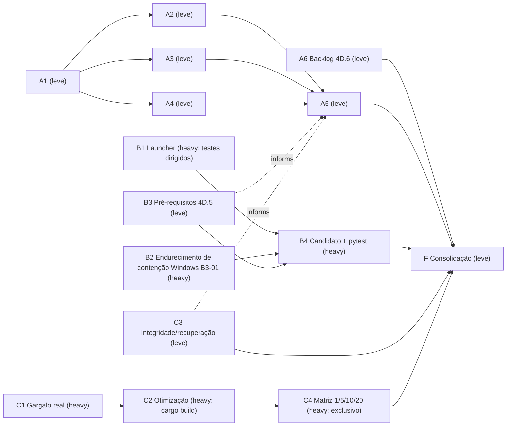

# Estudo de Caso: Missão Tri-Frente `4494783d8b3248ce` e Forense do `stale_takeover`

> [!NOTE]
> **Tipo:** estudo de caso operacional e análise forense para a Fase `4D.5.0` e futura carga no `ExperienceStore` / `InsightEngine`.
> **Missão analisada:** `4494783d8b3248ce` (`D:\ai-coordinator-diag\missao-tri-frente`, 26/11/2026, `11:15`–`18:15` UTC-4).
> **Referência de sistema:** `main` `87509121170f548be58f20f90abd3397b9f94ed5`, Core `v0.6.0`, Desktop `0.6.1-alpha.52`, AI Memory `v2.5.2`.
> **Documentos relacionados:** [`phase4d5-0-architecture.md`](../desktop/phase4d5-0-architecture.md) e [`phase4d5-0-impeditive-policies.md`](../desktop/phase4d5-0-impeditive-policies.md).

---

## 1. Resumo executivo da missão `4494783d8b3248ce`

A missão `4494783d8b3248ce` foi aberta em `26/11/2026` às `11:15` (UTC-4) para executar em paralelo três frentes complementares após a consolidação da `0.6.1-alpha.52`, encerrando às `18:15` (UTC-4) com janela total de aproximadamente `7 horas` (incluindo pausa de `~3h55` por esgotamento de cota na Frente C entre `13:15` e `17:10` e troca de coordenador por handoff preventivo entre `17:49` e `18:08`):

| Frente | Tarefa Coordinator | Estado final | Ambiente / Branch | Commits locais |
|---|---|---|---|---|
| **Missão (nó `F`)** | `4494783d8b3248ce` | `complete` (`rev 6`) | `D:\ai-coordinator-diag\missao-tri-frente` | — |
| **A — Arquitetura `4D.5.0`** | `8c6c0932d1b2431a` | `complete` (`rev 4`) | `D:\ai-coordinator-diag\phase4d5-0-arch` (`phase4d5/0-architecture`) | `6bc7035`, `f6ef632`, `e3252a3`, `9973ede` |
| **B — Core `v0.6.1` (lab)** | `e5dd9201b45341aa` | `complete` (`rev 5`) | `D:\ai-coordinator-diag\core-v061-lab` (`lab/core-v0.6.1-candidate`) | `fa51228`, `47c9122` (+ endurecimento `B3-01` sob divulgação coordenada) |
| **C — AI Memory Rodada 3** | `52e09fb9b0f24a91` | Lab concluído (`rev 10`, `active` até homologação) | `D:\ai-memory-dev` (`evolution/52e09fb9-round3`, base `6eeb88c1`) | `71a49d1a`, `a3173b0c`, `2459e3b6`, `f74667dc` |

Todas as entregas permaneceram estritamente isoladas em laboratório e documentação: **nenhum** `git push`, merge na `main`, alteração do runtime central `v0.6.0`, troca do Desktop `0.6.1-alpha.52` ou reinício do AI Memory de produção (`PID 18072`) foi executado.

---

## 2. Grafo de dependências (`dag-r1.json`)

O grafo da missão (`dag-revision --task 4494783d8b3248ce`, revisão 1, `dag-r1.json`) modelou **15 nós** e **18 arestas** (16 arestas bloqueantes padrão e **2 arestas não bloqueantes `edge_type: "informs"`**):

**Observações estruturais sobre o DAG real:**

1. **Separação de arestas `informs` vs `depends_on`:** `B3 -> A5` e `C3 -> A5` foram modeladas como `informs`, permitindo que a etapa 1 de `A` (`A1`–`A5`) avançasse em paralelo sem aguardar o fechamento completo de `B` e `C`, e incorporasse os achados finais de `B.3` e `C.1`/`C.4` na consolidação (`9973ede`). Esse padrão validou diretamente a proposta de arestas `informs` da arquitetura `4D.5.0`.
2. **Metadado `metadata.heavy` manual:** os nós declararam `heavy: false` (7 nós: `A1`–`A6`, `B3`, `C3`, `F` — nota: 8 nós leves ao todo, contando `A1..A6`, `B3`, `C3`, `F` = 9 leves e 6 pesados `B1`, `B2`, `B4`, `C1`, `C2`, `C4`), mas o Coordinator `v0.6.0` não consumia `metadata.heavy` nem `get_ready_nodes` automaticamente. A arbitragem teve de ser feita externamente via `MISSAO.md` + `heavy_lock.py`.

---

## 3. Paralelismo real versus serialização por HDD e CPU

### 3.1 O que correu em paralelo real

- **Frente A (`44 min` ativos totais: `38 min` na etapa 1 `11:20`–`11:59` + `~6 min` na etapa 2 `18:08`–`18:14`):** `0` posses do `heavy_lock.py`. Rodou inteiramente em paralelo às cargas de B e C (leitura estática, redação, verificações de citações e revisão independente via Coordinator).
- **Auditorias `C.3` da Frente C:** leitura dos logs de eventos do Windows (salto NTP), leitura de `hook-drain.log` (`11:40`–`11:50`) e re-hash dos 4 arquivos temporários órfãos (`12:26`–`12:27`) rodaram **em paralelo aos builds `cargo build --release`** sem disputar o disco de escrita pesada.
- **Consolidação final (`F`):** unificou relatórios e métricas sem carga pesada concorrente.

### 3.2 O que foi serializado sob `heavy_lock.py`

A máquina possuía **4 núcleos lógicos** e **disco HDD `D:` compartilhado** (inclusive com o AI Memory `PID 18072` de produção gravando no mesmo volume `D:`). As atividades pesadas somaram **14 posses efetivas** (`1` evento adicional foi o `stale_takeover` de `13:55:37`):

| Frente | Posses `acquire` | Tempo total sob lock | Atividades serializadas |
|---|---:|---:|---|
| **A** | `0` | `0 min` | — |
| **B** | `4` | `~75 min` (`4.529,8 s` somados em `locks/history.jsonl`) | Séries 1 (`25 min`), série 2 (`5,7 min`), `pytest` fatia 1 (`37,3 min`, `509 passed`), `pytest` fatia 2 (`7,3 min`, `766 passed`) |
| **C** | `10` (`9` efetivas + `1` ociosa) | `~100 min` úteis (`5.991,8 s` em `9` releases) + `40 min` ociosos (`13:15`–`13:55`) | Build instrumentado (`23,7 min`), `diag-01..03` (`17,1 min`), build R3 (`11,8 min`), testes Rust (`20,7 min`), `diag-04/05` (`3,6 min`), matriz lotes 1–4 (`23,4 min`) |

**Limitação de mensuração (requisito `J.2`):** não houve execução sequencial equivalente de controle; portanto, não se reivindica número de *speedup* líquido. O benchmark comparativo paralelo vs sequencial equivalente fica formalmente atribuído à subetapa `4D.5.8`.

---

## 4. Separação explícita de decisões (`Coordinator`, `Harness`, `Human`)

A missão demonstrou na prática a necessidade de separar `decided_by` no esquema `ExecutionDecisionRecord` (`4D.5.2` / `4E`):

| Origem (`decided_by`) | Decisões registradas na missão `4494783d8b3248ce` |
|---|---|
| **`human`** | (1) Autorização das 3 frentes com proibição explícita de push, merge na `main`, alteração do runtime central, do AI Memory de produção, da SSW e início da `4D.5`/`4E`/`4F`. (2) `~12:15`: limitação de CPU (`0xC` núcleos 2–3, `BelowNormal`, `cargo -j 2`, `pytest` sem `xdist`, repetição sob mesma restrição de séries iniciadas sem limite). (3) `~12:50`: evolução para fila FIFO e lotes de matriz `≤ ~45 min`. (4) `17:10` e `~17:20`: descarte de amostras sobrepostas à Frente B, medição de CPU externa (`v_lista.py` PID `26472` sem tocá-lo) e encerramento dos servidores de lab por lote. (5) Aprovação da correção técnica do `test_14` (Apêndice L.2) e autorização de consolidação final da Frente A (`~18:03`). |
| **`coordinator`** | (1) `plan --category analysis` ordenou `codex/gpt-6.1-sol > chatgptweb > agy/argon > claude/sonnet` e `code` ordenou `agy/flash > opencode/north-mini > codex/luna > chatgptweb > claude/sonnet`. (2) Execução da 2ª tentativa de revisão (`ae9ec9679ffa49cd`) com `--max-attempts 1` para contornar o defeito `D1`. (3) Retomada da tarefa `52e09fb9b0f24a91` na revisão `8`, checkpoints `9` e `10` sem `--status complete`. |
| **`harness`** | (1) Delegação da execução com disco/terminal a subagentes forks do harness Claude Code (Frentes A etapa 1, B e C) porque workers do Core são estritamente textuais (`≤ 8000` chars). (2) Exclusão de `Claude Carvalima` (`89%` semanal) e escolha do `Codex` (`3%`/`38%`) como reserva + handoff preventivo `01a219d5` do Claude Max (`86%` 5h) para `AGY` (`Gemini 4 Carbon High`). (3) Decisões táticas por frente: em B, venv próprio, fatiamento de `pytest` em 2 partes para respeitar teto de `90 min` do lock, envio de apenas caminhos relativos (zero ACEs em `System32`), inclusão de endurecimento preventivo complementar de contenção e validação de handles (`B3-01`) por pertencer ao mesmo item de segurança; em C, testes dirigidos em perfil `release`, substituição do lote 1 desigual pelo lote 4 e não implementação de commit em grupo sem aprovação. |

---

## 5. Arbitragem `0xC` / `BelowNormal`, carga externa e evolução para fila FIFO

### 5.1 Efeito da arbitragem de CPU e *starvation*

Após `~12:15`, a restrição para **2 núcleos (`0xC`) + prioridade `BelowNormal`** preservou a responsividade do host (2 núcleos livres para SO/sessão interativa) e padronizou as medições de B e C, porém revelou efeitos colaterais críticos quando não há arbitragem nativa de I/O e CPU no Core:

- **Frente B (`metrics-B.json`):** testes leves levaram **5× mais tempo** (`110 s` vs `20 s`) enquanto outra frente usava CPU; a partida de Python via launcher do venv chegou a **`> 15 s`**, provocando *starvation* do processo atacante e invalidando a série `fast` do candidato na 1ª tentativa. O primeiro desenho de teste para `D1` com Python base atingiu `241 s` devido ao `icacls` recursivo (`B3-09`) e precisou ser encerrado e redesenhado.
- **Frente C (`metrics-C.json`):** a carga externa de outra sessão (`v_lista.py`, PID `26472`) consumiu `~1,15` núcleo em `R2` do lote 1 (`run-01`), tornando o lote 1 não comparável e exigindo repetição como **lote 4**. Nos lotes válidos `2–4`, a carga externa oscilou entre `0,442` e `0,802` núcleo. Além disso, o monitor de afinidade inicialmente filtrava por `ai-memory` em vez dos binários de laboratório (`original`/`optimized`/`round3`), sendo corrigido antes do lote 1.

### 5.2 De lock binário para fila FIFO (`heavy_lock.py`)

Às **`12:28:45`**, a Frente C liberou `heavy.lock` após o build da candidata R3 e o **readquiriu no mesmo segundo** (`locks/history.jsonl`, linhas 6 e 7) para rodar testes Rust dirigidos, enquanto a Frente B aguardava em *polling* a cada `20 s` (esperando desde `12:37` na segunda tentativa). Um *poll* periódico nunca vencia uma reaquisição imediata.

A correção emergencial no `heavy_lock.py` introduziu `locks/waiters.json` (`WAIT_TTL = 600 s`): se o lock estivesse livre e existisse outro solicitante esperando há mais tempo, o chamador recebia `yield_to` e código `3`. Com a fila FIFO, a Frente B obteve o lock às `12:49:43` (após `14 min` de espera) e novamente às `13:55:37` (após `41 min` de espera). Esse episódio fundamentou diretamente o requisito de **fila FIFO priorizada no `ResourceLedger`** (`B3-08`).

---

## 6. Investigação forense do `stale_takeover` de `13:55:37`

### 6.1 Cronologia factual (`locks/history.jsonl`, linhas 11–13)

| Linha | Timestamp (`UTC-4`) | Evento | Detalhes registrados |
|---:|---|---|---|
| `11` | `2026-11-26T13:15:08-0400` | `acquire` | `owner: "C"`, `activity: "diag A/B restrito 0xC (instrumented vs round3, 10/20 produtores)"`, `since: 1795713308.255829`, `max_minutes: 40.0`, **`pid: 24260`** |
| *(lacuna)* | `~13:15`–`17:10` | Pausa por cota | Sessão da Frente C interrompida por esgotamento de cota logo após adquirir o lock; nenhuma amostra foi coletada e o lock permaneceu ocioso por `~40 min` |
| `12` | `2026-11-26T13:55:37-0400` | `stale_takeover` | `previous.owner: "C"`, `previous.pid: 24260`, `since: 1795713308.255829` (`40 min 29 s` decorridos `> 40.0 min`), **`by: "B"`** |
| `13` | `2026-11-26T13:55:37-0400` | `acquire` | `owner: "B"`, `activity: "B.2 serie 2 (candidato v0.6.1) sob 0xC+BelowNormal"`, `max_minutes: 85.0`, `pid: 12560` |

Naquela ocasião específica, o takeover não causou dano real apenas porque a Frente C havia realmente parado por cota e o subagente da Frente B verificou externamente que não havia processos pesados de `C` ativos (`metrics-B.json`, linha 71). **Contudo, o mecanismo em código do `heavy_lock.py` era estruturalmente inseguro.**

### 6.2 Por que o modelo do `heavy_lock.py` é inseguro

A inspeção de `D:\ai-coordinator-diag\missao-tri-frente\heavy_lock.py` (linhas 73–95) expõe três falhas graves de desenho:

1. **PID efêmero do CLI `acquire` (`"pid": os.getpid()`, linha 75):** o PID `24260` gravado no `heavy.lock` era o PID do próprio processo curto `python -I heavy_lock.py acquire ...`, que **terminou milissegundos após gravar o JSON** — não o PID do processo detentor da carga pesada (`cargo`, `pytest` ou subagente). Mesmo que se tentasse consultar se o PID `24260` estava vivo às `13:55:37`, ele sempre pareceria morto (ou pior: poderia ter sido **reciclado pelo Windows** para outro processo completamente distinto!).
2. **Expiração cega apenas por relógio de parede (linha 92):** `time.time() - cur.get("since", 0) > cur.get("max_minutes", 60) * 60` remove `heavy.lock` assim que `max_minutes` vence, sem verificar se o proprietário real continua executando trabalho legítimo (por exemplo, um `cargo build` ou suíte `pytest` legítima que passou de `40` para `45` minutos sob contenção `0xC`/`BelowNormal`). Além disso, dependência pura de `time.time()` fica vulnerável a saltos de relógio NTP — exatamente como o salto de `+1.153,45 s` (`+19 min 13 s`) observado no mesmo host em `25/11` (`Kernel-General/1`, `svchost.exe` PID `1860`).
3. **Ausência de `fencing_token`:** após `os.remove(LOCK)` (linha 94), nada impedia que o proprietário anterior (caso ainda vivo ou retomado depois) continuasse escrevendo no HDD `D:` em paralelo ao novo detentor `B` ou executasse comandos de limpeza/medição em estado inconsistente.

### 6.3 Como `heavy_lock_v2.py` e o futuro `ResourceLedger` (`4D.5.3`) resolvem

O modelo implementado em `D:\ai-coordinator-diag\missao-homologacao-pos-trifrente\heavy_lock_v2.py` corrige as três lacunas para a janela operacional imediata e define o contrato que será internalizado no `ResourceLedger` da `4D.5.3`:

| Dimensão | `heavy_lock.py` (missão `4494783d8b3248ce`) | `heavy_lock_v2.py` (missão atual) | Futuro `ResourceLedger` (`4D.5.3`, [`phase4d5-0-impeditive-policies.md`](../desktop/phase4d5-0-impeditive-policies.md)) |
|---|---|---|---|
| **Identidade do detentor** | `os.getpid()` do CLI `acquire` (efêmero, sem `create_time`) | `--holder-pid` (padrão `os.getppid()` do chamador real) + `holder_create_time_100ns` (`GetProcessTimes`) separados de `lock_cli_pid` | `(holder_pid, process_create_time_ns)` gravados na mesma transação SQLite do `reserve` + identidade `(mission, task, node, agent, profile)` |
| **Checagem no vencimento** | Remove o lock cegamente se `now - since > max_minutes * 60` | `_is_holder_alive(cur)` via `OpenProcess` + `GetExitCodeProcess` (`STILL_ACTIVE == 259`) + comparação de `holder_create_time_100ns` (detecta PID reciclado). Se vivo, **recusa takeover com `exit 4`** e grava `stale_takeover_refused_holder_alive` | Verifica vivacidade real (`PID + create_time_ns`) + heartbeat periódico de progresso (`P10`). Se vivo, não toma o recurso: classifica subestado (`productive` vs `stalled` / `waiting_input`) |
| **Fencing** | Nenhum | `fencing_token` monotônico crescente (`locks/epoch.json` atômico via `tmp + os.replace`), exigido no `release` (`exit 5` se divergente) | `fencing_token` monotônico propagado até o efeito colateral (`ResourceLedger.confirm`, mailbox/sandbox, `release`, checkpoint) |
| **Fila** | FIFO simples (adicionada reativamente após `12:28:45`) | Fila por `(priority, first)` (`0 < 1 < 2`, FIFO na mesma prioridade) em `waiters.json` atômico | Fila priorizada com precedência de segurança (`P0 > P1 > P2`), anti-starvation e *backpressure* por pressão de CPU/RAM/I/O (`B3-08`) |

---

## 7. Cotas, handoff `01a219d5` e contabilidade de tokens (`unknown` / `unavailable`)

### 7.1 Consumo medido de cotas

| Provedor / Perfil | Evolução observada | Consumo líquido | Proveniência |
|---|---|---|---|
| **Claude Max (coordenador + subagentes A, B, C)** | `11:13`: `22%` (5h, renova `12:10`) / `32%` semanal → `17:11` (pós-reset 5h): `1%` (5h) / `52%` semanal → `17:49`: **`86%` (5h, renova `22:10`) / `63%` semanal** | **+31 p.p. semanais** + 2 janelas de 5h (incluindo esgotamento na Frente C `~13:15`–`17:10`) | `measured` (medidor local `aviso-cota`) |
| **Codex (reserva + workers `V-Core`)** | Reserva `38%` → `39%` semanal; runs `0ff7516833314f96` (`167 s`, `interrupted`) e `ae9ec9679ffa49cd` (`32,7 s`, `complete`) | `+1 p.p.` semanal | Reserva: `measured`; runs Coordinator: `unknown` (`accounting_status: unavailable`) |
| **AGY (`Gemini 4 Carbon High`)** | Assumiu handoff `01a219d5-b4de-7752-afc9-6e58d41b9c01` (`18:08`–`18:15`, `~7 min` ativos para consolidar A e F) | Sem disparo de `[aviso-cota]` | `unknown` (harness não expõe tokens por turno) |

### 7.2 Handoff `01a219d5`

Quando o perfil Claude Max atingiu `86%` da janela de `5h` às `17:49`, foi executado handoff preventivo via `ai-memory` (`01a219d5-b4de-7752-afc9-6e58d41b9c01`) e checkpoint no Coordinator. A transição até o AGY retomar efetivamente às `18:08` durou **`~19 minutos`**, seguidos de `~7 minutos` para concluir o fechamento da Frente A (`9973ede`) e o relatório consolidado da missão. Isso confirmou na prática a necessidade de modelar o **handoff preventivo como nó explícito do DAG** (`4D.5.6`) com predição prévia de cota (`4D.5.3`) e medição de `time_to_resume_s`.

### 7.3 Limitações da contabilidade de tokens (`unknown` / `unavailable`)

- **Workers do Coordinator (`codex` no `v0.6.0`):** no run `ae9ec9679ffa49cd` (`revisao-worker-saida-v2.txt`), o adaptador registrou `reported_attempts: 0`, `unreported_attempts: 1`, **`accounting_status: "unavailable"`** e `complete_accounting: false`. O mesmo ocorreu no run abortado `0ff7516833314f96`.
- **Subagentes do harness (`metrics-A/B/C.json`):** nem Claude Code nem AGY expuseram contagem individual de tokens por subagente ou turno (`tokens: "unknown"`).
- **Implicação arquitetural (`I7`):** qualquer sistema de previsão ou aprendizado (`4D.5.2` e `4E`) que trate `unknown` como `0` distorcerá custo e eficiência. A proveniência explícita (`measured | estimated | unknown`) é obrigatória em todo registro.

---

## 8. Bloqueios, retrabalhos, desempenho e qualidade

| Frente | Principais bloqueios e retrabalhos observados | Indicadores de desempenho e qualidade atingidos |
|---|---|---|
| **A (`8c6c0932d1b2431a`)** | Checkpoint 1 recusado por conflito de revisão otimista (`rev 0 -> 1`, +1 chamada); 4 afirmações corrigidas após checagem no código (`GIT`/`GCM`, linhas de schema, HMAC vs hash, sandbox default); contagem de fallback corrigida de `13` para `14`; tentativa 1 de `V-Core` (`0ff7516833314f96`) abortou após timeout de `150 s` revelando o defeito `D1`, obrigando nova chamada com `--max-attempts 1`. | `phase4d5-0-architecture.md` + Apêndice L (`9973ede`); revisão `V-Core` concluída em `32,7 s` (`ae9ec9679ffa49cd`) com os 4 pontos endereçados nas seções `3.5`, `5.6` e `6`. |
| **B (`e5dd9201b45341aa`)** | Ajustes de desenho nos testes de contenção e `D1` (3 desenhos de worker até `cmd` inline); 1ª execução `D1` com Python base levou `241 s` por `icacls` recursivo (`B3-09`); série concorrente 1 invalidada por *starvation* sob `BelowNormal`; Python global com editable pendente exigiu venv próprio. | Endurecimento preventivo de contenção e validação de handles no Windows (`B3-01`, patch `v0.6.1`, sob divulgação coordenada); `D1` (`B3-02`) corrigido em `47c9122` (`7/7` reais); launcher `fa51228` (`5/5`); **`pytest` completo `1.275 passed, 4 skipped, 0 failed`** (vs `1.253/4/1` no baseline). |
| **C (`52e09fb9b0f24a91`)** | Pausa de `~3h55` por cota (`13:15`–`17:10`); `40 min` de lock ocioso (`stale_takeover` por B); parser tratou `probe="runtime"` como literal; checkpoint 9 recusado por exceder `12.000` chars (`B3-14`, exigindo externalização em `snapshot-rev8-full.json`); filtro de monitor corrigido antes do lote 1; lote 1 descartado do agregado por `v_lista.py` e repetido como lote 4. | `a3173b0c` (lotes `2–4` em `0xC`/`BelowNormal`, `20` produtores): leitura P95 **`21,7 ms`** (vs `5.113,9 ms` na `2.5.2` e `1.714,9 ms` na `R2`), busca P95 **`93,6 ms`** (vs `4.657,7 ms` / `4.598,6 ms`), `0/960` erros, `60/60` sob lock SQLite, `1.173/1.173` confirmações preservadas, startup `< 6 s`, recuperação `< 14 s`, `427` testes Rust aprovados (`31 + 370 + 26`). |

---

## 9. Lições transferidas para `ExperienceStore` e para a `4D.5`

Os achados desta missão foram estruturados no seed [`experience-seed-4494783d8b3248ce.json`](file:///D:/ai-coordinator-diag/missao-homologacao-pos-trifrente/frente-D/experience-seed-4494783d8b3248ce.json) para futura ingestão determinística no `ExperienceStore` (`experience.py`):

1. **Testes reais sem mock nos caminhos de falha (`D1` / `B3-02`):** mocks de `_run_worker` esconderam `RUNNING -> STARTING` na `v0.6.0`; toda subetapa da `4D.5` deve cobrir transições de falha com subprocessos reais.
2. **Lock apenas por relógio é inseguro (`stale_takeover` `13:55:37`):** exige `(holder_pid, create_time_ns)` vivo, `fencing_token` monotônico e fila priorizada (`heavy_lock_v2.py` → `ResourceLedger` na `4D.5.3`).
3. **Arbitragem nativa de CPU/I/O e reutilização de perfil AppContainer (`B3-08`, `B3-09`):** `BelowNormal` sem controle de prioridade de I/O nem pool de SIDs provoca `5×` de degradação e `~2 min/run` de `icacls`.
4. **Proveniência e teto de checkpoint (`B3-14`, `accounting_status: unavailable`):** referências externas estruturadas evitam estouro de `12.000` chars sob pressão de fim de cota, e `provenance` impede tratar ausência de telemetria como custo zero.
5. **Previsão de cota e handoff como nó do DAG (`01a219d5`):** evita locks ociosos de `40 min` e pausas de quase `4 horas` quando a cota semanal ou de `5h` se aproxima do limite.
